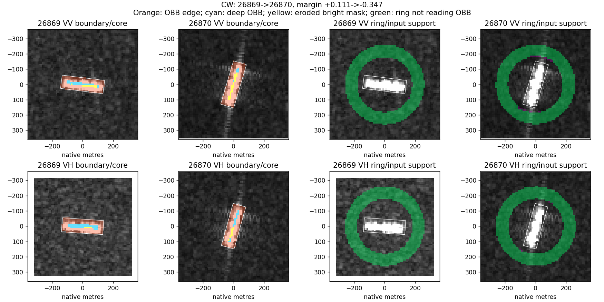
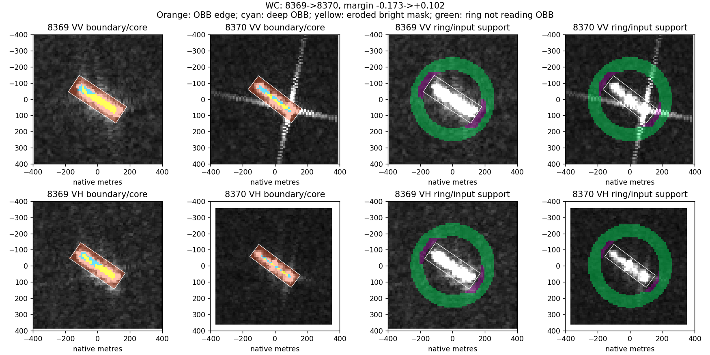
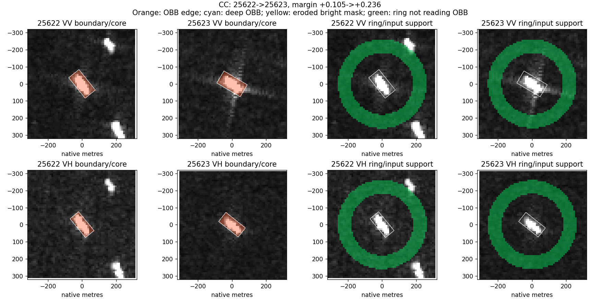
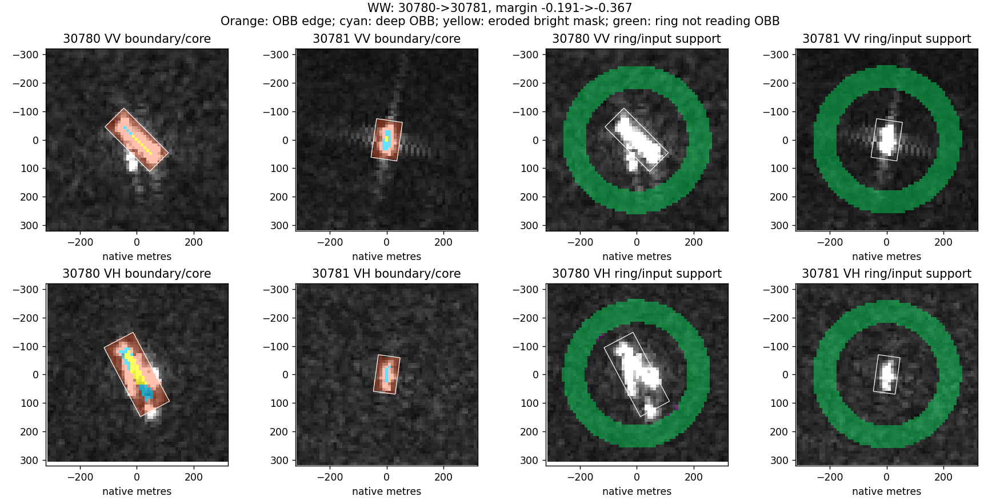

# 第08轮：边缘、内部与外围的方向参照

日期：2026-10-24。状态：完成；未训练分类器、没有新增OA/BA结果，未估计物理因果效应。

## 一句话结论

当前空间—尺度方向算子的测量明显集中在框边附近，但可测内部仍保留随船轴转向的结构；VV轴端的雷达参照小优势局限于近框读出，不能扩展为独立外围响应的一般规律。这帮助缩小机制解释范围，不等于已发现因果因素。

## 1. 问题、数据与操作

沿用第07轮VV/VH各114个同船观测对，合计116艘船、117个不同观测对、456张极化图像。228个极化配对不是228艘独立船。没有重新抽选有利案例。

使用原尺度PNG，像元间距10m，不旋转或缩放图像。对10m、20m尺度高斯导数形成局部方向张量，比较图像固定、船轴转向、雷达参照转向三种预测。误差是归一化张量的Frobenius距离，不是分类误差。该测量属于空间定位的尺度/方向分析，不是SAR复数多普勒分析。

在同一张图内，三个参照使用完全相同的输出像素，仅改变参照变换。跨观测的检测框及掩膜仍不同，并未实现物理点配准。OBB内外也不等于真实船体与纯海面。

新增区域：完整OBB、足以容纳整个卷积窗口的OBB内部、其余框边带、亮响应内部，以及轴端、侧向、180–260m远环带。卷积截断范围为3倍尺度：10m尺度对应7×7像元窗口。有效区域至少12像素、90%覆盖且能量非零。

首遍观察到VV轴端雷达参照优势后，追加登记了轴端/侧向“不读取OBB输入”的对照：剔除卷积窗口会触及OBB的输出位置。此为探索性补充，不伪装为事前独立确认。原始区域结果保留。详见PROTOCOL_ZH.md与boundary_reference.py。

## 2. 框边主导，但不能把它全部解释成伪影

10m尺度，每个极化228张图的中位数：

| 测量 | VV | VH |
|---|---:|---:|
| 框边带占框内导数能量 | 99.57% | 99.83% |
| 框边带占框内面积 | 93.15% | 95.84% |
| 接近PNG饱和值像素的卷积邻域占框内面积 | 98.45% | 98.00% |
| 两次观测都有可测深内部的配对数 | 40/114 | 34/114 |

边缘能量占比高，但边缘带本身就很大，不能声称“99%的变化由边缘造成”。饱和邻域也几乎覆盖全框，不能用其高能量重合率诊断显示饱和的因果作用。

20m尺度没有符合条件的深内部观测对。原因是当前框和卷积覆盖的尺寸关系，不是证明船体内部没有判别信息。

在可测深内部的匹配子集中：

| 极化及对数 | 完整框：图像固定→随船转向误差 | 深内部：图像固定→随船转向误差 | 深内部误差降低的配对比例 |
|---|---:|---:|---:|
| VV，40对 | 0.4003→0.1160 | 0.5824→0.3367 | 75.00% |
| VH，34对 | 0.4729→0.1283 | 0.6235→0.2736 | 85.29% |

因此，随船转向的结构不只存在于框边读出，但这个内部子集偏向具有较大可用内部区域的目标。它仍不是船型语义、物理不变量或分类收益的证明。

## 3. 雷达参照的轴端小优势在哪里

10m尺度、各极化同一批114对；表中越小越好：

| 极化及区域 | 图像固定 | 船轴参照 | 雷达参照 |
|---|---:|---:|---:|
| VV轴端 | 0.42584 | 0.41489 | 0.39493 |
| VV轴端，不读OBB输入 | 0.36770 | 0.33947 | 0.36996 |
| VH轴端 | 0.36295 | 0.28742 | 0.34759 |
| VH轴端，不读OBB输入 | 0.27844 | 0.28219 | 0.27885 |
| VV侧向，不读OBB输入 | 0.29878 | 0.30389 | 0.29491 |
| VH侧向，不读OBB输入 | 0.24599 | 0.24518 | 0.24590 |

VV原轴端雷达相对图像固定的平均误差收益为0.03091；剔除读取OBB的输出位置后为−0.00225。在雷达方向差至少5°的70对VV中，相应收益为0.05126与−0.00371，仍是同样的局限。

按26个查询过境组看，VV原轴端只有13组正收益、13组负收益；组等权收益为0.00448，低于样本等权的0.03091。剔除后11组正、15组负，组等权为−0.01717。不能把少数高贡献采集推广到所有采集。

**这说明优势集中在近框读出，不说明已证明是卷积泄漏造成。** 剔除操作既去掉了可能混入船体的卷积输入，也去掉了真实近船响应。两种解释尚未分开，不应把后者直接删为噪声。

远环带清除OBB输入后方向性普遍偏弱：VV/VH分别78.95%/70.18%的配对至少一幅图的各向异性低于0.1。三种参照的平均误差约0.13且接近。这里只能说该方向统计辨识力弱，不能说远处环境对分类没有任何价值。

## 4. 原图回看

复用第06/07轮四组代表案例，新增掩膜面板，不把它们当新独立样本。每图上下为VV/VH，左右对应前后观测的内部与外围分析；橙色为框边，青色为深内部，黄色为亮响应内部，绿色为不读取OBB输入的远环带。分类状态来自旧冻结interaction模型，不是新模型或分极化分类器。

### 26869→26870：原来对、后来错

亮响应从近水平变为近竖直，深内部只剩窄条，框边占大部分。这是解释测量受区域尺寸影响的案例；不能据此说转向导致分类错误。

### 8369→8370：原来错、后来对

新VV可见延伸到外围的十字状响应，VH没有相同强度的对应结构；两次检测轴方向变化不大。清除OBB输入后，较远延伸仍可能保留，所以“不读框内”不等于“只读环境”。本图没有独立证据把十字响应命名为船尾或某种确定运动效应。

### 25622→25623：两次都对

检测目标较小，当前尺度下没有足够深内部像素。较早图像外围还有额外亮响应，较晚图像不同；不能只凭外观确认临船身份。分类仍正确说明“无法测量深内部”不等于“没有分类信息”。

### 30780→30781：两次都错

较早检测框较大且包含分散亮响应，较晚框小且紧凑。较早VH可测内部包含多个局部结构，较晚主要为框边。案例支持区域/尺度需要一起看，不能从变化直接断言船体结构或真实运动改变。

图像路径、观测ID、极化、区域、条件和旧分类分差详见measurements.csv、pairs.csv及review_selection.csv。图像事实与待验证解释在以上描述中分开。

## 5. 实现检查与可复现文件

检查目的：防止名义上的“深内部/独立外围”实际仍受被排除输入影响；若失败则应修掩膜而非解释结果。将框外置零后，深内部导数与原输入完全相同；将框内置零后，清除后的轴端、侧向、远环带也完全相同，最大误差均为0。第07轮框内结果重放最大误差2.78e−16。这些只验证算子支持范围，不验证物理假设。

代码：../boundary_reference.py；运行依赖../joint_probe.py及本机原图。manifest.json记录计数和检查；boundary_summary.csv记录面积/能量覆盖；reference_summary.csv记录三个参照；common_body_core_pairs.csv用于匹配子集；pass_gains.csv记录过境组收益。

## 6. 能保留什么，下一步做什么

1. 保留空间位置、尺度、方向联合分析。它指出全框测量与深内部测量回答的不是同一问题，也不支持一套轴参照覆盖所有区域。
2. 保留近框轴端作为候选，不把其余区域简单丢弃。当前雷达参照信号有采集边界，需要区分真实近船响应和算子跨区混合。
3. 下一轮优先做同一批、同一输出位置上的输入来源分解，固定尺度、面积和参照；明确这种输入干预只识别算法依赖，不识别现实物理因果。
4. 在可恢复的少数观测上核实一致辐射处理输入，分开显示拉伸与真实响应。当前PNG上的饱和重合统计不足以回答这个问题。不先假定所有原始数据都可得，也不凭它宣布前述信号无效。

尚未达成“条件→响应改变→类别证据改变”的可迁移因果链。本轮不开发新的分类模块，也不把方向误差改善写成识别精度提升。
