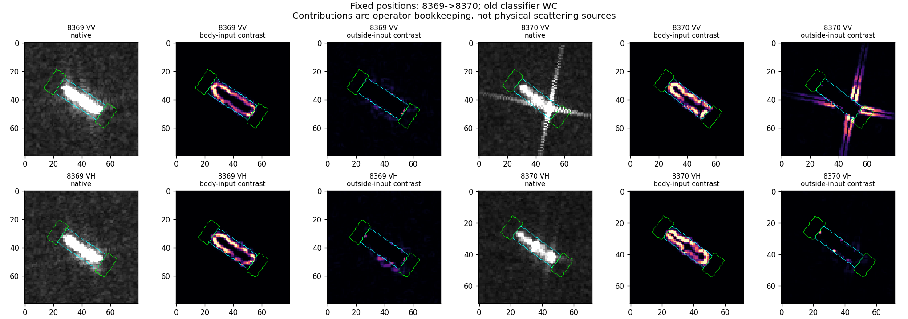

# 第09轮：固定位置后，框内与框外各贡献什么

2026-10-24，完成。VV/VH各114对，合计116艘船。代码：../fixed_support_probe.py；协议：PROTOCOL_ZH.md。

## 结果

这轮不删除近船输出像素，而对同一导数读出分解输入来源。以输出像素灰度为参照的对比贡献中，轴端读出的能量分解中位数如下：

| 极化 | 框内项/总量 | 框外项/总量 | 交叉项/总量 |
|---|---:|---:|---:|
| VV | 0.260 | 0.613 | 0.102 |
| VH | 0.299 | 0.528 | 0.147 |

各列分别取中位数，因此不要求加和为1。逐图三项严格加和为总能量。交叉项是算子分解，不是可直接解释的散射相互作用。

在同一轴端位置，框内贡献更随船轴变化：VV图像固定/船轴/雷达误差为0.5754/0.2819/0.5928；VH为0.5494/0.2276/0.5801。框外对比贡献的VV雷达相对图像固定收益为0.01544，按26个查询过境组等权仅0.00288。VH相应为0.00863与−0.00128。不能将其推广为稳定雷达规律。

重要敏感性：若直接把另一部分像素置零再分别计算导数，轴端框内项中位数超过总量（VV1.206、VH1.391），同时出现很大的负交叉项。这是硬掩膜边界项的抵消；它也改变了框外参照比较的结果。因此，不能把“遮掉框内/外后的能量”直接当作该物理区域的独立散射能量。

## 原图回看

四组图均已实际查看。绿色是轴端输出区，青色为目标框；图中其他位置的贡献图只是定位展示，不全进入轴端统计。

- 8369→8370：新VV十字状延伸在框外贡献图中保留，VH没有相同强度对应。排除框内输入不等于排除目标相关散射延伸，不能把剩余量命名为纯环境。
- 26869→26870：框内贡献主要围绕亮目标边缘，随检测轴从近水平转至近竖直；框外贡献也包含边缘附近差分，不能把它当独立临船。
- 25622→25623：较早图像的两个额外亮结构在框外图很明显，但它们主要远离轴端读出范围。不能凭全图热图认定它们驱动了这项轴端指标。
- 30780→30781：较早VV框外一侧还有强响应，较晚更紧凑。响应究竟来自延伸还是另一目标，当前图像不足以确定。

其余图：case_26870.png、case_25623.png、case_30781.png。状态标识沿用旧interaction分类器，非之后第10轮的full_global读出。

## 可保留结论与限制

近船区域是混合读出，区域名称不能替代输入依赖分析；两类输入贡献可能需要不同参照。局部灰度基准消除了共同亮度平移影响，但没有消除显示截断、区域定义及归因约定影响。它不是物理源分离。

线性叠加、共同亮度平移及第08轮原结果重放检查均低于1e−12，详见manifest.json。没有训练和新分类结果。下一轮转向受控输入对分类器的实际作用，而不是只解释导数图。
