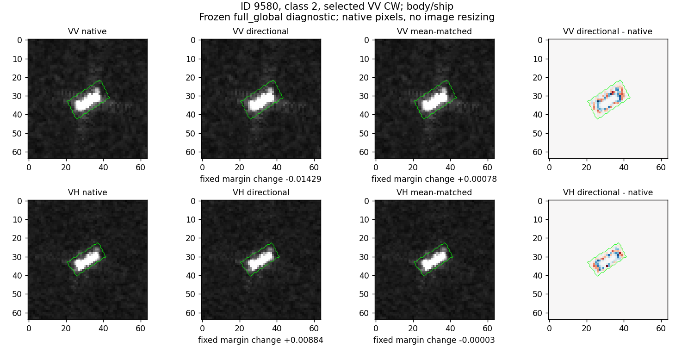
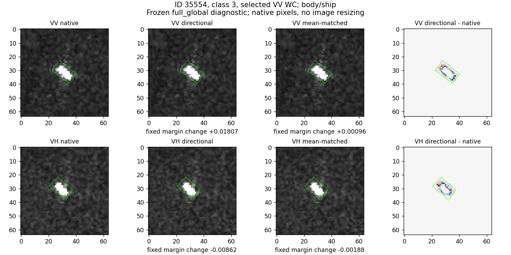
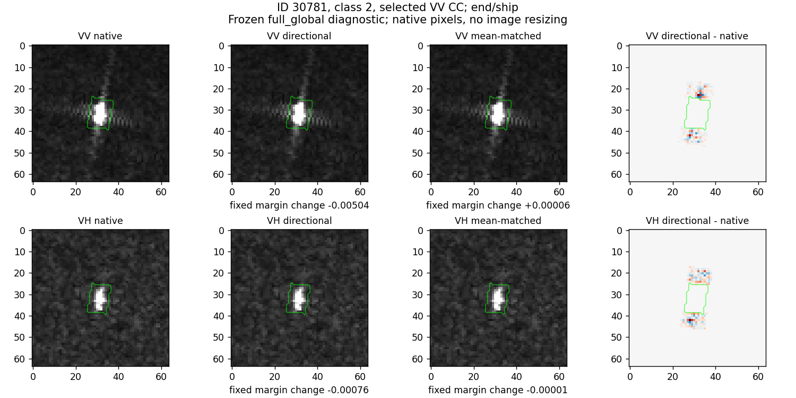
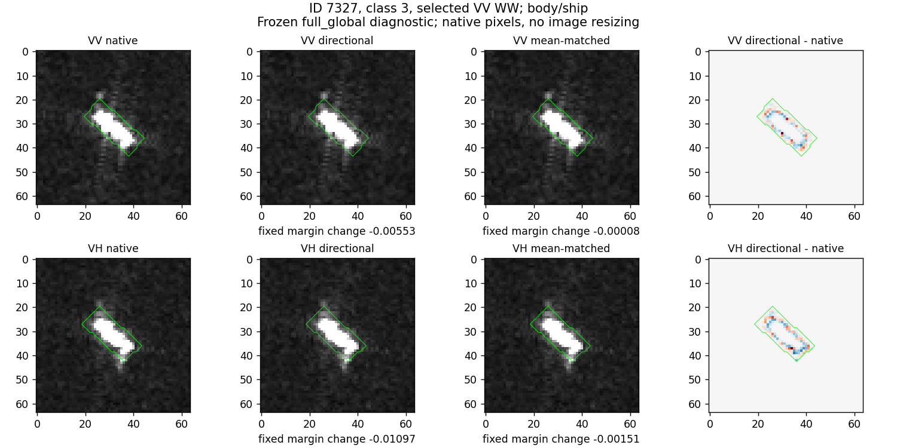

# 第11轮：均值变化不能单独复现结构干预，但方向规律尚弱

2026-10-24，完成。代码：../level_control.py。此轮在看到第10轮信号后补充，不是独立确认。

## 1. 亮度对照

对7456次方向干预逐一匹配同区域的灰度总和变化，不匹配L2或完整直方图。升/降亮采用保持[0,1]范围的像素余量分配，不另加clip。它仍有空间效应，不能叫绝对纯亮度。

VH框内高剂量平均分差变化：

| 方向 | 方向平滑 | 匹配均值对照 | 两者差 |
|---|---:|---:|---:|
| 船轴 | −0.006213 | −0.000908 | −0.005305 |
| 垂直船轴 | −0.008218 | −0.001879 | −0.006339 |
| 雷达轴 | −0.006749 | −0.001192 | −0.005557 |
| 垂直雷达轴 | −0.008261 | −0.001468 | −0.006792 |

该均值对照未复现方向平滑的作用，因此“只有灰度均值在起作用”不是充分解释。差值不等于正式因果中介效应，因为两个干预的L2、直方图和结构并不完全匹配。

扣除各自均值对照后，VH框内船轴与正交方向之差：船等权+0.001064，区间[−0.000017,0.002369]；过境组等权+0.001071，区间[0.000054,0.002181]。雷达轴差：船等权+0.001227，区间[0.000055,0.002671]；过境组等权+0.001277，区间[−0.000860,0.003331]。聚合方式下不确定性不一致，保留小信号而非固定优劣定律。

VH框内船轴差按类别也不一致：class0/3/5/7为正，class2/4/6为负；class6仅3艘船。不能按多数类结果给所有船型规定同一方向处理。

## 2. 与真实同船变化的联系

每极化114对中，VH相对方向cos(2phi)变化与框内细粗尺度比变化rho=0.215，与轴端为−0.299。VV对应0.078与−0.229。但细粗尺度比变化与冻结full_global自然分差变化的相关很弱：VH框内−0.053、轴端−0.051；VV框内0.007、轴端−0.174。这里只是相关，不是中介或物理因果识别。

一个重要幅度缺口：

| 极化/区域 | 真实log尺度比变化绝对值中位数 | 人工变化可达幅度中位数 | 真实变化不超过人工幅度的对数 |
|---|---:|---:|---:|
| VH框内 | 0.11557 | 0.01339 | 9/114 |
| VH轴端 | 0.29895 | 0.09111 | 12/114 |
| VV框内 | 0.08635 | 0.01538 | 17/114 |
| VV轴端 | 0.40798 | 0.09522 | 15/114 |

表中人工幅度取两端、四方向中最大绝对改动，只比较大小，不保证变化形态或符号相同。不能以温和人工干预直接解释全部真实变化。数据见amplitude_coverage.csv。

## 3. 四种原图案例

状态指此次full_global的原图→人工干预，不是同船前后观测，也不是第07轮interaction状态。两种分类器不混报。

| 案例 | 操作与结果 | 匹配均值对照 |
|---|---|---|
| 9580，CW | VV框内沿船轴平滑，分差−0.01429；由class2改判class7 | +0.00078，仍为class2 |
| 35554，WC | VV框内沿船轴平滑，分差+0.01807；class6改为真class3 | +0.00096，仍class6 |
| 30781，CC | VV轴端平滑，分差−0.00504；仍正确 | +0.00006 |
| 7327，WW | VV框内平滑，分差−0.00553；仍错误 | −0.00008 |

肉眼可见原图整体形态基本不变，差分定位在指定框内或轴端，没有改变周围整图。9580、35554的VV与VH作用方向不同。差分图使用放大后的色标，不能把其颜色强度当原图的可见强度。样本接近决策边界，微小局部变化即可翻转，不等于人为恢复了真实船体。

## 判断

可保留的是“局部结构改动对冻结模型的作用不能由这一个均值对照复现”。下一步针对真实观测联系做两件事：检查掩膜随船轴转动造成的测量效应；在框内尝试达到真实变化幅度。两者分别在第12、13轮执行，不继续增加网络模块。
