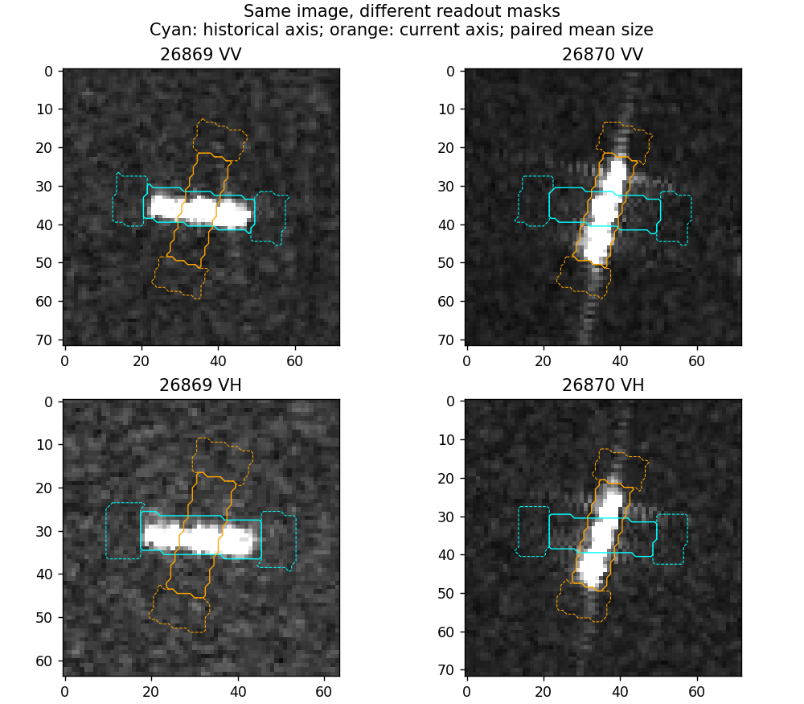
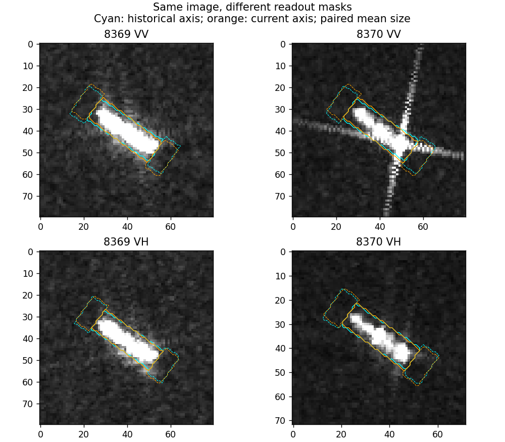

# 第12轮：测量区域自身会制造角度相关

2026-10-24，完成。代码：../region_counterfactual.py。仍为VV/VH各114对，不训练。

## 做法与结果

固定每对平均框长宽，在两端图像各自中心分别放历史角和当前角的框内/轴端/侧向区域，组成2×2测量表。由此严格分出图像变化项与测量角变化项，两项加和误差低于1e−12。这里的图像项也含中心定位、显示和未知条件差异，不能直接叫物理变化项。

VH轴端的相对方向变化相关如下：

| 比较 | rho |
|---|---:|
| 第11轮各自原框测量总变化 | −0.299 |
| 第12轮匹配框长宽后的总变化 | −0.034 |
| 固定匹配尺寸下的图像变化项 | +0.164 |
| 固定匹配尺寸下的测量角变化项 | −0.361 |

这不是原−0.299的精确比例分解，因为第12轮同时固定了框尺寸。它说明原关联对测量定义敏感；不能跳过掩膜效应，把角度相关直接命名为雷达散射因果关系。

在至少3对的同一历史—查询过境组合内去均值，VH仍有78对/13组；轴端图像项相关为−0.033，测量角项−0.224。VV有77对/13组，轴端两项为−0.160、−0.147。过境组控制不等于控制个体运动、位置环境或显示截断。

作为不随船轴转动的测量，60m中心圆盘中VH细粗尺度比变化与相对方向变化仍有rho=0.226；过境组合内为0.200。VV为0.051与0.074。120–200m环带没有同样稳定的模式。圆盘中还可能包含非目标响应，且检测中心来自图像，这一信号仍是候选关联，不是因果识别。

圆盘变化与自然分类分差的相关VH为−0.038，过境组内−0.131，尚未连接成明确判别机制。

## 原图回看

26869→26870中，两套轴端区域明显读到不同位置，交叉放置还会覆盖原船体侧面；这是测量规则的干预，不是现实船只在固定雷达下旋转。8369→8370中两套轴近重合，但新VV有明显外围延伸，提示并非所有变化都由掩膜角造成。

另外已查看case_25623.png和case_30781.png：前者额外远处亮点并未随目标掩膜转动；后者用配对平均框后较小目标周围包含更多区域。没有把这些可见差异直接解释为船型、运动或船尾。

## 可保留结论

已验证一个测量层面的受控作用：在图像不变时，区域组织规则足以改变尺度统计。应把它与成像变化区分。仍可追踪VH中心圆盘这个较少依赖掩膜角的候选，但不能据此宣布找到物理因果因素。
