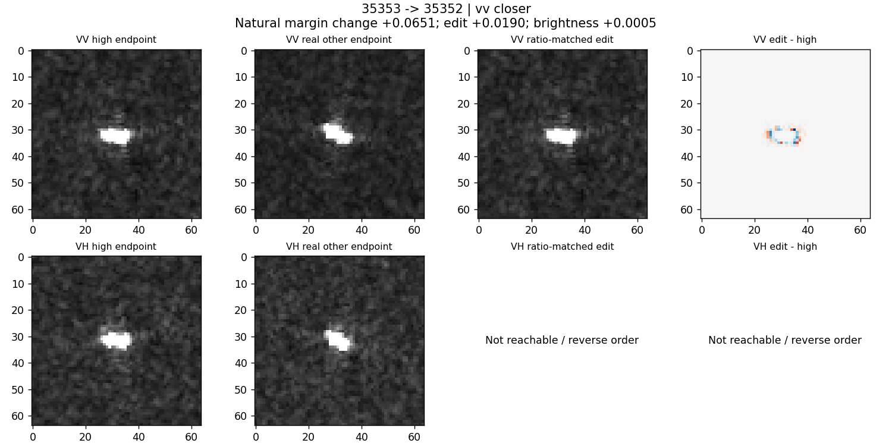
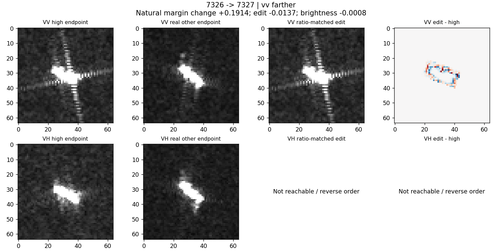
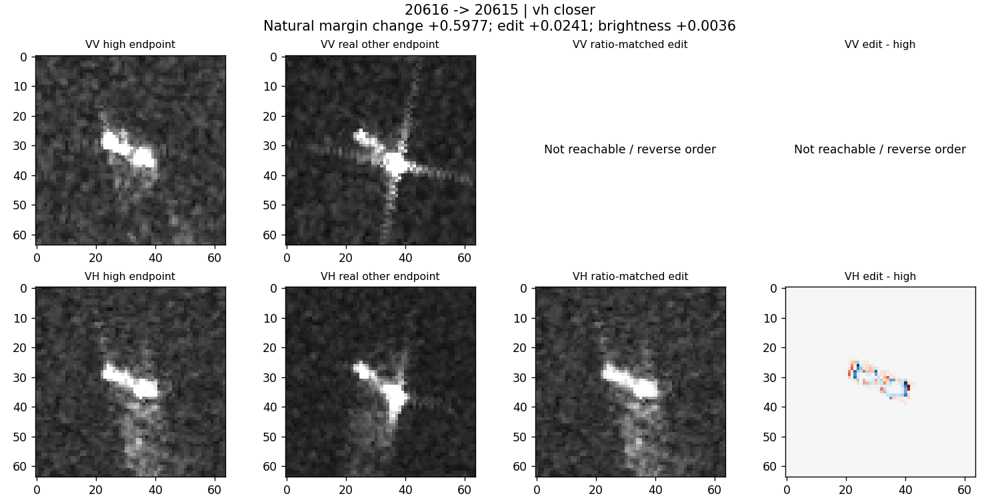
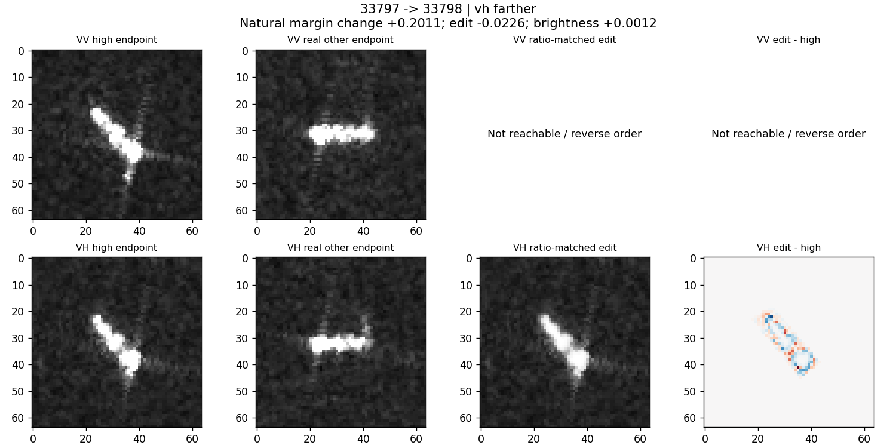

# 第13轮：匹配真实尺度变化，是否重现真实类别证据变化

2026-10-24，完成。代码：../natural_amplitude.py；输入恢复覆盖：../raw_pair_coverage.py。

## 主要结论

把框内细粗尺度比准确调整到同船另一观测的值，并不足以普遍重现那次观测的类别证据。这削弱“该单一标量及当前平滑操作能够连接完整因果链”的假设，不否定其他空间—频率结构的作用。

两个真实端点同时改变了很多信息，两极化也可能都变；本轮只改变其中一个极化。因此，桥接失败不能证明该因素没有任何因果贡献，成功也不能证明它是实际观测变化的原因。

## 覆盖与结果

各极化114对×4方向共912个尝试，392个方向任务在混合系数不超过0.9时可达。未达到的完整保存，没有把范围无限扩大。四方向共同可达的子集为VV47对、VH36对，每对对应不同船。匹配log尺度比最大误差均低于1e−6。

下表是共同子集。收益定义为：干预前到真实另一端分差的绝对距离，减去干预后的距离；正值代表更接近。竞争类别固定为较高尺度比端点的最强错误类。数值是ridge分差单位，不是OA/BA或概率。

| 极化 | 方向 | 平均更接近量 | 更接近比例 | 匹配均值对照更接近量 |
|---|---|---:|---:|---:|
| VH，36对 | 船轴 | −0.01258 | 38.89% | −0.00054 |
| VH，36对 | 垂直船轴 | −0.01444 | 38.89% | −0.00004 |
| VH，36对 | 雷达轴 | −0.01103 | 41.67% | −0.00023 |
| VH，36对 | 垂直雷达轴 | −0.01507 | 30.56% | −0.00042 |
| VV，47对 | 船轴 | −0.00044 | 51.06% | +0.00102 |
| VV，47对 | 垂直船轴 | +0.00217 | 51.06% | +0.00121 |
| VV，47对 | 雷达轴 | +0.00316 | 55.32% | +0.00080 |
| VV，47对 | 垂直雷达轴 | −0.00294 | 48.94% | +0.00151 |

VH共同子集真实分差绝对变化均值0.27828，VV为0.25702。VV雷达轴有很小的桥接正信号，但相对于自然变化很小，且方向对照不一致，不足以宣布“频谱匹配重现了真实观测效应”。

## 原图案例

以下“更近/更远”指分差距离，不等于分类正确/错误；H/L按尺度比高低排序，不一定是时间顺序。只显示可达的另一极化干预，无法达到或次序相反时明确留空，不伪造对照。

35353→35352：VV原图均为较紧凑亮响应。真实固定竞争分差变化+0.06511，人工改动+0.01898，均值对照+0.00054，方向一致但未复现全部变化。不能把差分边缘直接命名为某个船体部件。

7326→7327：较高比值端有明显交叉延伸，真实另一端更细长。真实分差+0.19137，框内尺度匹配却−0.01367。干预只软化局部，既未改变整体方向，也未移除框外延伸；这解释了为何一个匹配标量不足以构造真实另一端，但并未识别哪个未改因素是主因。

20616→20615：两极化可见响应布局变化；VH人工匹配带来+0.02409，真实变化+0.59772，仅是很小一段。均值对照+0.00359。

33797→33798：真实亮结构的方向和局部布局均明显变化。人工只在原位置平滑，真实分差+0.20114，人工−0.02260，均值对照+0.00115。这不是“物理条件被成功模拟后仍无效”，而是只匹配了一个统计量。

## 已知原始数据入口与下一步缺口

复用10月21日辐射追溯记录，并检查记录中的measurement文件目前仍可读。该范围内有2个完整原始产品：122F（2025-10-24）和CEA9（2025-11-05）。与本轮228个极化配对相交：两端均有已验证原始产品0对，仅一端10个极化对（5个不同同船对），其余218个极化对不在该已验证产品集合中。

这不是全盘搜索，也不证明其他位置或网上不存在源数据。raw_pair_readiness.csv保存逐对状态；one_endpoint_recovery_targets.csv给出优先恢复对象；raw_pair_readiness.json列出3个伴随产品：B4FF（2025-10-25）、2778（2025-10-31）、78A7（2025-11-06）。本轮没有启动大文件下载，也没有声称已恢复定标值。

后续应优先补这批少量真实配对的一致处理输入，再检验联合的空间响应布局与频率结构，而不是继续把单一尺度比作为充分中介。两端数据齐全也不自动控制运动、环境等混杂，只是消除当前显示处理来源这一具体缺口。
