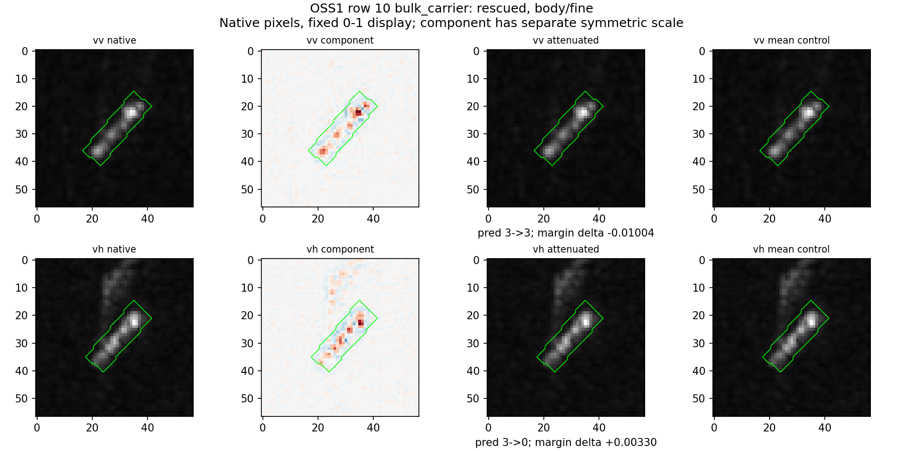
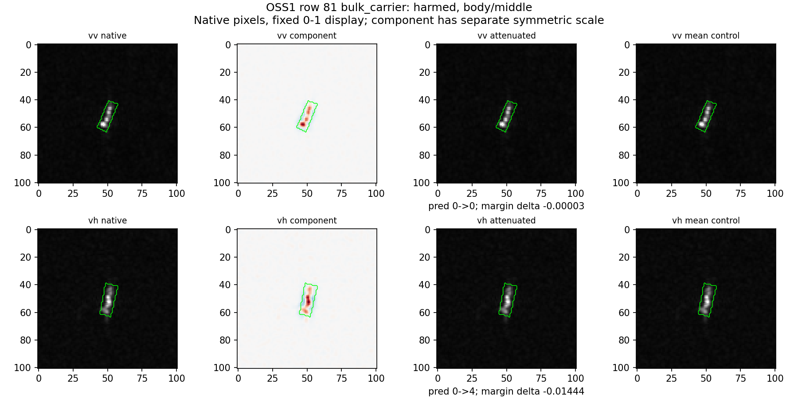
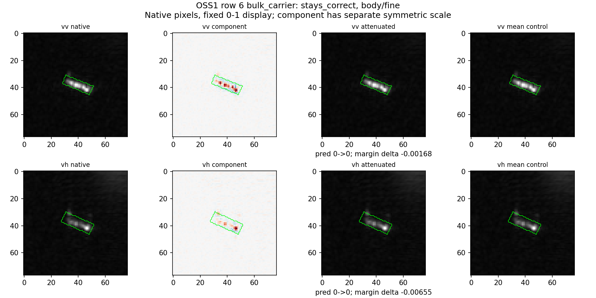
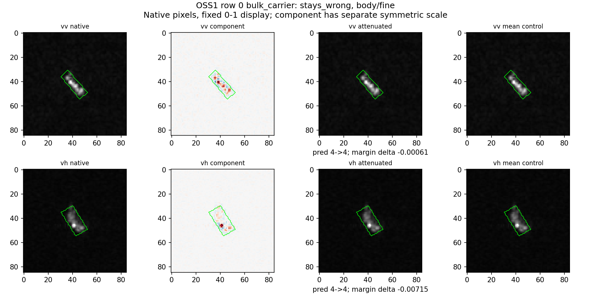
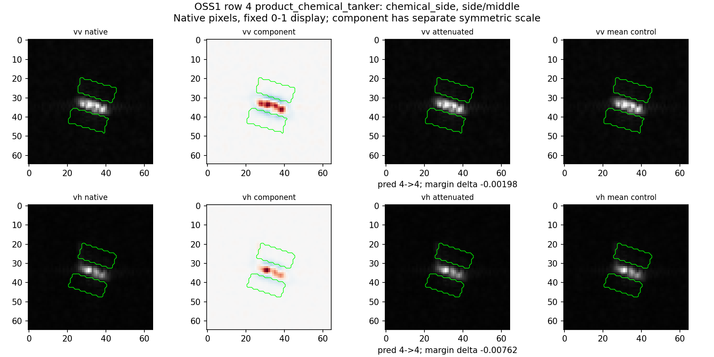
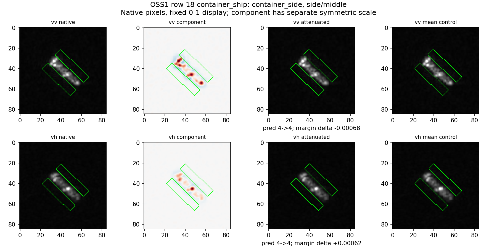

# 第23轮原图回看

六组面板已逐一查看。每组上VV、下VH，列为原图、Gaussian频率分量、区域内削弱后、同均值对照。原图/改图固定0–1显示，不缩放输入像素；分量图单独使用对称色阶，不能将其颜色强弱跨图作绝对比较。分量图展示全图，但实际操作只在绿色区域。OBB来自冻结检测器，不等于精确船体分割。

本轮没有支持适配。分类器是该折源训练的固定诊断头，原图来源/产品/MMSI/折及原始文件路径在baseline.csv；全部原预测、改动和对照分数在interventions.csv.gz，选中操作在case_records.csv。三个fold是划分，不是种子。

选择规则：前四种状态各取obs_id最小者，再固定按pol/region/band排序取操作，不挑最好看的图。为解释两类边界，另取化学品和集装箱的第一个VH侧向middle案例。前四个恰为多数类散货船，不能把其解释推广到所有类别。

## 救回：10，MMSI563770000，fold1

图像事实：两极化主体都沿左下至右上延伸；右上端有集中亮响应。VH上方还有框外较弱延伸纹理，不能由此认定是尾迹或旁瓣。只改框内，外围保留。

分类证据：原散货船被判化学品船，分差-0.001508。削弱VH fine后两类分数均下降，但错误化学品下降更多（-0.006805对-0.003504），分差+0.003300，救回；同均值对照+0.000210未救回。VV相同操作分差-0.010039，反而恶化。

解释：该个体VH细尺度响应相对更支撑混淆类别，并不等于该频带对散货船总体有害；VV与VH不能合并成一个“高频有害”结论。尚未知道该相对响应由何种真实观测条件产生。

## 误伤：81，MMSI413411710，fold2

图像事实：主体在101px图像里较小、接近竖直，VV/VH都是狭长亮响应，VH集中度和两端显示不同。绿色区域覆盖检测主体，人工变化肉眼很小。

分类证据：原散货正确，分差+0.014337。VH middle削弱后散货-0.009383、集装箱+0.005057，分差-0.014440，翻成集装箱。亮度对照仅-0.003350；VV同操作仅-0.000029且不翻转。

解释：这部分VH中尺度输入支撑当前正确判别，去掉它会丢证据。不能将人工造成的错误认定为自然观测中失焦的同一机制。

## 持续正确：6，MMSI414768000，fold0

VV较连续明亮，VH主体整体暗一些、右端更集中；背景低亮度细纹理可见。框内fine削弱后VV/VH分差分别-0.001683/-0.006550，但原优势+0.226074，均远未越界。top1不变不等于没有分类证据损失。

## 持续错误：0，MMSI413338000，fold0

VV斜向长条中有多个相连亮点；VH较集中在一侧端部。原散货被判集装箱，分差-0.138710；VV/VH fine削弱分别-0.000612/-0.007149，均未改善。该操作不是纠错通用方法，当前没有从图像证明其自然错误根因。

## 化学品侧向：4，MMSI257681000，fold0

两极化主体近水平，有多处亮响应，侧向绿色带大部分是较暗邻域。middle分量在主体边界外有延伸；这既可能来自滤波空间支撑，也含图像原有结构，不能自动认成独立海面机制。

VH侧向middle削弱使正确化学品-0.006129、集装箱+0.001494，分差-0.007623，原错误加重；VV也不利-0.001975。均值对照VH为-0.001809。该案例说明“看起来暗”不代表外围操作没有分类作用，但还不能把它叫作环境语义。

## 集装箱侧向：18，MMSI229009000，fold1

斜向长目标沿长轴有相隔的亮响应，VH相较VV较稀疏。相同侧向middle操作，VH分差+0.000619（正确分数+0.000058、竞争类-0.000561），VV为-0.000681。原分差+0.110903，均保持正确。这是作用方向依赖极化的微小个体证据，不是显著性能提升。

## 回到数据与机制

可保留的结论：对同一观测、同一冻结分类头，输入其他部分不变时，区域×尺度×极化会改变具体竞争类证据；仅平均亮度变化不能复现所列救回/误伤。不能保留的解释：靠肉眼认定某亮点是船尾、某纹理是尾迹，或者把某频率分量一律当作因果噪声。几何筛选缺少小船、公开集分类器较弱和跨来源同类反向，都是结论适用边界。
