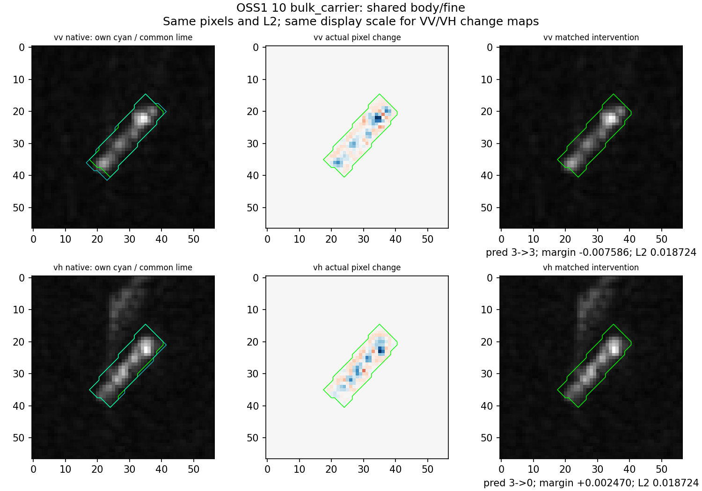
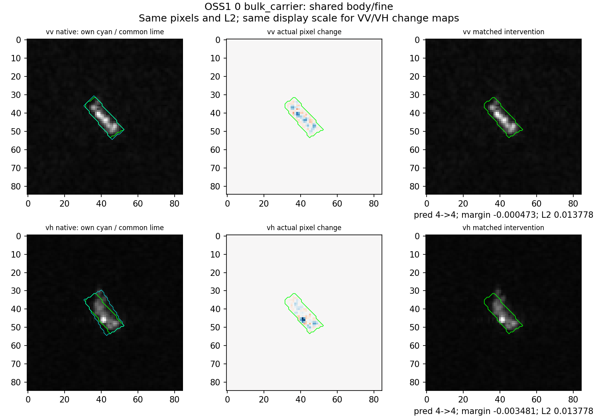
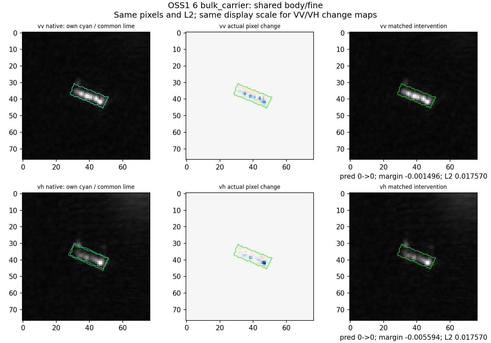
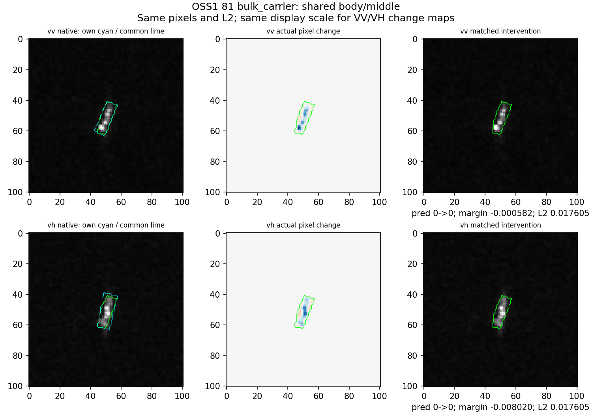
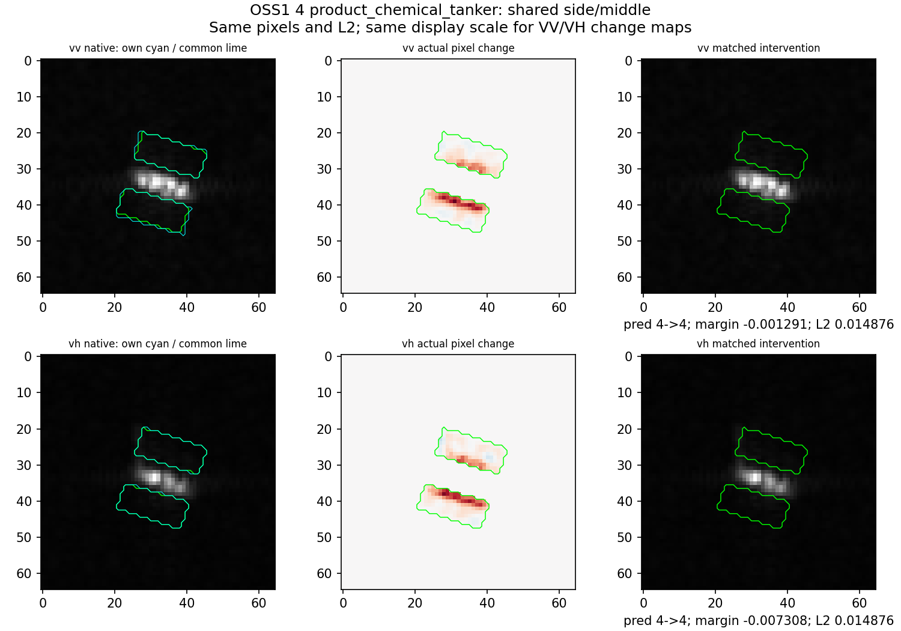
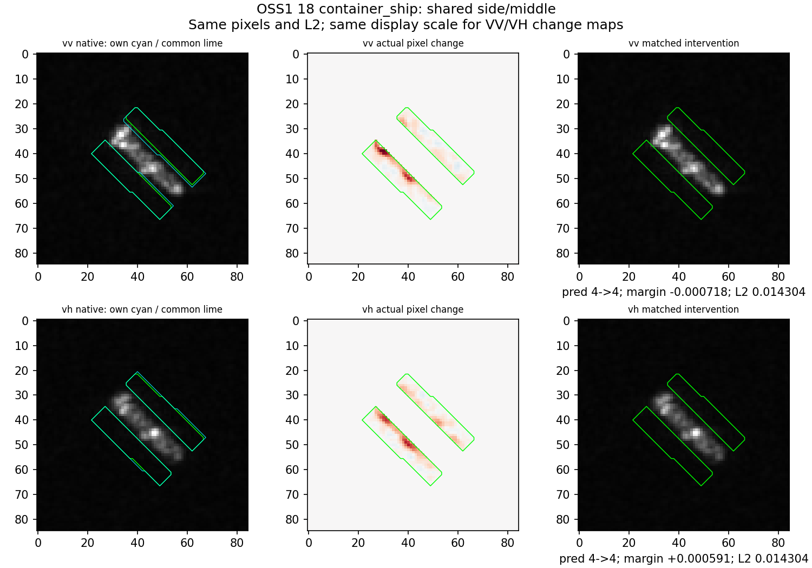

# 第24轮共同区域原图复核

原始路径、MMSI、产品、fold仍见第23轮baseline.csv；本轮直接复用三个源训练头，没有支持适配或新训练种子。全部六组已看。左：原图（原区域青、共同区域绿）；中：实际像素改动，VV/VH使用同一对称色阶；右：改动后。每图都是原尺度读入再补零，不重采样。各案例之间色阶可不同，不能跨案例比颜色深浅推断幅度。

## 10：反向作用保留

原图可见主体沿左下到右上延伸，两极化都有较集中的亮点；VH上方额外弱纹理保留未动。实际变化限于共同226px区域，亮点中心减小、局部相邻位置略增加，符合局部细尺度削弱而不是整船亮度统一平移。

共同区域高剂量下VV正确类-0.003179、错误类+0.004407，仍恶化；VH正确类-0.002667、错误类-0.005137，错误下降更多，救回。原始图像可见差异并不能单独决定此方向；精确读出分解见FINDINGS_ZH.md。

## 0：持续错误

VV的主体较连续，VH亮响应集中在一端。公共区域去除了两路框不一致的边缘，仍只改主体。VV/VH分差分别-0.000473/-0.003481，原错误均未改变。高方向相似的特征变化仍可被不同权重放大成不同效应。

## 6：持续正确

近横向主体，VV比VH显示更连续；两路改动图的强改动位置分布不完全相同。分差分别-0.001496/-0.005594，原优势足够大，均未翻转。不是top1不变就无输入效应。

## 81：误伤在降幅后消失

主体在图中较小而狭长，公共区域为两框重叠。两路改动图均主要降低主体内响应。共同幅度后VH分差下降-0.008020，但没有越过原+0.014337优势，因此仍正确。自己区域+同一较低幅度时已不翻转，不能把结果归因于共同区域改进。

## 4：化学品侧向操作仍不利

共用两条侧向邻域带，强改动主要靠主体边缘；不能因为区域在框外就当作独立海面物理信息。VV/VH分差-0.001291/-0.007308，原错误集装箱判断加重，变化更大的VH同时受到不同读出权重作用。

## 18：侧向操作仍一负一正，但未翻转

斜向目标有相隔亮点，两侧共同区域位置一致。VH改动中一些位置的幅度更集中，但总体L2与VV相等。VV分差-0.000718、VH+0.000591，均仍正确。两路特征变化余弦0.6346，内容变化差异比10号框内更明显，但当前分解中权重项仍较大且与特征项部分抵消。

## 可保留解释

本轮把“看哪里”和“改多大”匹配后，仍能复现部分极化反向效应，并通过实际分类头精确定位不同读出权重的作用。剩余缺口在于权重偏好如何由源训练样本形成，以及能否迁移；原图不支持直接命名某种物理散射原因。六个案例是诊断集合，不是总体规律的独立统计证明。
