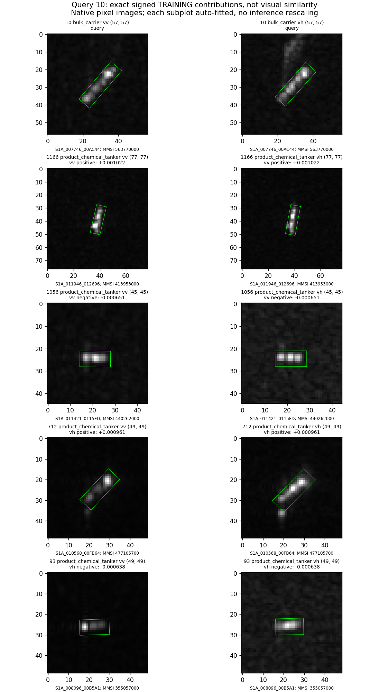
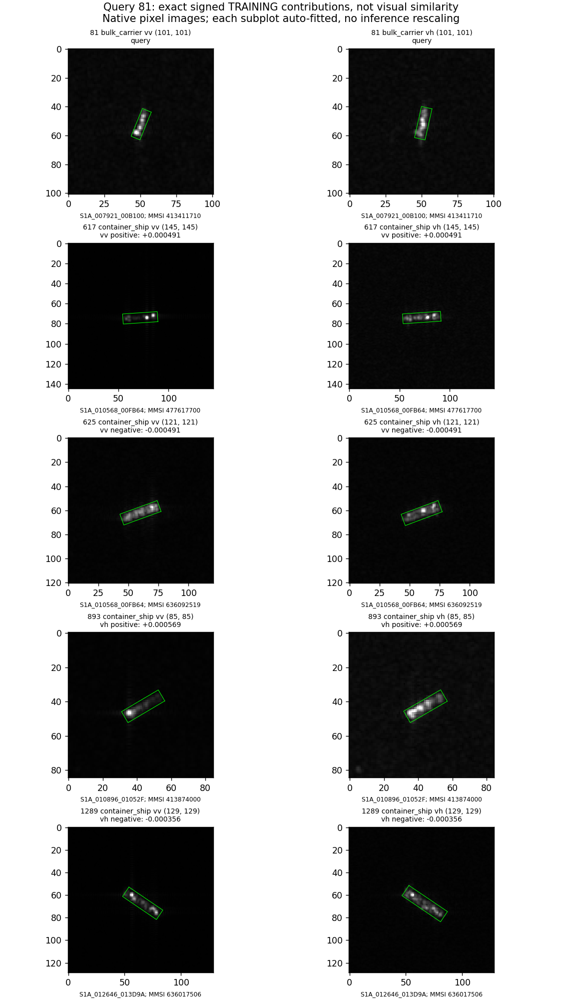

# 第25轮原图复看

## 范围与读法

复看第24轮0/4/6/10/18/81六个原始VV/VH与共同区域干预面板；本轮不修改图像，直接复用逐坐标变化。另生成并查看source_cases_10.png和source_cases_81.png。源样本按固定训练解中对该干预的正/负最大贡献选择，不是最近邻检索，也不是支持案例。不同尺寸图在面板中自适应显示，坐标标注保留原生像素；分类输入未做缩放。

## 10号：原来救回，删采集后方向稳定但不再翻转

- 查询10，MMSI563770000，S1A_007746_00AC44，fold1，散货船。
- 两极化共同主体呈细长亮响应，靠一端较集中；VH框外上方另有弱结构，本次共同框内干预没有修改那里。fine操作改变的是主体内局部高低起伏，并非删除整船或单独海面。
- 原头：VV -0.007586仍判化学品船；VH +0.002470救回散货船。删源过境后两种标准化各15次仍VV负/VH正，但VH不再发生救回；6/15头原本正确、9/15仍错误。
- VV正贡献源1166：化学品船，MMSI413953000，S1A_011946_012696，+0.001022。主体有多个不均匀亮段。
- VV负贡献源1056：化学品船，MMSI440262000，S1A_011421_0115FD，-0.000651。较紧凑的横向多亮峰响应。
- VH正贡献源712：化学品船，MMSI477105700，S1A_010568_00FB64，+0.000961。沿轴多个亮段，VH在一端外侧还有弱延伸。
- VH负贡献源93：化学品船，MMSI355057000，S1A_008096_00B5A1，-0.000638。VV一端峰强、余段弱，VH主体相对更连续。
- 四个源样本同属化学品船却贡献有正有负。因此不能把此解释简化成“化学品船都亮/都暗”或“朝向相同就同类”。这些图说明形态有变化，但没有证明哪一个具体亮峰决定了训练权重。

## 81号：原先的误伤边界与源数据变化

- 查询81，MMSI413411710，S1A_007921_00B100，fold2，散货船。小而细长，VV有分离峰，VH亮段更连续。共同body/middle作用局限于主体区域，非背景整体变暗。
- 第24轮匹配幅度后原头仍正确，VV -0.000582、VH -0.008020。原第23轮更大VH幅度曾误伤，不能将剂量效应写成区域组织收益。
- 删采集后VH14/14保持负；固定标准化下移除S1A_010896_01052F或S1A_011421_0115FD会使原分类边界靠近，进而发生误伤。仅VH图像头原本判集装箱，联合头原本判对，和10号的融合表现不同。
- 源617：集装箱船，MMSI477617700，S1A_010568_00FB64，VV正贡献+0.000491。长轴上多个分开的亮点，并可见弱条状延伸。
- 源625：集装箱船，MMSI636092519，同一源过境，VV负贡献-0.000491。较连续的亮带、局部强峰。与617同类同过境而贡献相反，不能仅用采集标签解释。
- 源893：集装箱船，MMSI413874000，S1A_010896_01052F，VH正贡献+0.000569。VV集中于一端，VH沿主体多处响应。
- 源1289：集装箱船，MMSI636017506，S1A_012646_013D9A，VH负贡献-0.000356。多峰细长结构。
- 不把这些可见条纹命名为尾迹、旁瓣或物理船尾。贡献的正负针对“本次衰减对散货减集装箱分差的影响”，不是源图本身好坏。

## 其余四个查询

| 查询 | 原图可见事实 | 本轮结果与含义 |
|---|---|---|
| 0 | VV主体较连续，VH局部峰更集中；干预仍在共同主体 | 原本持续错。VH负15/15保持，较弱VV只有11/15保持；不能给VV固定物理解释 |
| 6 | VV横向主体连续，VH一端强峰明显 | 原本持续对。VH负15/15保持；VV14/15，分类状态和分差变化分开记录 |
| 4 | 化学品主体紧凑，多亮点；side改动靠近主体边缘 | 原本持续错，两极化负15/15保持；“侧向”不等于独立海面信息，滤波分量也受主体边界影响 |
| 18 | 集装箱主体沿轴分布多个亮段；side改动沿近侧边缘 | 原本持续对，VV负/VH正15/15保持。单VH图像头正效应近零，说明联合读出影响作用强度 |

本轮没有新的支持抽样/训练随机种子；各对照是确定性ridge。全部原始路径可由原round23 baseline.csv及本轮source_case_selection.csv的obs_id/source_id追溯。未根据外观修改标签。
