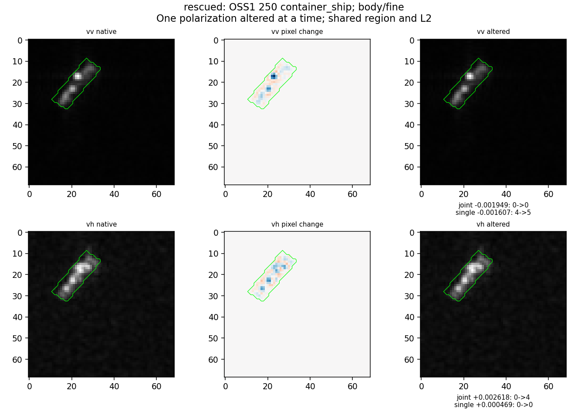
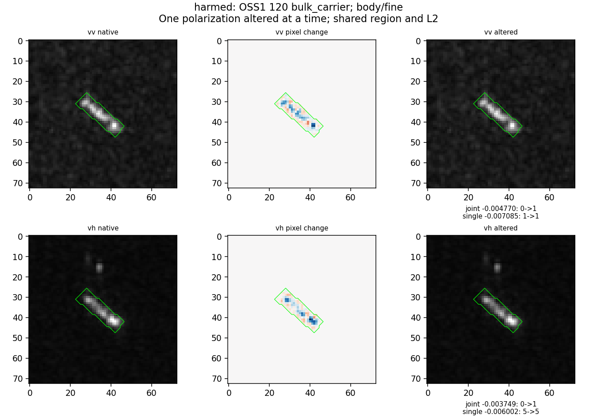
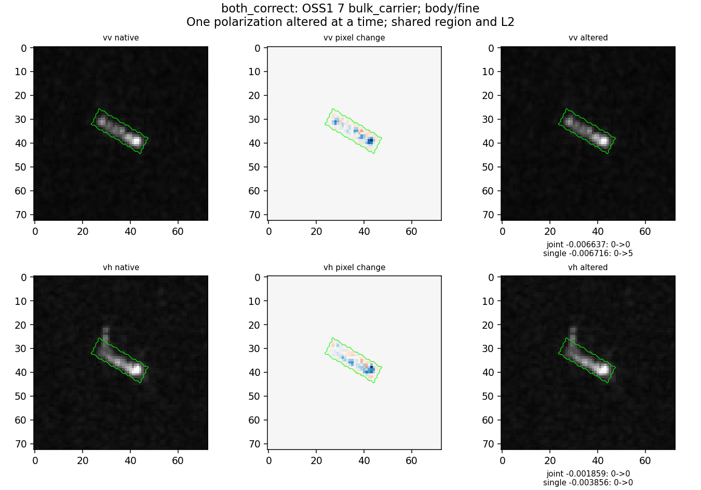
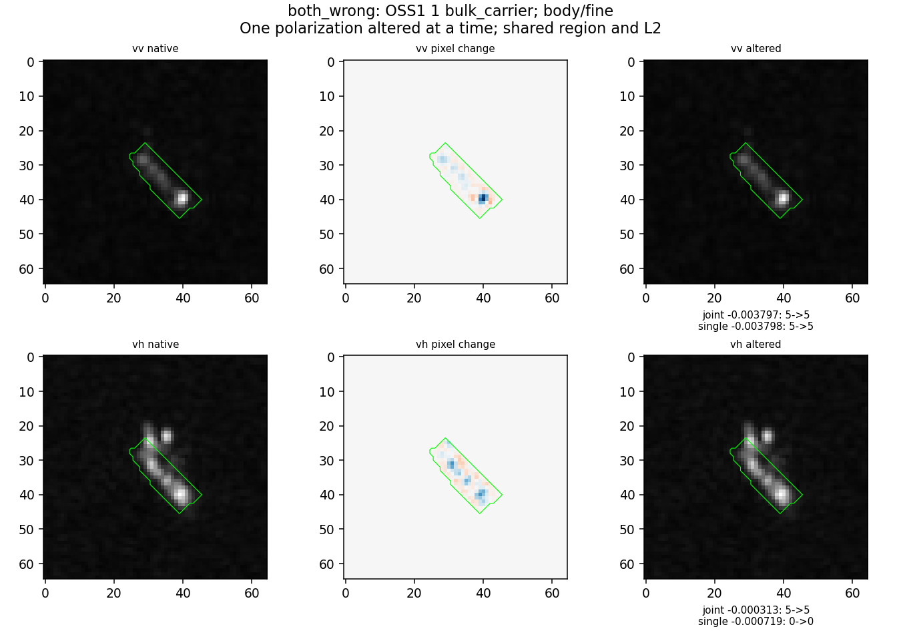
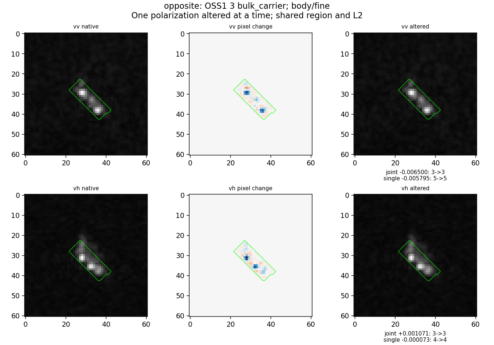
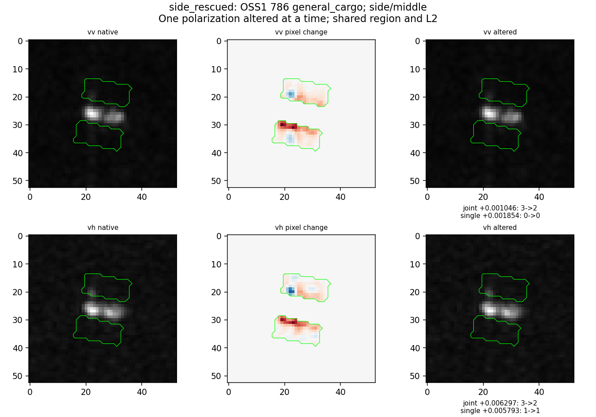
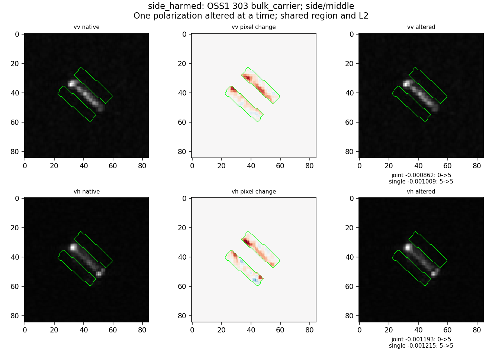

# 第26轮新增查询原图分析

七组面板已逐一实际查看。前五组按预定状态、ID顺序选首次出现且未重复的观测，不选最大效果。由于前五组恰好全为body/fine，展示阶段补两组side/middle救回/误伤，仍按首次ID而非幅度。增补仅用于图像解释，不修改统计或训练。

面板两行是分别修改VV、VH，不是同时改两路；“single”是对应极化图像头，仍保留四个几何维。状态标签只针对被选中的极化行，不保证另一行具有同样状态。原生像素不缩放，显示范围0至1；改动图两极化共享颜色范围。完整源路径由cohort.csv的obs_id关联，支持集不存在，本轮只有冻结源训练分类头。

## 250：被救回的集装箱船

- MMSI248846000，S1A_009496_00DC88；VH body/fine，联合0散货→4集装箱，单VH仍0。分差联合+0.002618，单VH+0.000469。
- VV主体有多个分开的亮峰，VH沿轴亮段更连续且上部较强。共同框内改动呈亮峰减弱、邻近像素轻微增加，未改整张背景。
- 联合真实类分数-0.000327，混淆散货分数-0.002945，故主要是混淆类证据减弱更多。均值对照分差+0.000496，剩余+0.002122，不能全部归因灰度均值。
- 同张的VV fine操作相反：联合-0.001949仍判散货，单VV从正确集装箱变原油轮。外观与极化都有关，但读出方式也影响后果，不能简单删除所有细节。

## 120：被误伤的散货船

- MMSI477847100，S1A_009321_00D788；VH body/fine，联合0散货→1渔船，单VH原本5原油轮且仍错。
- VV背景纹理比VH明显；VH主体上方还有独立亮点，但本轮共同框内操作未改变它，不能把误伤归因这个框外点。
- VH联合分差-0.003749，真实类-0.005712、渔船-0.001963；真实类证据损失更多。均值对照-0.000647，残差-0.003102。该操作并非仅去掉无用噪声。
- VV同类操作也使联合误判渔船，分差-0.004770。两极化在本例都包含原判对所依赖的信息。

## 7：分差下降但仍判对

- MMSI412563000，S1A_007396_00A2CA；选中VH body/fine。联合与单VH均保持散货，分差分别-0.001859/-0.003856。
- 主体不均匀，一端亮峰明显；修改图集中在这段亮响应及其周边，没有改整片海面。
- 联合真实类得分-0.004074、竞争原油轮-0.002215，确实损失了判别优势，但还没越界。不能把没有top-1变化写成没有作用。
- 另一行VV操作使单VV误伤为原油轮，联合仍对；“两头持续正确”仅指所选VH行。

## 1：两头持续错误

- MMSI413376390，S1A_007396_00A2CA；选中VV body/fine。联合与单VV均将散货判原油轮，分差-0.003797/-0.003798，几乎相同。
- VV主体一端强峰突出，其他位置弱；VH上方还有额外亮响应，但VV操作未改它。仅凭这张图无法确认是何种对象或成像机制。
- 联合真实类得分-0.002904、错误原油轮+0.000893，削弱当前VV细节会进一步恶化，而不是修复原错因。单VH原本正确，与选中VV的两头持续错不矛盾。

## 3：作用反向，却没有救回

- MMSI413866000，S1A_007396_00A2CA；VH body/fine。联合原判化学品、单VH原判集装箱，均未变。
- 主体有沿轴分离的亮段，VH上段较亮，细尺度操作局部重分配而非移走目标。
- 对固定“散货减化学品”分差，联合+0.001071、单VH-0.000073。对单VH自己的竞争集装箱，作用也是负（-0.004654），不是只因比较了不同竞争类而造出反向。
- 联合真实类分数也下降（-0.002482），只是化学品下降更多（-0.003553）。正分差仍不足救回。

## 786：侧向区域救回普通货船

- MMSI374033000，S1A_010685_00FED5；VH side/middle，联合3化学品→2普通货，单VH1渔船→1。
- 主体紧凑、两段亮区。侧向共同区域位于上下两侧，变化最大处靠框边，而不是远处海面。
- 改动图不少像素为正值：middle分量可为负，减去它反而增加灰度。不能把这个操作说成简单“压暗背景”或“去掉海杂波”。
- 联合正确类+0.000890，化学品-0.005407，分差+0.006297；同均值对照+0.001426，剩余+0.004871。单VH对同一类对也+0.005793，但其最强错误类是渔船，所以没有救回。
- 同张VV侧向middle也救回联合头，+0.001046。当前证据支持某种邻域输入结构影响分类，不足命名其物理源。

## 303：相近侧向操作误伤散货船

- MMSI477598100，S1A_009671_00E1AF；VH side/middle，联合0散货→5原油轮，单VH原本5且仍错。
- 细长主体一端强、余段较弱；两侧区域改动沿近主体边缘分布。与786一样，部分像素是增加，不代表删除一个独立背景物体。
- 联合真实类-0.000461、原油轮+0.000732，分差-0.001193；均值对照-0.000134，剩余-0.001059。此处外围输入原本有保护正确分类的作用。
- VV同类操作也误伤，-0.000862。外围没有一致有利/有害方向。

## 可保留与未解释

空间位置、细/中尺度和极化并非可互换；相同局部改动在不同读出下可改变类别证据。图像回看确认作用局限与真实分数路径，但还不能把某个亮段命名为某船型的特定散射机制。地区、风浪、姿态如何自然生成这些响应，不由本轮合成干预单独识别。代表图不代替总体比例，比例以完整数表为准。
