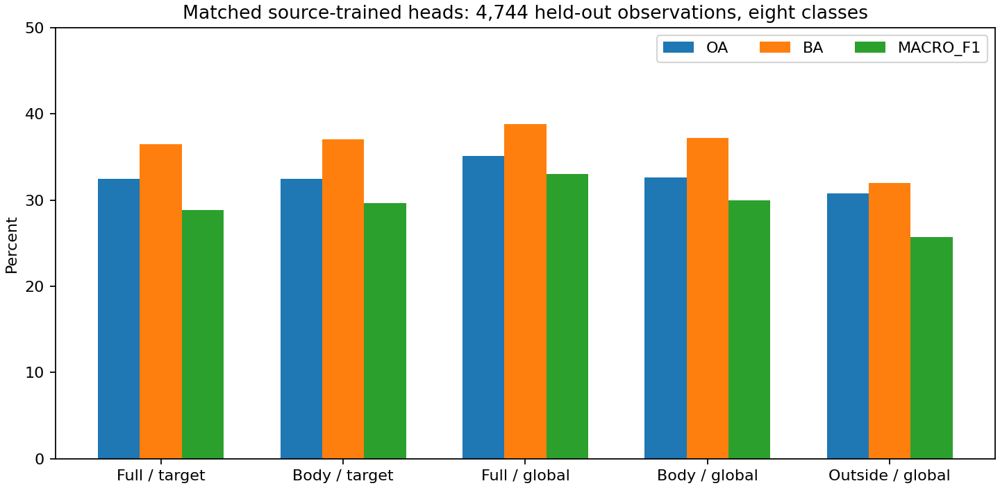
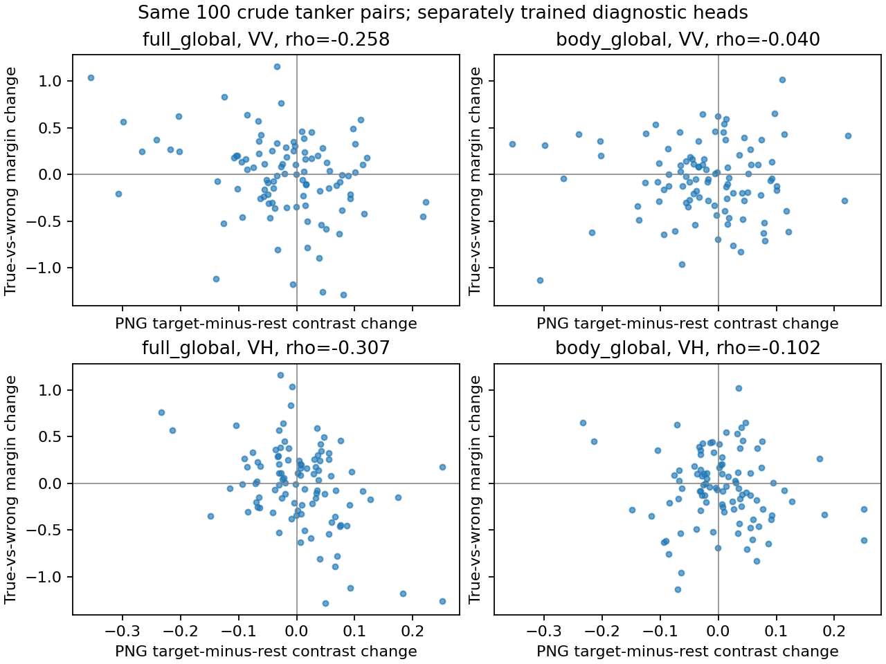
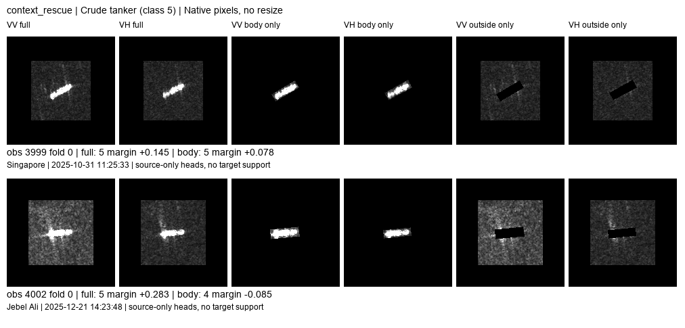
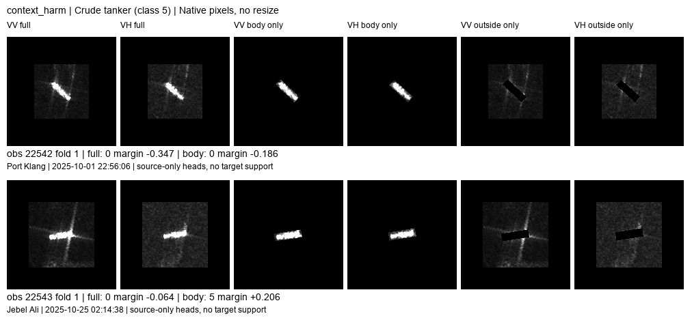

# 原油轮关联：输入对照、显示来源与训练覆盖

2026-10-21。**配套分类头训练、输入功能诊断和实际源覆盖恢复已完成；拉伸前定标数据的跨时相对照尚未完成。** 现有主模型不替换。本轮不是开放集实验，也不是完整双路支持适配系统重训。

## 结论先行

1. **“原油轮应该弱散射”不是本轮结论。** 可以确认的是，这套诊断分类器确实使用了框外显示响应；去掉它会减弱此前的对比度关联，却也损失原油轮识别率。
2. **框外信息不是一概有害。** 同样的全局池化和源端训练下，整图比框内输入 OA +2.530、BA +1.565 个百分点；原油轮召回 +11.358 个百分点，三个身份折均为正。其他类别有正有负。
3. **有几何案例，不代表有对应图像外观。** 大多数原油轮端点有相近源几何；显示统计分布的尾部与更高错误率有关，但还不是补数据必能修好的因果证明。
4. **显示链已追到逐景、逐极化拉伸，不是逐 chip 拉伸。** 但历史数值上下限和成对定标强度缺失，暂不能定量拆分真实响应变化与拉伸贡献。

## 本轮到底训练了什么

使用既有24港队列的三个船舶身份折，沿用时间划分：源训练早于2025-09，源验证为2025-09，测试从2025-10起。三个训练折为4392/4419/4418条观测；最终同一4744条测试、2973艘船、18港、八类。并非严格留港，也不是全新独立采集确认集。

冻结 ImageNet R50 stem，160像素原生裁剪/补零，不缩放；VV/VH分别读出，四次90度旋转平均。每臂260维：双极化均值/最大响应256维，加相同的OBB像素长宽4维。每臂分别拟合Ridge分类头，只按源验证选alpha。15个最终头、45次候选拟合，**不是三个随机训练种子，不是端到端骨干训练**。本轮没有目标支持集。

测试308条观测的VH因缺目标框或关联禁用而统一置零；五臂一致，200个原油轮配对端点均有可用双极化。OBB是检测范围，不是精确船体分割；本文“框内”不等于纯物理船体。

| 输入 / 池化 | OA % | BA % | macro-F1 % | 原油轮召回 % |
|---|---:|---:|---:|---:|
| 整图 / 框内池化 | 32.441 | 36.494 | 28.869 | 51.358 |
| 严格框内输入 / 框内池化 | 32.441 | 37.053 | 29.659 | 43.210 |
| 整图 / 全局池化 | 35.139 | 38.795 | 33.035 | 53.580 |
| 严格框内输入 / 全局池化 | 32.610 | 37.231 | 29.952 | 42.222 |
| 框外输入 / 全局池化 | 30.776 | 31.947 | 25.692 | 46.667 |

“严格框内”在归一化和卷积之前将框外置零；“整图/框内池化”仍可通过感受野读取框外。全局池化排除原图外补零位置的权重，但边界感受野仍可能接触补零。硬掩膜及其形状可见，框外臂还共享OBB尺寸，**不能把框外臂的准确率全部归为海面环境信息**。

整图/全局相对框内/全局救回690、误伤570，净120个正确；原油轮405条观测中救回84、误伤38，净46。三折原油轮召回增益为+11.765/+13.475/+8.594个百分点；三折整体OA增益为-0.769/+5.699/+2.515个百分点，不能声称每折整体获胜。

按真实类别内MMSI重采样1500次的配对95%区间：OA增益[+1.000,+4.058]、BA[-0.175,+3.327]、原油轮召回[+6.313,+16.194]个百分点。它们只描述已拟合模型下的船舶样本不确定性，不含重训、采集独立性或多重事后探索的不确定性。

同一比较下逐类召回变化：散货+5.891、渔船-10.345、普通货船+6.606、成品油/化学品船-2.838、集装箱+9.249、原油轮+11.358、拖船+3.960、海工补给船-11.364个百分点。保留原油轮范围的收益，不能把它扩写成所有船型都需要背景。

这里采用简化且匹配的诊断读出，整图OA35.139%低于已有keep_refs主方案40.964%；**这不是主方案退化或新模块涨点对比，两种读出能力不同**。其用途是拆开输入范围和池化影响，不是替代现有分类器。

## 对比度关联在哪里

使用固定100对、200端点。T为框内，R为排除目标及其他合格检测框后的其余图像区域；R未被证实为纯海面。统计量为PNG均值差T-R，不是雷达散射截面。

| 读出 | VV 对比度变化与分差变化 rho | VH rho | 两次均正确 / 仅一次正确 / 均错 |
|---|---:|---:|---:|
| 整图 / 全局 | -0.258 | -0.307 | 30 / 39 / 31 |
| 框内 / 全局 | -0.040 | -0.102 | 20 / 43 / 37 |
| 整图 / 框内池化 | -0.350 | -0.220 | 27 / 44 / 29 |
| 框内 / 框内池化 | -0.068 | +0.033 | 25 / 43 / 32 |

去掉框外输入后关联减弱，且匹配的不同池化比较方向一致，支持它不只是框内平均亮度的现象。但两边重新训练了分类头，因此这是输入可用性与学习结果的比较，不是对旧主模型参数固定不动的因果分解。100对是旧开发分析集合，没有伪装为新验证。

## 固定新模型，分别改变哪部分像素

固定整图/全局模型，对200端点分别在VV或VH的T或R加/减0.05，不动另一极化、其他区域、尺寸和方向，截断到[0,1]。共8个干预设置加原图重放。这里改变的是显示像素，不是海况或物理散射。

| 显示域操作 | 原油轮相对最强错误类分差平均变化 | 分差增加的端点比例 |
|---|---:|---:|
| VV框内 +0.05 | -0.057 | 9.5% |
| VV其余区域 +0.05 | +0.070 | 77.5% |
| VH框内 +0.05 | +0.002 | 68.0% |
| VH其余区域 +0.05 | +0.133 | 98.5% |
| VV框内 -0.05 | +0.067 | 89.5% |
| VV其余区域 -0.05 | -0.116 | 13.5% |
| VH框内 -0.05 | -0.030 | 24.0% |
| VH其余区域 -0.05 | -0.215 | 1.5% |

这证实了**该诊断模型对周围显示亮度的响应**，而非仅有两次自然观测之间的相关。不能据此断言旧主模型完全相同，也不能说“降低船体真实散射会提升识别”。正向框内操作有43.93% VV、38.96% VH像素触及截断上限，增减不对称，表中数字不能当作线性物理敏感度。

## 显示来源：已查明与仍缺失

400视图全部核对到原裁片manifest。存档流程为：SAFE measurement → 10米UTM UInt16 → 整景单极化近似2/98分位拉伸到UInt8 → 网格裁切 → PNG。裁chip环节没有再次求分位或拉伸，VV/VH各自采用整景统计。

实际恢复：30视图与UInt8 TIFF窗口逐像素相同；2视图各有1像素差异，保留为未精确对应；22视图取得未定标UInt16 SAFE候选小窗；其余346只有PNG及来源元数据。**0对同时取得经验证的拉伸前两端，0幅取得定标backscatter；四个重点端点也没有上游像素。**

因此显示链的算法位置已定位，但历史逐景lo/hi与辐射域贡献尚不能算出来。不能由PNG变化直接判断目标反射增强、海况变化或传感器饱和。详见 `radiometry_trace/FINDINGS_ZH.md`，原始小窗不进入GitHub。

## 实际源训练覆盖

已恢复三折实际源训练/验证/测试，63个旧score文件行号吻合。原油轮训练独立船132–156艘，少于散货861–888艘；但损失中每个类别总权重相等，类内每艘船总权重也相等。不能直接说“原油轮类别总权重太低”。

在相对轴角、入射角、OBB像素长宽联合邻域上，大部分200端点有相近原油轮源案例。以源端自身异船异产品最近邻的加权95%距离为参照，VV只有6、VH12端点超出；这些小组没有更低正确率。覆盖距离变化与旧模型分差变化rho约-0.079/-0.056，不支持把主要错误统一解释为几何覆盖不足。

进一步新增读取10090张合法源PNG，补读框内/其余区域显示统计，并复用400个端点视图统计。200端点的目标均值均在对应源原油轮极值范围内，周围均值也没有高于源上界，故不支持“缺少亮船/亮背景”的解释。较明显的是暗背景与高对比度尾部：VV有11、VH有7端点的R均值低于对应源最小值。

固定用对应源原油轮加权2.5%–97.5%分位作描述性参照，不按测试对错调阈值。VV的T均值、R均值或T-R任一落在源尾部的31端点，旧基线错误率65.59%，其余169端点41.22%；VH为21端点52.38%、其余179端点44.13%。统计将旧模型三个种子的每端点错误率平均，不能当成三倍独立样本。单看VV暗背景低尾23端点，错误率71.01%，同指标中央区间41.57%；高对比度尾部与暗背景尾部有重合，不能相加。

这条结果比“角度没见过”更值得跟进：**源端少见的显示外观与局部风险相关**。但尾部不是完全没见过，分位选择及类别条件化都是诊断口径；没有干预补充训练，不能宣称已找到缺样本导致错误的根因。VV这31端点只占全部错误事件约22.6%，大多数错误仍发生在非尾部。

详细源表、几何和显示覆盖在 `source_coverage/`；没有把骨干ImageNet预训练覆盖冒充本次源头训练覆盖。

## 原图回看

已实际查看六组、十二条观测的原生VV/VH、框内输入与框外输入；固定0–255显示，不为单图自动调对比度。`case_index.csv`保存路径、折、预测与分差。没有目标支持集，因此本轮不存在需要展示的支持chip。

- **4002被周围输入救回**：框内判集装箱，整图判原油轮；图上VV背景较亮、目标附近有延伸响应。只能确认整图输入有帮助，不能从这张图单独命名延伸为尾迹或海况机制。配对3999两种输入均对。
- **22543被周围输入误伤**：框内对，整图判散货；可见穿过/邻近目标的长条响应，框内保留的主体较紧凑。跨框延伸值得怀疑，但它是不是造成误判仍需局部替换，不凭外观直接定因。
- **27657两种输入均对**：VV背景较亮仍不改变结论；同船27658整图错而框内对，说明“亮背景/同船”都不是确定规则。
- **6142/6144两种输入均错**：前者有较强交叉延伸，后者是亮背景中的紧凑响应，两端均误分集装箱。简单屏蔽背景未解决这对的判别缺失。
- **32042/32043、30233/30237**重新展示：自然观测同时改变主体结构、背景和显示强度。新简化分类头的判定与旧主模型不完全相同，报告明确保留这一事实，不将旧案例的救回故事移植到新模型。

## 评价依据和下一步

已读 *Cross-Dataset Transfer and Unknown-Class Detection in Imbalanced SAR Ship Classification* 全文。采用其BA、macro-F1、逐类召回优先的评价原则，OA仍报告；没有将该文三分类跨数据集数值与本轮八分类直接排名。未知检测和错误检测须用不同标签，本轮没有未知类，故不额外凑AUROC。具体见 `PAPER_NOTES_ZH.md`。

**当前保留：框内与周围分开读、保留周围作为可选证据的方向。暂不做：统一去背景、认定原油轮弱散射、仅凭角度缺口扩充训练。** 原图和训练统计提示下一步应检验显示外观尾部与周围证据误用，而不是再改一个几何卷积名字。

优先把少量两端都可恢复的原始measurement/定标窗口补齐，固定共同辐射与显示规则重算；同时将本轮有意义的输入隔离比较接回既有强读出，避免把简化头的机制泛化至整个系统。前者未完成前，只讨论显示域证据；后者未完成前，不将本轮+2.53点记作完整模型新收益。

## 验证与复现

`input_controls.py extract/fit/perturb`、`analyze_results.py`、`verify_results.py`。15头分数重放最大误差8.88e-16，扰动原图重放2.00e-15；18888条划分成员与恢复记录一致；4744测试逐臂一致；目标像素完整保留；框外任意改值不能进入严格框内描述子。定向独立审阅未发现影响结论的实现错误。

验证脚本初版误将源覆盖表的船舶fold字段当作split_fold，导致成员比较失败；已按真实语义修正验证脚本并通过，未改变任何训练数据或模型。特征提取91.69秒，分类头拟合11.21秒；不包含来源追溯、原图分析与文献阅读时间，不冒充部署成本。
