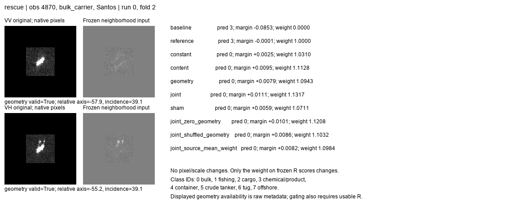
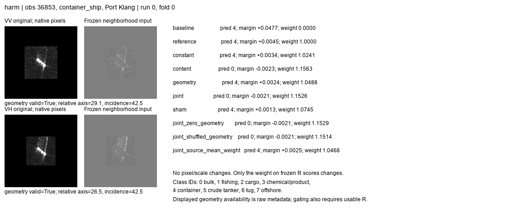

# 几何能否指导邻域证据使用：小验证完成

日期：2026-10-21。45次小门控训练、源端选步、缓存重放、原图回看完成。未改原图、骨干或原分类器；旧有效组件全部保留。

## 一、结论

**可以保留微小正信号，但目前不能把增益归给正确几何，也不值得据此升级成论文核心模块。** 较强整图模型加原始邻域的OA/BA为41.512%/42.707%；再加内容与几何联合门控为41.575%/42.790%，分别增加0.063/0.082个百分点。三次净正确数为0/2/7，配对区间均跨零。

仅内容加有效性标志为41.568%/42.781%；错配几何也为41.568%/42.780%。联合相对内容或错配几何只有约0.007个OA百分点，差异不明确。使用联合模型的源端平均权重也能达到41.596%OA，不能说已经证明逐样本几何门控必要。

不是实现完全没有使用几何：固定联合模型换成错配几何，三次分别有1/8/1张预测改变。可是这些变化没有构成可重复的净收益。**预测表观长度有用的条件关系，尚未通过本次接法转化为明确分类收益。**

## 二、这次究竟改了哪里

保留较强整图分类器A，以及已训练的邻域残差r=D(x)，原方案是A+r；新方案只有：

`scores = A + w*r`, `w = 2*sigmoid(g)`。

初始化w=1，恰好保留旧方案；有限参数下w在(0,2)内。它只改变既有邻域修正的强度，不能改变类间修正方向。没有修改采样、卷积、池化、像素尺寸，没有把条件换成图像拉伸。这是一个接入可行性探针，不是新卷积或跨场景核心表征。

- 内容：冻结D的32维隐藏表示，经源训练均值/标准差归一化，再tanh；不是纯纹理，也不是与类别无关的表示。
- 几何：VV/VH各自的相对船轴角cos(2φ)、sin(2φ)、固定尺度入射角，以及两极化有效性标志。使用现有OBB与雷达LOS，不用AIS航向、同船历史、真实类别或目标长度。
- 几何有效性同时要求该极化邻域可用，未把禁用VH偷偷放回输入。VV/VH条件分开输入，但控制一个共同残差权重，不是两个独立极化专家。
- constant只有一个标量；其余为40→8→1的337参数MLP。content候选实际是内容+validflags，连续几何槽为零；名义架构相同不等于有效容量完全相同。
- sham在每折train/val/test分区内部，按port/platform/quarter/两极化有效性分层交换整组成对几何。97.68%测试观测的几何向量实际改变。每折三个训练种子共享一次固定置乱；它只用于诊断，不能部署为依赖其他测试样本的规则。

## 三、数据与训练范围

沿用24港实验的4744测试观测、2973船、18港、8类，三身份/日期折、三配对运行，排除31237。不是F_0921或公开集的新结果，不是严格留港，也不是新采集独立确认。原生160像素crop/pad，不缩放；全局强模型和原始R均冻结。

每候选150次源端加权MSE更新，学习率/权重衰减均.001，batch128；按源验证BA、Brier从0/50/100/150步选择。零步是保留A+r，不是退回A。原D在fold0/seed2、fold2/seed2已选择零残差，这两组没有门控学习信号，保留主表、不剔除。

源端VH几何有效比例约56%–58%，验证/测试约83%–87%；VV均有效。共同validflags对照控制了一部分输入差异，但不能据该覆盖差直接断言泛化失败原因。当前所有分类翻转位于两极化均有效组，另一组整体指标未变；不把组间绝对准确率差解释为几何质量效应。

门控训练用的是A/D已拟合过的源训练样本，属于分阶段训练，并没有实现另一报告建议的源端留船误差训练。A/D与门控还共享源验证集选步。测试不参与训练或选择，但该开发协议不能被描述为完全独立确认。

## 四、完整配对结果

表中单位%，均为三次运行各合并三折后再平均。

| 方案 | OA | BA | macro-F1 |
|---|---:|---:|---:|
| 冻结A，不加邻域 | 40.964 | 42.565 | 37.993 |
| 冻结A+r，当前参考 | 41.512 | 42.707 | 38.460 |
| 学习统一权重constant | 41.505 | 42.692 | 38.446 |
| 内容+有效性标志 | 41.568 | 42.781 | 38.518 |
| 几何决定权重 | 41.533 | 42.745 | 38.487 |
| 内容+正确几何joint | 41.575 | 42.790 | 38.520 |
| 内容+错配几何sham | 41.568 | 42.780 | 38.515 |
| 固定joint，几何数值置零 | 41.596 | 42.798 | 38.532 |
| 固定joint，换错配几何 | 41.582 | 42.807 | 38.530 |
| 固定joint，使用源平均权重 | 41.596 | 42.769 | 38.513 |

后三行是事后固定头诊断，不参与选步或候选选择。几何数值置零但flags保留，不对应合法物理角度，只是数值块消融。源平均权重来自源训练集，并非用测试标签挑倍率；它与单独训练constant是不同的诊断。

joint相对A+r的OA差条件MMSI区间为[-0.021,+0.155]个百分点，BA为[-0.011,+0.183]；joint相对content为OA+0.007、BA+0.009，均不明确。joint相对constant的BA差+0.097、条件区间[+0.016,+0.189]可作为有限候选信号，但不足以证明几何独有作用。所有多候选比较是探索性结果，不做挑选性显著性叙事。

逐类joint召回变化约：散货+0.078、集装箱+0.257、原油轮+0.329、拖船+0.165个百分点；成品油/化学品-0.045、海工-0.126，渔船与普通货船不变。不同类并非全胜，保留小幅收益和退化的实际边界。

## 五、为什么改进小：已排除与仍未解决

1. **不是模块没有接上。** 9组旧参考分数重放误差0，45个选中门控权重重放误差0，源端选步符合记录。7个非零残差组合都选中非零门控步数。联合权重测试范围约0.674–1.314，确有变化；不是全部退回1。
2. **不是sham几乎没有改变输入。** 测试几何向量改变4634/4744。固定联合头对几何错配的权重平均绝对变化按折/种子约0–0.021，最多改变8张预测；几何对最终决策影响较弱，且正确几何没有净优势。
3. **不能把幅度空间不足与学不会混为一谈。** 事后用测试真类仅计算理想可达性：对每张样本解出使真类超过所有其他类的w区间，不训练、不据此调整模型。允许w在[0,2]选择，三次最多额外救回172/202/84张；实际只救回9/8/8且误伤9/6/1。理想平均OA约44.730%，不是可部署性能或保证可学到的收益。可救回样本中117/134/58张需要w偏离1超过0.25。存在幅度空间，但当前标签不可见的门控没有有效兑现。
4. **也有结构上不能救的样本。** 固定r只能沿一个类间方向变化，30237和32059在本次run0中即使知道真类、选择最有利的0–2权重也无法改对。此类错误需要不同的判别证据或读出，而不只是更强门控。
5. **源端目标和泛化还未分清。** 终末源验证BA不少组合与起点持平、Brier略变；部分确有小增益。联合源平均权重已能取得近似效果，尚无证据证明逐样本权重变化的额外价值。源训练内拟合残差与真实未见样本错误不同，是待验证解释，不把它提前认定为根因。

## 六、原始chip回看

已查看全部7组VV/VH原生面板。查询与邻域输入完全不变，只有同一个r的倍率变化。原图路径、fold/seed、预测、真类分差、权重和选步见case_index.csv；可达性见oracle_family_rows.csv。下面均为run0，分类救回/误伤相对A+r定义，不挪用旧D已有收益。

| 观测 | 原图可见事实 | 模型路径 | 结论 |
|---|---|---|---|
| 4870，散货 | VV/VH斜向亮目标，VH上方有额外离散亮点；邻域不等于纯海水 | A+r分差约-0.00015，joint权重1.132后+0.011；constant仅1.031也救回 | 当前救回只是已有正确方向跨过很近的边界，不依赖正确几何 |
| 36853，集装箱 | 斜向目标，框外有细长亮延伸，VH更明显 | 原A分差+0.0477，旧邻域已压至+0.0045；joint继续放大到1.153，分差变-0.0021，改错散货 | 对已有有害修正继续放大；content和几何置零也误伤，不能归咎某个雷达角本身 |
| 34657，散货 | 近水平小亮目标，两极化附近可见弱线状响应 | 旧邻域降低分差但仍正确，joint略再降低仍正确 | 不翻转也可能减少安全余量，不能仅因判对就说新增信息有益 |
| 32059，成品油/化学品 | 小而紧凑的亮目标，框外变化较弱 | A、A+r、门控都错拖船；理想0–2倍率也不能救 | 当前固定r方向不足，不是只差一个正确门值 |
| 4002，原油轮 | 近水平亮目标，VH上方延伸更显眼 | 强整图轨道原本已正确，joint略提高分差；几何置零/错配仍正确 | 不是新救回，不能沿用框内诊断中的“救回”标签 |
| 10461，集装箱 | VV长亮结构、多条横向延伸，VH更紧凑 | A正确，A+r错海工；应把权重从1降到约0.574以下才可能救回，joint却取1.009 | 确有可用缩减空间，但本轮没有识别出来；不能把亮纹直接命名为误伤物理原因 |
| 30237，原油轮 | 近竖向较长亮响应，来自另一报告的长度过度修正案例 | A、A+r及所有门控仍错散货；joint只让分差-0.0848到-0.0828 | “能解释长度变化”与“具有足够分类证据”不同，倍率范围内无解 |

没有依据这些图像去修改标签或命名尾迹/海况机制。代表案例不等于总体频率。此管线不使用查询支持集，因此没有虚构支持船案例。

## 七、如何收口

保留旧原始邻域方案，不替换主模型，不把此次微小收益直接包装为几何注意力创新。内容门控与joint作为低成本候选记录，但不按本测试表挑一个“最优部署版”。

这轮缩小了下一步问题：应区分“已有邻域方向有利、只是幅度不当”和“方向本身无法修复错误”。若继续门控研究，优先用源端留船预测构造真实未见错误来训练/选择，而不是立即加深门控；它针对的是训练信号与部署误差可能不一致的缺口，仍需实验。若推进新的局部读出，则针对倍率无解的错误寻找新证据，不把所有失败归给同一种角度补偿。

该后续尚未执行。源条件关系迁移正信号继续保留，但不能转述为已经实现分类机制。无需这轮继续搜索倍率或加训练轮数。

## 八、执行记录

训练约65.5秒，仅缓存上的45个小头，不含图像提取/部署耗时。9次冻结参考、45次选中权重、45次源端选步检查完成；原图由既有缓存路径重新读取展示，不称全原图重放。独立审阅未发现冻结、隔离或选步错误，指出content实际保留validflags，协议与本报告已改正。分析中逐港缺类引起的BA库警告改用相同数学定义的实际类别召回均值计算，训练与预测未改动。

事后可达性诊断使用真类，严格单列，不作为模型输入或参数选择。所有代码、小表、负结果与7组native面板归档；不上传权重、特征或原始数据集。
