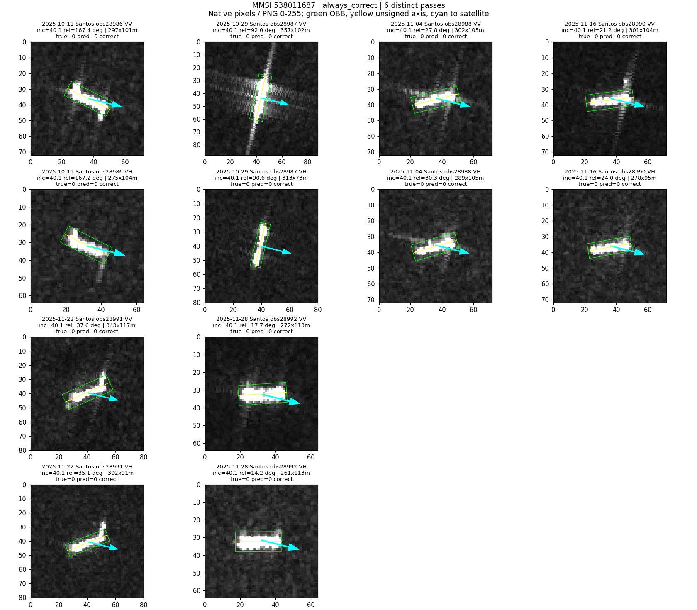
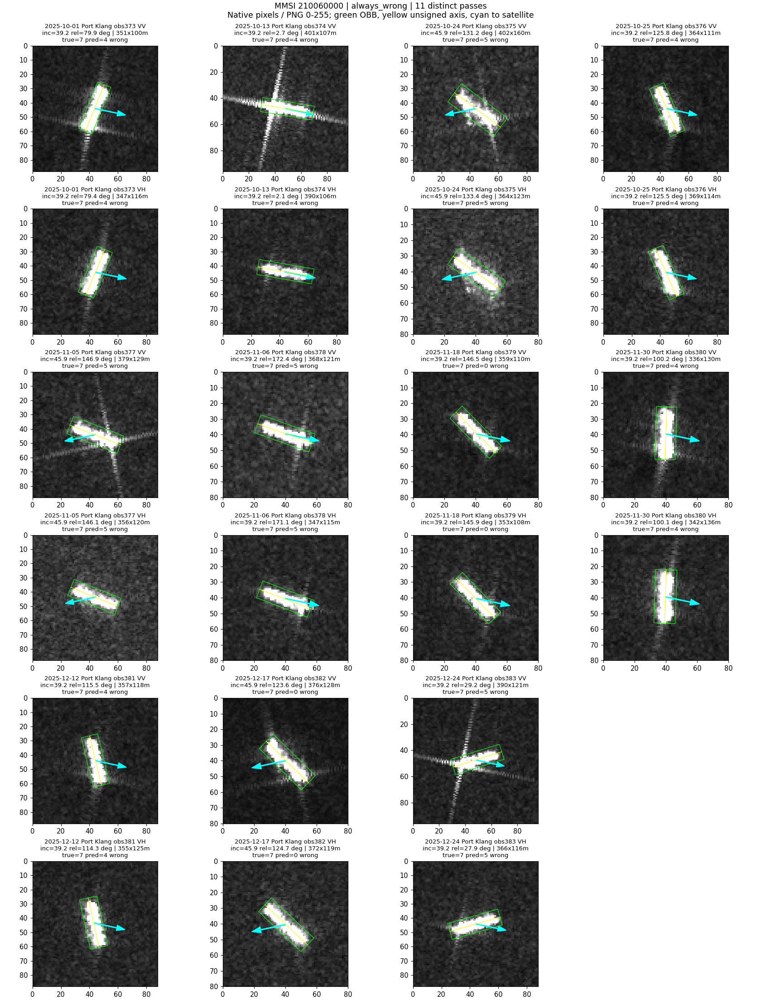
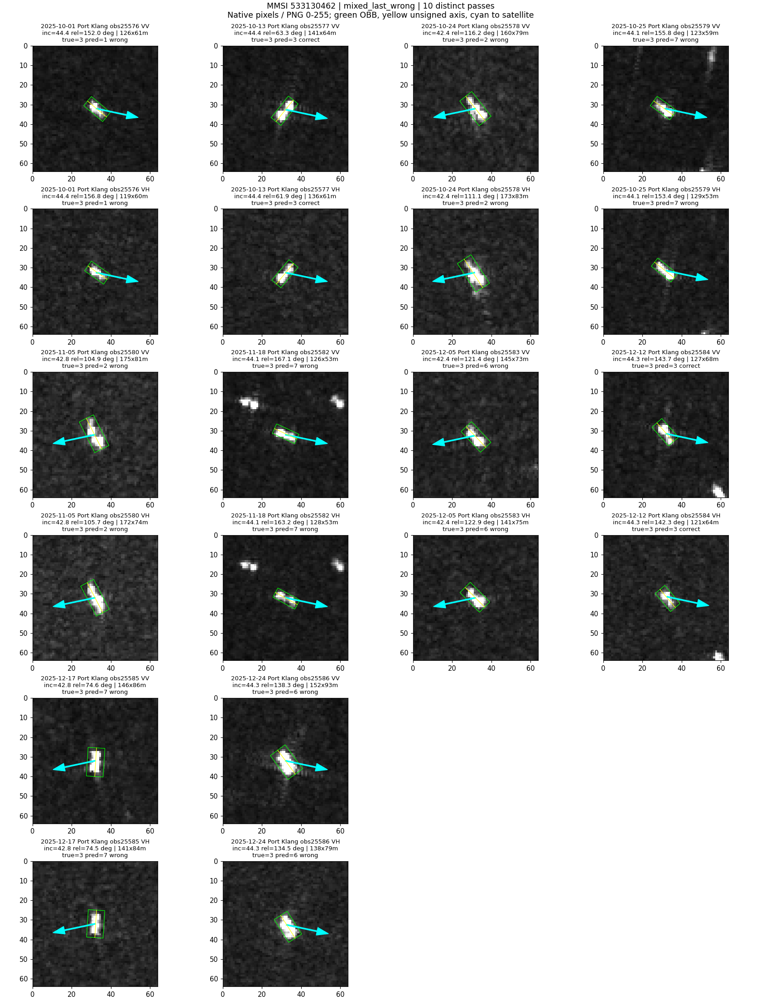
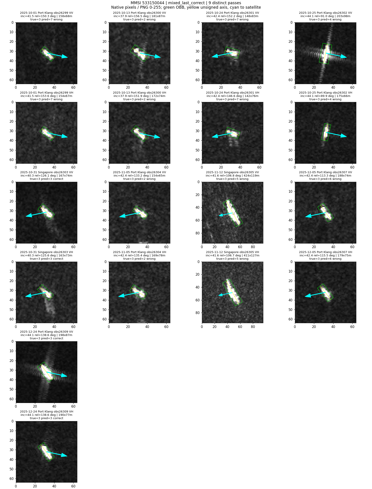

# 同船多时相：从两张对比扩展到完整观测序列

## 结论先说

用户指出的限制成立：上一轮每船只取一对，遗漏了已有的中间观测。本轮完成材料盘点，并将已核查队列中的120艘船展开为612次独立过境、1224幅VV/VH图像，每船4至11次。不是新增数据，也不是已完成全图库定量分析。

现在可以确认材料足够开展多时相研究；但尚不能确认简单的“相对角差越大，表观尺寸差就越大”。下一步应检验具体条件模式能否在留出观测和其他船上重复，而不是直接把所有变化当作需消除的干扰。

## 1. 材料到底有多少

| 范围 | 船数 | 说明 |
|---|---:|---|
| 现有重复观测图库 | 8900 | 28027条观测，不是原始数据全集 |
| 至少4次独立过境 | 2302 | 可扩展材料，未全部完成本轮定量核查 |
| 至少6次独立过境 | 735 | 不等于735艘都有完整几何与可靠目标关联 |
| 全图库最大次数 | 54 | 不是本轮已测量轨迹 |
| 已核查定量队列、至少4次 | 120 | 本轮实际分析612次过境，最多11次 |
| 本轮跨两个及以上港口 | 24 | 其余96艘同港多时相 |

本轮120艘：4次55艘，5次34艘，6次16艘，7次5艘，8次4艘，9次2艘，10次3艘，11次1艘。

平台+绝对轨道号+datatake定义过境，同一次过境相邻产品切片合并，VV/VH不作为两次。过境彼此不同不意味着完全统计独立；统计单位仍为船。原有MMSI关联及CRS假设继承，双极化中心互相落入唯一框只核查几何一致性，不独立证明身份准确。

队列来自24港语料，不是F_0921。实际覆盖6港：Port Klang302次、Jebel Ali161次、Los Angeles59次、Singapore49次、Santos26次、Richards Bay15次。船型为成品/化学品油轮64艘、原油轮19、散货11、集装箱10、海工7、杂货6、拖船3；无渔船。不能泛称24港全体规律。

## 2. 条件覆盖与尺寸变化

| 逐船统计，再取船间中位数 | VV | VH |
|---|---:|---:|
| 时间跨度 | 60天 | 60天 |
| 入射角最大差 | 2.58度 | 2.58度 |
| 船轴-雷达轴相对角最大差 | 81.44度 | 80.25度 |
| OBB最大长度/最小长度 | 1.233 | 1.236 |
| OBB最大宽度/最小宽度 | 1.352 | 1.366 |

118/120艘相对轴角变化达到30度；79艘入射角跨度至少2度，34艘至少5度。因此不是完全缺少角度变化。最大/最小比值随观测次数增多也会增大，不能与上一轮仅一对的变化百分比直接比较。

480幅复用上一轮测量缓存，744幅补读原图。没有旋转或缩放后重新测量，未使用模型预测筛选观测。尺寸是检测OBB在地面投影坐标中的表观尺寸，不是船舶登记长宽；亮度和对比度来自已有8bit PNG，不是定标RCS或后向散射。

## 3. 相近条件是否反复更相似

固定同船、同港、同平台、同升降轨且入射角差<=2度，再比较相对轴角差<=10度和>=30度。只有同一艘船同时拥有两类配对才进入比较。每船先求配对平均，再跨船等权，不把很多配对当很多独立船。

| 指标 | 可比较船数VV/VH | 远角度组差异减近角度组差异VV/VH |
|---|---:|---:|
| OBB长度绝对对数变化 | 27 / 32 | +0.0114 / +0.0055 |
| OBB宽度绝对对数变化 | 27 / 32 | +0.0154 / -0.0016 |
| 高响应长度绝对对数变化 | 25 / 30 | +0.0225 / +0.0088 |
| 高响应宽度绝对对数变化 | 25 / 30 | +0.0036 / -0.0263 |

所有按船bootstrap的95%区间均跨0。不能宣布远角度必然变化更大，也不能据此否认条件信息：本对照检验的是角差与变化幅度的简单关系，不是具体角度区间、类别和局部散射结构的全部交互。海况、速度、处理和测量误差也未固定。

这说明“120艘有多次观测”和“120艘都具有可比较的近/远条件重复”是两回事。高响应范围缺损继续标记无效，不以0填充。

## 4. 原图逐船回看

使用已有frozen_fivepoint seed0局部诊断分类器；不是图库旧R50/R18，也不是完整支持适配模型。120艘中8艘持续正确、32艘持续错误、80艘有对有错。该分布受本轮筛选和每船次数影响，不作为全数据准确率。

### 持续判对：538011687，散货船，6次

均在Santos；入射角约40.1度，船轴方向显著变化。2025-10-29 VV中船体附近纵横亮线明显，其他日期亮线分布和背景强度不同；6次仍都判为散货。VV表观长度272至357米。

证据：明显外观变化不必然导致分类失败。不能仅凭亮线外观将其判定为船尾、尾迹或某种确定物理效应。

### 持续判错：210060000，标注海工船，11次

均在Port Klang；纵横延伸亮线在部分日期突出，VV/VH的细节不同。预测在集装箱、原油轮、散货之间变化，11次均未命中标注类别。

证据：这不只是某一次不利角度导致的翻转；可能涉及持续类别混淆、表征或样本身份/类别信息，但本轮未定位根因，不能武断归因角度或改标签。

### 有对有错：533130462，成品/化学品油轮，10次

均在Port Klang。2025-10-13、12-12判对，其余错误。10-01、10-25、12-12都处于相近入射角和大致相似船轴方向，但分类结果并不相同；11-18可见额外亮目标，12-12边缘也有额外亮目标却判对。

证据：不能用“角度相近就一定一样”或“有其他亮目标就一定错”解释。分类器实际利用了哪部分证据，尚需固定图像的受控读出比较。

### 暴露出待核查异常：533150044，成品/化学品油轮，9次

覆盖Port Klang和Singapore。obs26305（2025-11-12）VV/VH显示的主体都显著长于该序列其他图：VV OBB约424米、VH约411米，其他VV约148至203米。前后几次的局部背景和延伸响应也变化。

证据：这是多时相展开才突出显示的结构不一致。双极化彼此一致不足以确认此图与该MMSI的历史观测属于同一个物理目标；可能是关联、尺度/测量或实际成像响应差异，尚未确定。保留原始记录，不自行删除或改标签，也不把这一跳变当成角度效应的正证据。该例需要回查原始AIS位置、目标框与源地理转换。

## 5. 下一步收敛到什么

先完成上述异常的定点核查，再以完整多时相轨迹检验可重复条件模式。具体应把每船最后一次真正留出，比较“该船此前平均表观尺寸”和“此前观测+条件关系”的预测；随后再留出整艘船，检查跨船迁移。不要使用未来观测计算该船标准化中心。

只有这些条件关系能解释留出变化、并且对应分类证据丢失，才推进条件化分类模块。本轮没有新增分类训练，也没有完成上述两种预测验证；不能宣布已经提高OA/BA，或已经证明因果因素。

本轮已完成：全图库过境覆盖盘点、120艘全部合格观测测量、逐船条件覆盖、近/远条件探索、4条完整原图轨迹及时间曲线。全部120艘逐次信息见cohort.csv和measurements.csv。脚本复用同级上一轮测量实现，独立目录不覆盖原结果。
