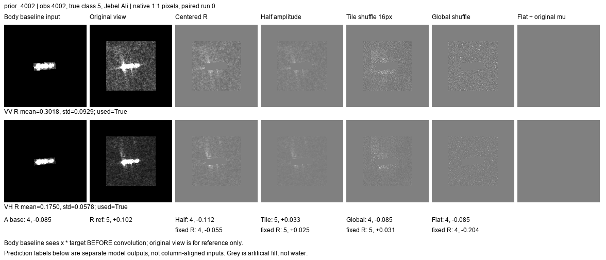
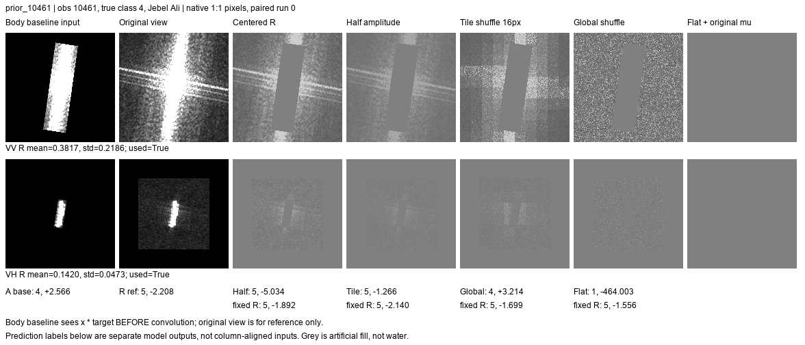

# 邻域通道的效用与原图旁路：2026-10-21

## 结论先说

用户指出的问题成立：**原模型继续读取未经改动的整张 chip，不妨碍检验新增通道的系统增益，但会妨碍用该实验单独判断邻域信息是否必要。** 因此本轮保留旧轨道，另加卷积前框内输入的机制轨道；两条轨道的模型、基线和结论分开，不覆盖旧结果。

新增严格框内对照已完成。框内基线 OA **32.610%**、BA **37.231%**；加入原始邻域通道后 OA **35.406%**、BA **38.658%**。三次配对训练的 OA/BA 均提高。保留邻域直方图、打乱局部排列后，配套重训只能得到 OA **33.242%/33.115%**。这支持：**在当前冻结表示和训练协议下，邻域中存在均值及整体亮度分布之外的可利用信息。** 尚不能将其命名为尾迹、海况或特定散射机理，也不等于发现了跨场景不变特征。

较强整图基线上的 OA 仍是 **40.964% → 41.512%**，BA **42.565% → 42.707%**。不能把较弱框内诊断基线上新增的 2.797 个 OA 百分点，冒充完整主模型的新增收益。

## 两条轨道分别回答什么

| 轨道 | 冻结基线能看什么 | 新增通道 | 能回答的问题 |
|---|---|---|---|
| 系统增量 | 未改动的整张 native chip，沿用较强 keep_refs | 独立邻域读出加到旧分数上 | 旧模型已有整图信息时，专门读邻域还能否补益 |
| 框内机制 | 给定 PNG 与检测框后，先 `x * target`，再进入卷积；分类头也用这种输入训练 | 独立邻域读出，重新针对该框内基线训练 | 关闭原始框外像素旁路后，邻域通道是否提供补充 |

不是把整图训练的模型在测试时临时遮住背景。框内基线复用之前配套训练的 `body_global`，其分数与旧存档重放一致；新增残差头重新训练，没有借用整图轨道的残差头。框内基线仍保留检测框长宽和有效画布几何，本轮关闭的是**给定 PNG、掩膜下的框外真实像素值通路**，不是声称消除了数据生成过程的一切上下文影响。

两种基线的结构/读出强度不同，因此不把 40.964% 与 32.610% 的差值全部归因于框外信息。

## 实际数据与管线

- 来自24港历史实验队列；实际测试 **4,744条观测、2,973艘船、18港、8类**。不是 F_0921，也不是两个公开集的扩展结果。
- 沿用三身份折与日期隔离的源训练/源验证/目标测试；不是严格留港。源训练早于2025-09，源验证2025-09，目标测试从2025-10开始；当前与旧框内基线的18,888条划分记录完全一致。
- 这是已经多轮使用的开发队列，尚无新采集独立确认。三次结果不是三组独立测试数据。
- VV/VH分开；原生160像素裁剪/补零，不缩放；排除已确认问题观测31237，保留既有冲突视图处理。
- `R` 是有效chip区域去掉已接纳目标框及其他检测框，不保证是纯海水，不保证没有漏检的船或目标延伸。
- 邻域输入为 `0.5 + 0.5*(x-mu_R)*R`；非R为人工灰色填充。冻结R50浅层stem、C4处理、R掩膜均值/最大池化；VV/VH共256维，再加原邻域均值和可用性共260维。
- 残差头260→32→8，GELU，8,616参数，末层零初始化。源端加权MSE、150次更新，同初始化/批次预算；源验证按BA、Brier从0/50/100/150步选择，0步表示保留基线。
- 新提取8组变换特征，覆盖15,252队列行、29,034可用极化视图。全量检查置乱数值多重集、格内直方图、非R填充、native尺度；原始描述子重放仅首批，不称全队列重放。
- 整图轨道36个新头，框内轨道45个新头，另做对应固定头输入替换。所有81个选中模型已重放，按原GPU全队列计算路径分数误差0，选步全部符合源验证规则。

## 四种变换不能混为一谈

| 输入 | 保留 | 改变 | 解释边界 |
|---|---|---|---|
| 原始R | 均值、变化、局部排列 | 仅既定中心化编码 | 参考 |
| 幅度减半 | 排列、均值槽、全部可逆信息 | 编码偏差减半 | 不是删除信息，检验固定非线性编码/读出的适配 |
| 格内置乱 | 每个16×16格的直方图、整体直方图、掩膜 | 格内R像素位置 | 不是交换格子，也不是抹去所有纹理 |
| 全R置乱 | 整体直方图、均值、掩膜 | R内像素位置及局部分布 | 会引入人工边缘，不是物理场景干预 |
| 全常量flat | 原始均值槽、可用性、R池化掩膜 | 编码图全0.5 | 仍有掩膜/边缘响应，不能称纯均值或纯常数模型 |

三次置乱由观测ID、极化、运行种子确定，不读取类别或结果。每种变换既做固定头替换，又做配套源端重训。固定头下降只说明依赖；配套重训仍下降才支持该表示/训练预算下的实用信息损失，仍不构成唯一物理归因。

## 框内机制结果

下表为三次配对运行平均，单位%。

| 方法 | OA | BA | macro-F1 |
|---|---:|---:|---:|
| 冻结框内基线 | 32.610 | 37.231 | 29.952 |
| 加原始R | **35.406** | **38.658** | **32.149** |
| 幅度减半，配套重训 | 34.823 | 38.573 | 31.981 |
| 格内置乱，配套重训 | 33.242 | 37.597 | 30.603 |
| 全R置乱，配套重训 | 33.115 | 37.398 | 30.208 |
| flat，配套重训 | 32.715 | 37.065 | 29.856 |

原始R相比框内基线：OA **+2.797个百分点**，BA **+1.427个百分点**，三次净正确数增加 **141/156/101**。按类别分层、MMSI聚类配对bootstrap1500次，OA差区间 **[+2.053,+3.582]**、BA差区间 **[+0.639,+2.234]**。这些区间以已训练模型为条件，不能覆盖新采集、重新训练或模型选择的所有不确定性。

原始R若换成源训练样本的平均残差，OA只有 **33.263%**、BA **37.118%**。因此观察到的全部收益不能由统一类别偏置解释；实际样本相关读出另有作用。这仍不区分均值、局部形态、掩膜及其他信息的全部贡献。

配套重训后，格内/全R置乱相比原始R分别少 **2.164/2.291个OA百分点**；其配对区间均在零下。即便整体直方图不变，当前模型仍损失大部分原始R增益。幅度减半保留大部分收益，不应把它解释为幅度从未有用。

但格内相对全R置乱仅 **+0.126个OA百分点**，区间 **[-0.389,+0.640]**，BA差也不明确。**当前更支持原始局部响应/排列有实用价值，不支持已验证跨格长程几何关系。** 固定头时格内优于全局的差距更大，配套重训后缩小，不能忽略重训结果只讲固定头。

类别边界：原始R对散货船、成品油/化学品船、集装箱船召回分别约增加 **5.01/3.06/4.05个百分点**；原油轮约+0.33，渔船约-0.69，海工类约-3.41。接受有限范围净收益，同时保留损失，不包装成所有船型受益。完整逐类和各次结果在 `body_only/class_recall.csv` 与 `summary_by_seed.csv`。

## 较强整图系统结果

| 方法 | OA | BA | macro-F1 |
|---|---:|---:|---:|
| 冻结整图基线 | 40.964 | 42.565 | 37.993 |
| 加原始R | **41.512** | 42.707 | **38.460** |
| 幅度减半，配套重训 | 41.062 | 42.751 | 38.276 |
| 格内置乱，配套重训 | 41.182 | 42.604 | 38.155 |
| 全R置乱，配套重训 | 41.020 | 42.611 | 38.116 |
| flat，配套重训 | 41.076 | 42.624 | 38.105 |

配套重训后各变换的OA仍低于原始R，但BA差异较小且多数区间跨零。格内/全R差 **+0.162个OA百分点**，区间跨零。原始R换源平均残差OA为41.217%，说明一部分系统增益可以由统一修正取得。保留原始R的有限OA收益，不将两轨道的增幅相加，也不宣称已经接入完整双骨干/支持适配主模型。

## 原图回看：看到了什么，不能说什么

本轮生成整图轨道6组、框内轨道8组native面板。已逐一查看框内8组，并查看整图轨道2952、10461、12646、31472；各图VV/VH分列于上下两行。原图路径、obs、seed、分差见 `case_index.csv`，折和实际选步见 `case_selected_steps.csv`。首列框内输入展示掩膜确实在卷积前起作用；灰色为人工编码填充，不是海面。

以下均是框内轨道seed0的真实预测，分差是真类减最大错类，非概率：

| 案例 | 图像可见事实 | 实际模型证据 | 能下的结论 |
|---|---|---|---|
| 4002，原油轮 | VV/VH框内为近横向亮结构；VH框上方另有延伸亮响应 | 框内误判集装箱，分差-0.085；原始R正确+0.102；格内置乱重训仍正确+0.033 | 邻域能补益此例；不能据此定位是哪条亮线或断言尾迹。全R重训选择0步，不能把其退化全部归为某处像素 |
| 10461，集装箱 | VV有很长亮结构及横穿其附近的多条亮纹，延伸到画布边缘；VH目标明显更紧凑 | 框内正确+2.566；原始R误判原油轮-2.208；格内仍错，全R重训正确 | 原始邻域也会误导；不是越多细节越好。flat异常另见下节，不能用异常幅度解释图像物理 |
| 9505，原油轮 | 斜向紧凑目标，VH下方有离散亮斑及局部亮变化 | 框内正确+0.101；原始R错为散货-0.158；格内/全R/flat重训回到正确 | 三者此折均选0步，实际是拒绝附加修正，不是证明学到了更好的空间规律 |
| 13466，散货 | 近横向小亮目标，框外上下有细长/离散响应；VH下方较明显 | 框内错为成品油/化学品-0.034；原始R救回+0.155；两种置乱重训回到错判 | 原始邻域可救回；本例配套置乱头为0步。固定原头置乱也改变预测，说明读出依赖，但未定位唯一物理原因 |
| 26936，散货 | 小目标，VH下方有较明显纹理延伸 | 框内与各配套重训均正确，原始R分差0.184→0.262；固定原头两种置乱会判错 | 固定头依赖不等于重训不能恢复；不能只用固定干预推断必要性 |
| 9450，普通货船 | 框内只占少量亮像素，周围响应弱 | 框内及原始R持续误判拖船，分差-0.178→-0.160 | 当前通道未解决此类混淆；外观不足以认定真实原因 |
| 22543，原油轮 | VV目标附近明显十字状亮纹，VH延伸较弱 | 框内和原始R均正确，分差0.206→0.343 | 不是本轮救回或误伤。不能沿用其他基线的旧案例标签 |
| 2952，普通货船 | 显示很暗，目标很小，VH有细弱延伸 | 框内和原始R都错为渔船；整图强基线却能被R救回 | 同一邻域效果依赖基线已有证据；不能把不同轨道的案例作用互相挪用 |

整图轨道12646有框外十字状细亮纹但始终正确，原始R略降分差；31472目标很小、持续错为拖船。看见结构与证明该结构有类别效用不是一回事。当前分类头不使用查询支持案例，故本轮没有可展示的“实际支持船”，不虚构支持机制。

## flat异常、验证与事后敏感性

固定常量图仍经过卷积边缘处理和样本相关R掩膜池化。10461的VV区域达到画布边缘；flat读出第87维在源端近常量，标准差下限1e-5，而该观测偏离源均值约1.20，标准化后约119,751。整图轨道有两次、框内轨道三次该样本分数绝对值大于10，均来自flat；其余原始/半幅/置乱配套头没有此问题。

这说明flat不是干净的“只剩均值”对照，且该源标准化会放大边缘异质性。**原始结果全部保留，没有按测试标签修参数或删样本。** 只追加10461剔除敏感性：框内flat OA32.715%→32.722%、BA37.065%→37.074%，整体结论不变；整图flat也只变约0.002/0.004个百分点。`outlier_sensitivity.csv`明确标记事后口径，不替代主表。

初次CPU重放因float32取消误差超过绝对阈值而中止，最明显发生于flat极端分数。没有简单放宽门槛判通过：改为按原始同批量GPU路径重放，81头误差均为0；CPU预测类别也全部一致，CPU数值差另存 `verification.csv`。该验证修正不改训练或指标。

提取启动时另遇系统提交内存不足，torch导入WinError1455。用户保存并关闭SARlabelimg后重试完成。它是资源故障，不是模型负结果；未终止其他研究任务。提取约596秒，36头/45头训练分别约45/37秒，仅本机运行记录，不含完整部署成本。

两份独立只读审阅已归档。审阅发现reference选步被记为0的元数据问题，训练前已修正；框内图首列展示和fixed头命名已补清楚。审阅当时未完成的运行检查，以本轮 `VERIFICATION.json` 最终回执为准。

## 收口与下一步

保留两条轨道：整图主模型负责验证实际增益，框内隔离对照负责检验补充信息。**没有必要为了分工好解释，就现在强行把较强主模型改成只看框内。** 若未来正式采用框内/邻域分工，还需与同等容量、配套训练的整图方案比较。

目前值得保留的证据是：邻域样本相关读出有用，原始局部排列在这一模型族中比仅保留亮度统计更有效，且收益并非全由统一类别偏置解释。当前未证明：雷达几何必要、远距离区域关系有效、可识别的物理机制、完整支持适配增益或新采集泛化。

下一次若继续模块设计，应优先检查可用的局部组合如何被读出、哪些条件使它误导；不因为这次置乱退化就直接上复杂几何卷积。无需本轮继续扩模型或搜索新倍率。原始/负结果与适用边界一并归档。
