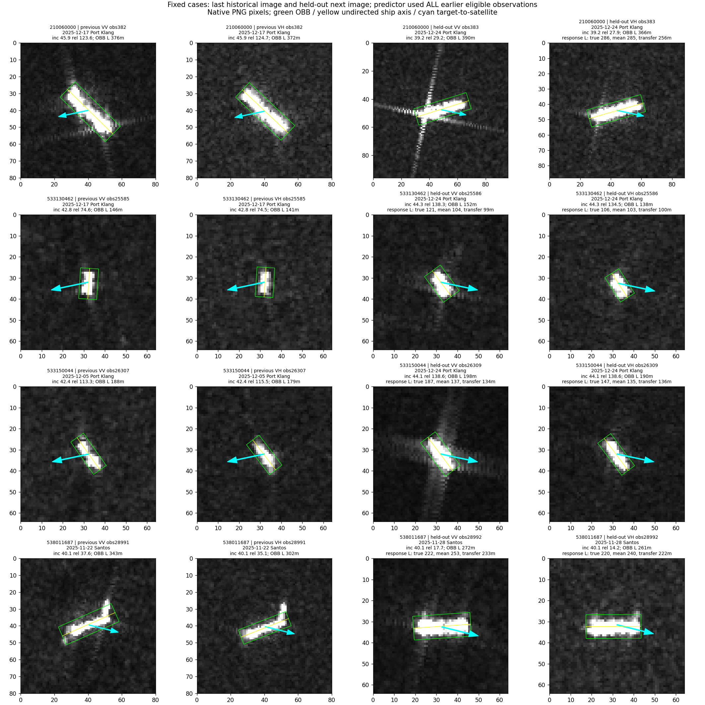

# 前几次观测能否预测下一次，并迁移到其他船

## 结论

有可保留的局部正信号：条件关系对“高响应区域沿船轴的长度”有预测帮助，VV较明确；不是所有长宽都有效，更不是分类精度已经提升。

本轮120艘、612次既有过境，每船固定最后一次作查询。OBB尺寸评价120艘；高响应尺寸要求查询有效且至少3次有效历史，VV/VH分别114艘。缺失时没有换一个更容易的查询。数据仍来自24港语料中的6港/7类既有开发队列，不是新增独立确认集。

## 1. 两个问题分别怎样验证

**同船下一次**：用该船前3至10次观测，学习表观尺寸与入射角、相对船轴方向的关系；最后一次尺寸隐藏，只给它的观测条件。比较历史平均和最近一次两条基线。

**跨船迁移**：按MMSI固定5折，拟合条件斜率时排除整折船；每个查询只使用其他折中早于查询时刻的源观测，并排除查询过境。每次拟合有34至96艘源船。先在源船内部减去各自平均，学习“条件变化对应多少尺寸变化”，避免直接记住某艘船本来更长。

迁移到查询船时，只用其已有历史确定参照大小，不用它来学习条件斜率。形式为：

`预测log尺寸 = 该船历史平均log尺寸 + 学到的条件斜率 × (当前条件 - 该船历史平均条件)`。

这叫未见船、但有历史参照；不叫一张陌生chip的零样本尺寸预测。当前方向由当前图像检测得到，是“当前条件已知、当前尺寸留出”的预测，不是提前预报未来船向。

## 2. 定量结果

下表为相对历史平均基线的log-MAE下降百分比。正值更好，负值更差；不是OA/BA百分点。

| 留出预测目标 | 同船条件模型VV | 同船条件模型VH | 跨船完整条件VV | 跨船完整条件VH |
|---|---:|---:|---:|---:|
| OBB表观长度 | +6.05% | +4.09% | +1.90% | +5.00% |
| OBB表观宽度 | -2.91% | +3.02% | -3.83% | -5.94% |
| 高响应长度 | +6.06% | +4.49% | **+12.03%** | +7.90% |
| 高响应宽度 | -1.66% | +1.31% | +0.96% | -3.40% |

同船表中使用下述固定尺度修正版，是首轮后针对性修正，不能冒充完全事前冻结结果。所有原始失败结果也保留在predictions.csv和summary.csv。

高响应长度不是船舶真实长度：它是目标参考点周围固定180米圆盘内、超过固定背景阈值的响应，沿检测船轴投影的加权5%-95%范围；排除其他有效检测框，要求覆盖合格。里面可能含目标散射延伸及其他响应。

### 正信号集中在哪里

- VV高响应长度：历史均值log-MAE **0.159655 → 0.140453**，下降12.03%；114艘中75艘改善、39艘退化，5个留船折平均收益均为正。
- VH同项：0.158910 → 0.146362，下降7.90%；67艘改善、47艘退化，仅3/5折均值为正，证据弱于VV。方向项而不加入入射角时下降8.86%，仍保留不确定性。
- 不只是时间或平台信息：相对“时间+平台+升降轨”模型，完整几何使VV高响应长度误差再下降11.12%，VH下降6.55%。方向分支单独也有作用，VV相对历史平均下降9.87%。
- 最近一次本身是较弱基线。即使只以最近一次为参照，迁移几何仍使高响应长度误差下降VV10.71%、VH9.23%；但它并不因此优于利用全部历史均值的方案。
- 从训练及评价中同时去掉上一轮已标记异常的533150044，VV完整几何收益仍12.23%，VH7.86%。收益不是那一条已知异常独自支撑的。

### 可靠性与边界

按船配对bootstrap10000次，VV高响应长度完整条件模型的平均log误差收益95%区间为[0.00612,0.03207]；按查询过境分组bootstrap为[0.00129,0.03445]。26个查询过境中18个均值正，去掉任意单个查询过境，剩余平均收益仍为正。

VH同项按船区间[-0.00172,0.02657]，按过境[-0.00102,0.03079]，均跨0。不能把VV与VH说成同等稳定。这些区间基于固定预测，不包含重新拟合、模型选择及新数据集的全部不确定性。

分类型探索：VV高响应长度在散货、杂货、成品/化学品油轮、集装箱和海工均值为正，在原油轮与拖船为负。部分组只有3至6艘，不据此制定类别开关；本轮真实类别只用于事后分组，不输入预测器。

## 3. 单船模型首次为何严重退化，怎样纠正

首次按每艘船历史标准差缩放条件，出现极端外推，不应误判为“条件关系不存在”。

例249838000，前三次入射角45.211、45.214、45.219度，标准差仅0.00334度，最后一次37.816度。模型却从极小历史波动拟合斜率，入射角一项对log宽度预测贡献-21.665，导致不可能的尺寸预测。

这属于窄条件覆盖下的缩放/外推设计问题，而非查询尺寸泄漏。针对性修正：入射角固定以5度为单位，sin/cos以1为单位，保持正则系数1，不搜索倍率、不裁剪输出、不删除出错船。原逐船单位方差化模型和新固定尺度模型并列保留。修正后极端问题解除，VV长度两个指标出现约6%的净收益，其他指标并未全部变好。

因此合理设计不是为每船自由拟合复杂函数，而是有限历史下受约束地学习，并利用其他船提供的共享变化规律。

## 4. 固定原图案例回看

本轮没有依据新预测挑案例，沿用上一轮已固定的四艘。下面对比的是高响应长度测量及预测，分类结果仍是旧frozen_fivepoint seed0，未重新训练。

| 船/最后观测 | 极化 | 实际测量 | 历史平均预测 | 跨船条件预测 | 现象 |
|---|---|---:|---:|---:|---|
| 538011687 / 28992 | VV | 222m | 253m | 233m | 改善 |
| 同上 | VH | 220m | 240m | 222m | 改善 |
| 210060000 / 383 | VH | 286m | 285m | 256m | 误修正 |
| 533130462 / 25586 | VV | 121m | 104m | 99m | 退化 |
| 533150044 / 26309 | VV | 187m | 137m | 134m | 退化 |

538011687：最后一幅主体更接近图像水平，沿轴高响应范围比历史平均短。条件模型预测向较短方向移动，与测量一致；这艘船原分类器一直判对，所以本例证明统计预测改善，不证明救回分类错误。

210060000：最后一幅VV有明显纵横延伸亮线、VH较紧凑；VH实际长度基本等于历史平均，条件模型却将其缩短。几何不是充分条件。VV高响应测量因覆盖条件不合格未纳入，不补造结果。

533130462：最后一幅的高响应范围比模型估计长，VV/VH条件修正都朝更短方向，使预测更差。仅凭最后图的形态和观测角度，无法确认具体物理原因；应保留为共享条件关系的失败样本。

533150044：此前异常长观测26305仍保留；最后一幅VV有明显局部延伸响应，预测不足。单船异常需要另行核查，不能靠这组图片就判定角度导致或错标。全队列去除此船后的敏感性结果已单独报告。

## 5. 现在能说与不能说什么

**能说**：在本轮有限多时相队列中，观测条件包含可用于预测下一次高响应长度的统计信息；部分共享关系能迁移到未参与斜率拟合的船，VV表现较明确。它比上一轮只看一对之间的相关更进一步。

**不能说**：已经恢复真实船长、分离纯因果因素、解释全部成像差异或提高分类OA/BA。相对角和沿船轴长度共用检测轴，测量定义本身存在耦合；目前是PNG统计关系，不是经定标SAR物理规律。队列被用于多轮开发，折内留船不等于全新独立确认。

下一步可保留“条件帮助解释局部纵向响应”这一有收益边界的方向。接入分类时应把条件关系用于解释局部证据，不能直接统一扣除长宽；先以固定有效读出为基线，检验这部分关系是否改变正确类与混淆类证据。若只改善统计预测而不改善类别关系，就留作机制辅助，不强行包装成分类模块。

## 验证与文件

948份源拟合材料清单核查通过；16776条方法预测（含敏感性与各指标，不是独立样本数）重放最大误差1.78e-15。查询指标不参与预测计算、整折身份排除、源时间早于查询、查询过境排除、每船权重、汇总结果均通过检查。没有改变主模型、原图、标签或既有结果。

`summary.csv`包含全部正负结果与三种基线；`predictions.csv`逐船可追溯；`fit_manifest.json`保留源观测ID和系数；`stratified_gains.csv`与`query_pass_uncertainty.csv`保留分层和过境分析；`fixed_case_predictions.csv`提供上述原图对应的所有预测。运行次序为run.py、finish.py、strata.py。
