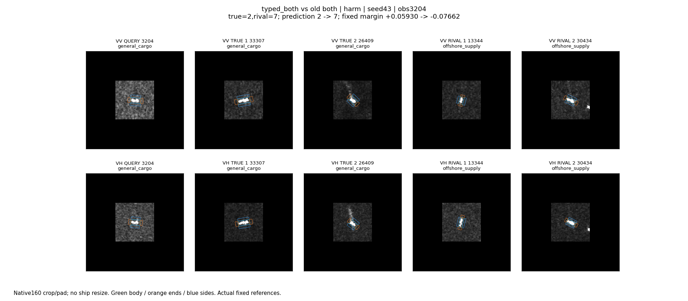
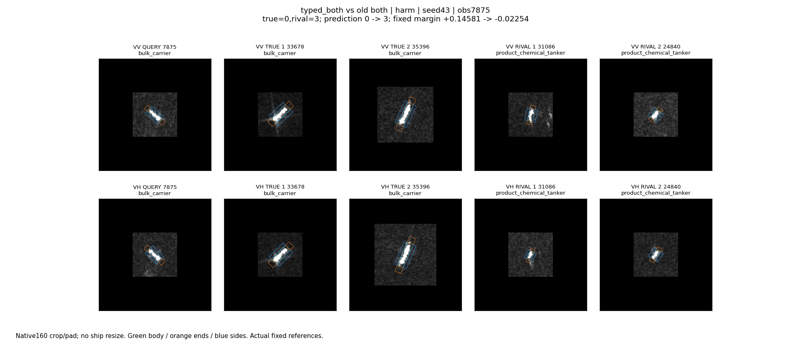
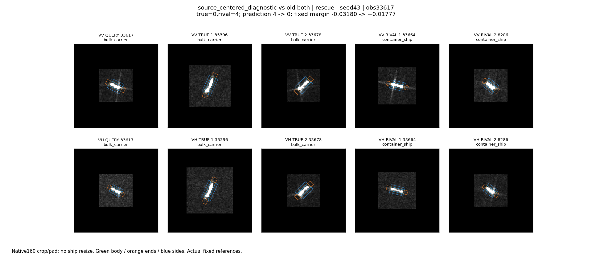
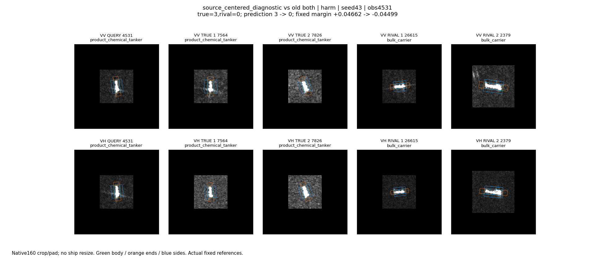

# 原始chip及实际参考回看

2026-10-25。主代理实际查看以下12组图，每组VV/VH分开，包含查询与该模型实际使用的两个同类、两个混淆类参考。保持原生160裁剪/补零，不缩放船体。图的绘制放大仅用于阅读。框内/侧向/轴端为模型区域，不是像素物理来源的严格分离。

查询、参考的原文件路径、OBB、placement、类别分数、种子和固定模型干预记录在 `analysis/cases.json`、`analysis/error_cases.json`、`analysis/bias_cases.json`。以下事实来自原图，数值来自保存的预测；物理机制不由外观强行命名。

## 全部五个新误伤，seed43

| ID | 真实类 -> 新错类 | 固定混淆类分差：旧 -> 新 | 实际参照现象与模型定位 |
|---|---|---|---|
| 3204 | 普通货船 -> 海工补给 | +0.05930 -> -0.07662 | 查询短小、VV/VH周围显示纹理较亮；同类与异类参考都有短亮结构。VV框内修正条件效应-0.08096，撤回它恢复普通货船；VH框内也负向，但单独撤回未恢复。不能只据明亮背景认定海况或背景因果。 |
| 7085 | 散货船 -> 集装箱船 | +0.00418 -> -0.03319 | 查询VV亮区较宽、VH较细，实际两类参考同样可见长亮条。旧分差极小，VV框内和两侧修正等共同推过边界；没有单个区域撤回就恢复。VV/VH频带+协方差块在此反而略有利，不能统一归咎频带。 |
| 7875 | 散货船 -> 化学品船 | +0.14581 -> -0.02254 | 查询两极化均为较细亮条，短于两个散货船参考；混淆类参考更短紧凑。VV框内效应-0.09675，VH框内-0.04720，各自撤回均恢复；将VV类别响应矩或VV带+协方差换成源均值也各自恢复。单改K或T不翻错，联合才翻错。不能把像素长度比较直接等同真实船长机制。 |
| 23397 | 普通货船 -> 拖轮 | +0.01102 -> -0.02376 | 查询短宽，两类参考都含类似短亮结构；一个拖轮参考框外还有孤立亮点，仅凭图不能命名成临船。VV/VH框内效应分别-0.01572/-0.01961，单独撤回均不足以恢复。只改K评分即可误伤。 |
| 27445 | 散货船 -> 化学品船 | +0.01058 -> -0.03134 | 查询中等长度，VV边缘有局部离散亮响应、VH较细；同类参考长度跨度明显，混淆参考也有细长亮条。VV框内及两极化侧向为负，VH框内略正；多项共同作用，不能用单个频带或背景规则解释。 |

这些是本轮全部5例新误伤，不是从大量错误里挑出的五例；但它们只代表本轮开发队列、seed43的特定更新，并非所有SAR数据的错误比例。

区域效应的定义：固定当前模型，把一个极化/区域的全部类别局部E/m换回旧模型值，观察真实类与实际混淆类分差的变化。它是条件干预，不可简单求和为独立贡献，也不是原图遮挡或重训消融。

## 持续正确与错误

- **19378，seed43，新both持续正确渔船。** VV仅小亮点，查询VH缺失；真实与异类参考也有短亮点。分差3.54359降到3.48783，类别未变。VV框内修正负向约-0.03844，但离边界远。缺失VH效应严格为零，未伪造另一极化贡献。
- **20554，seed43，新both持续把普通货船认作散货船。** 查询VV/VH是长亮目标，实际散货船参考也较长，同类参考相对较短。分差-1.40168到-1.40553，新增修正不足以改变强混淆。VV框内为负、VH轴端略正；外观相似不能证明模型仅按尺寸分类。
- **18767，seed29，transport回退后的持续正确渔船。** VV弱小响应、VH缺失；分差3.78866不变，区域干预效应为零。用于如实说明源端回退，不算新模块生效。
- **20820，seed29，transport回退后的持续错误化学品船。** 两极化亮条，散货船和化学品船参考均有类似表现。分差约-0.00037但未修正，说明接近边界也不自动产生收益；此种子选择的更新为零。

## 对照和事后诊断中的救回

- **13387，seed29，旧both继续训练对照。** 化学品船从普通货船救回，分差-0.01373到+0.00062。两极化均短亮，实际两类参考相似。这是旧模型继续训练的收益，不归给新分频描述；该对照三种子整体仍略退化。
- **33617，seed43，源均值扣除诊断。** 散货船从集装箱船救回，分差-0.03180到+0.01777。查询与两类参考均为长亮条，VV局部外围有细条响应，VH更集中。改变来自源端估计的类别分数偏移扣除，没有新增局部特征，不能讲成新频带找到了物理船型线索。
- **4531，seed43，同一扣除诊断新增误伤。** 化学品船转散货船，分差+0.04662到-0.04499。两极化均为直立亮条，真实参考显示对比度、大小不同，散货船参考也有亮条。该操作把部分散货船救回的同时损伤其他类别，证明简单均值扣除不是完整修复。

## 能留下的解释

已确认：五例误伤由本轮M3改动引起，旧头冻结；VV框内证据路径对五例分差都不利，但其他区域和新描述块的效应有正有负。类别整体偏移解释部分损失，但扣除后依然净退化。持续错误长亮目标没有因微小修正而被救回。

尚未确认：显示亮度、船体长度、邻域纹理或某种物理散射机制是否是可迁移的决定因素。当前只证明模型的条件作用路径和类别竞争结果，不用这些图强行补出物理故事。
