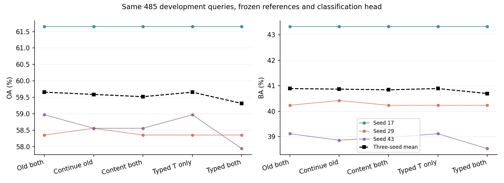

# 旧 both 保留式 M3 修正：完成，尚未超过旧版

2026-10-25。12 次训练及后续诊断完成。**旧主模型不替换；新修正版作为负结果与机制诊断保留。** 不把本轮结果推广成频域信息无用，也不把源端收益当成目标识别收益。

## 1. 这一轮具体改了什么

上一轮新 M3 使用独立的新增分类头，初始度量下该头已带来主要退化。本轮不再训练新分类头：冻结 M1、M2、旧 both 度量和旧证据读出，只训练 820 参数的局部度量修正。旧版继续训练对照为 640 参数。

新描述在旧版完全相同的 20 个硬槽位重新读取；VV/VH、框内/轴端/侧向、细/中/低尺度分别处理。91 维描述包含 PCA32 内容、24 维类别响应矩、3 维原图带响应统计和32维内容-带响应协方差。它们用来调整旧32维内容的比较权重，而非另造一套独立类别分数。

对查询槽 i 和参考槽 j，先分别投影到4维，再以均值、绝对差和类型嵌入预测有界权重修正。三个频带修正平均：

`w1 = w0 * (1 + 0.25 * mean_band(tanh(g(query, reference, type))))`

`K1 = weighted_cosine(old_content_query, old_content_reference, w1)`

- transport：K1 只用于求对应 T1，计分仍用旧 K0。
- both：T1 和 K1 同时用于计分。
- 两者均由旧分类头读取相同的区域匹配证据 E 与匹配质量 m，不新增分类头。
- 末层零初始化精确回放旧 both；缺失极化、区域和空槽不贡献新修正。

频带仍是原有显示图上的 `I-G1 / G1-G2 / G2`，不是新增原始复数 SAR，也不声称分离出了纯物理因果因素。内容/频率相互作用是候选描述，是否有分类效用由实验决定。

## 2. 固定协议与结果

沿用自建24港来源的开发队列：源训练644、源选择612、开发查询485；开发查询涉及445艘船、29个过境组、14港。另有64个**源参考**，每类8个，每查询每类固定检索2个。不是64个目标标签的新实验，也不是F_0921或公开集扩围。队列已多轮开发，不是独立确认集。

四组乘三个种子17/29/43。每组100次更新、批量32、微批8，源抽样完全配对，分类头冻结。仅按源选择集 `(OA+BA)/2` 选0/20/40/60/80/100步，平局保留更早版本；全部检查点冻结后才读取开发结果。

| 方法 | 三种子平均 OA % | BA % | NLL | Brier | 选择步数17/29/43 |
|---|---:|---:|---:|---:|---|
| 旧 both | 59.656 | 40.892 | 1.202405 | 0.549155 | 原保存版本 |
| 旧 both 继续训练 | 59.588 | 40.869 | 1.203696 | 0.549661 | 0 / 20 / 40 |
| 仅内容修正 both | 59.519 | 40.843 | 1.202873 | 0.549410 | 0 / 0 / 40 |
| 新类型证据，只改对应 | 59.656 | 40.892 | 1.202405 | 0.549155 | 0 / 0 / 0 |
| 新类型证据 both | 59.313 | 40.697 | 1.205549 | 0.550571 | 0 / 0 / 80 |

新 both 平均 OA -0.344pp、BA -0.195pp。seed17/29回退旧模型；seed43为0救回、5误伤。只改对应的持平来自源端回退，不能讲成“非零新模块成功保住性能”。旧继续训练seed29有1例救回，seed43有2例误伤；仅内容seed43有2例误伤。

29过境组、2000次配对簇bootstrap，先在每查询内平均三个种子的正确性差。新both相对旧版OA差区间[-0.606,-0.122]pp；BA差[-0.346,-0.057]pp，BA只统计包含全部8类的1742次抽样。这是本开发队列内的条件性不确定度，不是新数据集或训练随机性的充分估计。

## 3. 不只是“没有涨点”：定位到了什么

### 学到了源端有效的修正，但完整系统没有受益

seed43新both在源训练集7救回/3误伤，源选择集7救回/2误伤，目标开发集0救回/5误伤。分类头和原度量均冻结，因此本轮退化不能再归因于“新分类头自身改变了决策”。

源选择集7个救回中，6个是化学品船、1个是海工补给；同时误伤1个散货船、1个渔船。源选择集化学品船198/612，目标67/485。**不只是比例改变：同类错误的分差位置也不同。**

| 化学品船 | 源选择 | 目标开发 |
|---|---:|---:|
| 样本数 | 198 | 67 |
| 旧模型错误数 | 84 | 27 |
| 旧错例分差位于[-0.1,0) | 8 | 0 |
| 新版使旧错例分差改善 | 54 | 19 |
| 最终救回 | 6 | 0 |
| 全类平均真类-最强混淆类分差变化 | +0.01615 | +0.01710 |

**19/27个目标化学品船错例的分差改善，却仍未跨过决策边界。** 这保留了“部分连续判别变化有效”的信号；同时，5个原本正确的散货船/普通货船跨到了错误一侧。故不能把结果概括成所有新信息都未迁移，也不能用分差改善掩盖净误伤。0.1只是事后描述分差覆盖的分箱，不是训练或推理阈值。

### 对应和评分都能改变决策，评分影响更广

固定seed43已经选定的both权重、原头和数据，拆开K/T作用：只更新T为0救回/2误伤，只更新评分K为0/4，联合为0/5。3204、23397只改评分即可出错；7085、27445单独任一路均可出错；7875需要两者共同变化才跨线。后者说明作用不能按错误数简单相加。这不是重新训练的单路消融。

### 图像与区域定位

五个新错例为3204、7085、7875、23397、27445，涉及5艘不同船、5过境、4港，类别为3个散货船和2个普通货船。旧正确分差分别0.05930、0.00418、0.14581、0.01102、0.01058，均是相对接近边界的案例，但不是全都具有相同背景亮度、长度或极化形态。

原生160裁剪/补零、VV/VH与实际同类/混淆类参考均已查看。五例中VV框内修正对真类-实际混淆类分差都是负贡献；撤回3204的VV框内修正可恢复正确，7875撤回VV或VH框内任一路可恢复。其他案例并非撤回单个区域即可修复。这里定位的是模型证据路径，不等价于严格隔离框内像素：卷积感受野仍可能跨区域。

## 4. 类别偏移诊断：解释了部分误伤，但不是修复

追加一次明确标注的事后诊断：只使用644个源训练样本，按真实类别等权估计新旧分数差的平均类别向量，然后从新分数扣除，系数固定1，没有目标拟合或倍率选择。

这一操作恢复原5例误伤中的4例，还新救回33617，但新增误伤4531、6248、37581；3204仍错。seed43相对旧版最终1救回/4误伤，OA -0.619pp、BA -1.051pp。不能升级为有效组件。

**支持的判断：源端学到的修正包含明显的整体类别偏好，这能解释部分错误；不能支持的判断：全部误伤都来自该偏好，或扣除它就得到纯粹有用的查询信息。** 原始带响应与类别响应矩在不同案例中有正有负，不存在本轮已验证的“统一关闭某极化/频带即可改善”规则。

## 5. 实现、成本和后续判断

- 新旧硬槽质量在1805条观测全部一致，最大差0；4个实际空槽保持零，不重新分配质量。
- 零修正分数回放误差2.38e-7，局部证据误差0；有限差分和自动梯度一致，旧头/旧度量无梯度。
- 独立审阅纠正了旧继续训练诊断参照不一致，保留原诊断字段，并统一到冻结K0/T0。训练分数和检查点未改。
- 推理微批从8改为64的复算最大差1.91e-6，预测完全一致。无诊断、缓存已备齐的1741条推理平均：旧M3约1.37秒，新both约1.55秒；只测M3，不含完整图像管线。新描述提取146.98秒，未含已有缓存生产成本。12次训练及原始评估1138.10秒，训练峰值CUDA分配约321MB。
- 12组原VV/VH及实际参考案例已查看，另有1张汇总图；报告生成字段/图表查询错误已修复，不涉及训练或结果重选。

**收口：旧 both 仍是主方案。新分极化/分频描述与保留式接入代码可留作研究候选，但不列为已提升完整模型的组件。** 不再直接加大修正倍率或增加频域层。

下一轮若继续，更值得检验的是：在源端跨采集的查询-同类-混淆类关系上，让新增证据学会改善具体类对竞争，并区分整体类别偏好与查询特异的补充；同时评价旧错例的分差覆盖和已对例的损失。它是由本轮证据提出的方向，不是已经保证能超过旧版的方案。当前没有证据宣称原图/标签错误是根因，也尚未证明某个物理因素导致上述失效。

配套文件：`PROTOCOL_ZH.md`、`metrics.csv`、`paired.csv`、`source_vs_development.csv`、`class_score_changes.csv`、`margin_coverage.csv`、`fixed_model_switches.csv`、`error_trace.csv`、`bias_diagnostic.csv`、`CASE_REVIEW_ZH.md`。训练、分析和诊断均已完成，无新增实验后台遗留。
