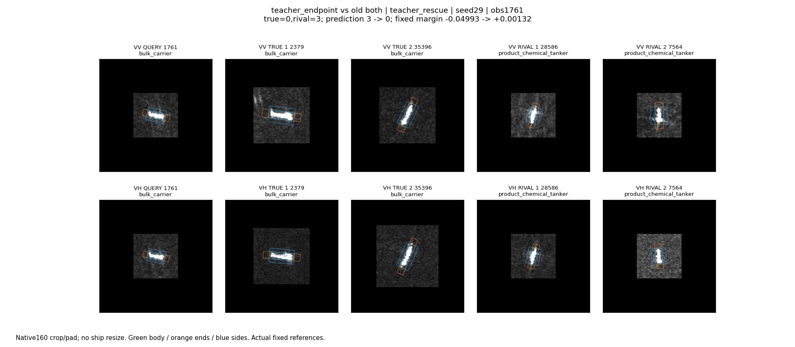
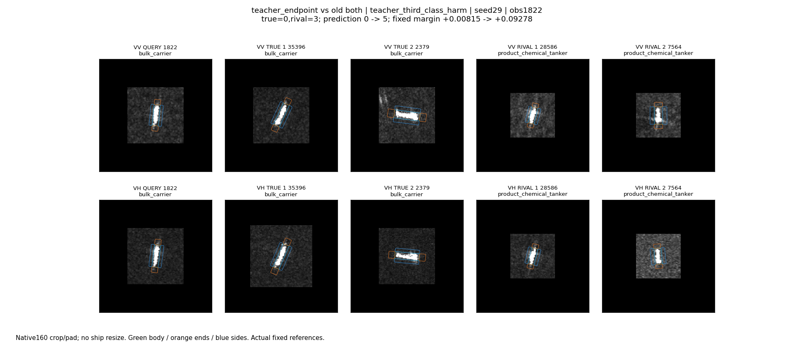
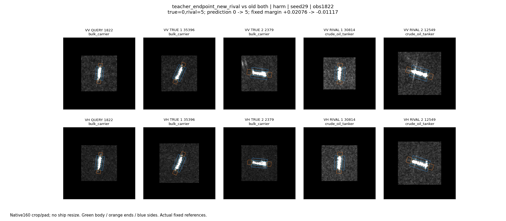
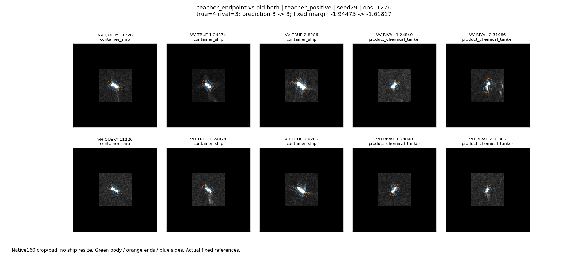
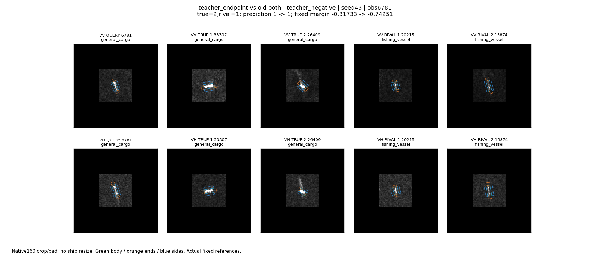

# 原图与实际参考：8例、9张面板

主代理2026-10-25实际查看以下9张面板；每张含查询及两个真类、两个竞争类实际参考，VV/VH分开，原生160裁剪/补零，没有缩放船体。路径、OBB、placement、种子、参考ID、分数与干预效应见analysis/cases.json。1822额外查看新竞争类原油轮的参考，不只看旧化学品竞争类。

## 操作确实能救回，也能误导

**1761，源选择seed29，散货船。** 查询为短而较宽的亮条，两极化均可见；真实散货参考一个中等长度、另一个明显更长，化学品参考也有短亮结构。不能凭图简单说宽或长就等于船型。VV框内4像素尺度的描述替换后，真类分数+0.01718、错误化学品分数-0.03407，固定分差-0.04993→+0.00132，3→0，真实救回。它是指定单项端点的源端作用，不是学习器自行选对。

**1822，源选择seed29，散货船。** 查询两极化都是细长竖向亮条，散货、化学品和原油轮参考均可见类似长条，真实参考横纵朝向均有。与1761相同的VV框内4像素描述替换，真类分数+0.06357、化学品分数-0.02106；只盯化学品会判定有益。但原油轮超过真类，0→5。新增原油轮参考30814/12549也呈长亮结构，不能从外观强行解释成具体散射机制；可确认的是完整八类竞争被固定类对教师漏掉了。

**11226，源选择seed29，集装箱船。** 查询较短，真实与化学品参考都含短亮条；一个真实参考外围有延伸响应，单凭显示不能命名尾迹。同一VV框内4像素替换令真类+0.08608、化学品-0.24050，分差-1.94475→-1.61817，仍判错。它说明连续证据改善不必足够翻转，不证明这个案例没有受益信息。

**6781，源选择seed43，普通货船。** 查询细短，VH响应较弱且窄；两个同类参考形态较宽，两个渔船参考中有细小亮条。指定替换令正确类-0.01889、渔船+0.40630，分差-0.31733→-0.74251。该操作主要强化了错误类，而不是大幅删除真类分数。缺少直接像素干预证据，不能说某个可见亮点就是导致误判的物理原因。

## 选中模型回退后的持续正确/错误

- **150，散货船，seed17 CC。** VV/VH都为较长亮条；真类、原油轮参考也都是长条。旧分差+1.60266，本轮门控0，结果不变。
- **179，散货船，seed17 CC。** VV周围显示纹理较亮，VH相对暗；两极化船体都有长亮响应。旧分差+1.94559，不变。不能因为这里背景明亮仍正确，推断背景一定无用。
- **220，普通货船，seed17 WW。** 查询短、VV背景显示明亮，同类6970也有类似显示；散货参考比查询长。仍错为散货，分差-0.16885。新模型回退，没有补上这次判别缺口。
- **365，海工补给，seed17 WW。** 查询是较长亮目标，两个同类参考更短，一个外围有孤立亮响应；实际散货参考也为长条。旧分差-3.31295，无变化。可观察到参考外观覆盖差异，不能据此直接归因标签错或尺寸因果。

上述四张面板分别为analysis/effect_CC_150_17.png、effect_CC_179_17.png、effect_WW_220_17.png、effect_WW_365_17.png，均已实际查看。对应所选模型没有非零新门控，所以不能将其正确/错误归给本轮频段选择器。

## 边界

源端端点案例用于说明作用路径和监督错位，不能代替开发集实际精度。最强正/负效应案例是按效应大小选出的，不代表样本比例；1761/1822是从源操作表选择的针对性案例，不是用户直接指定的观测。动态教师纠正训练仍回退，以上证据不包装成已经有效的自适应模块。
