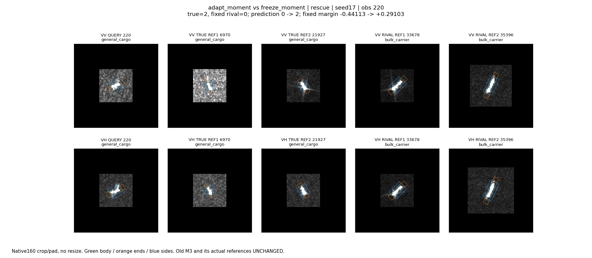
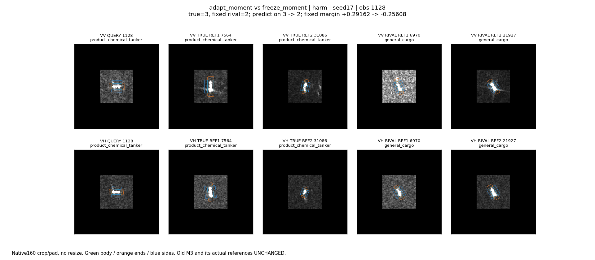
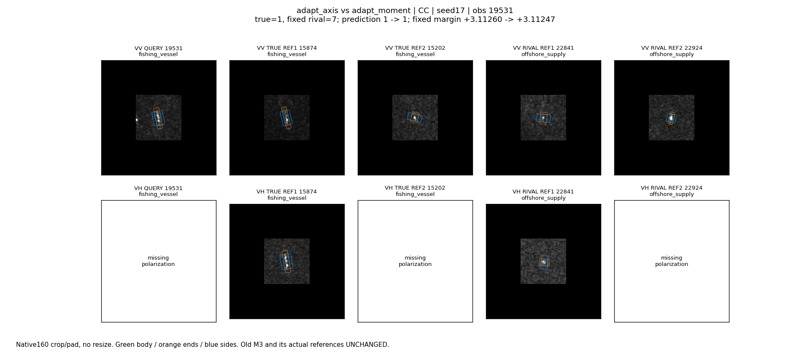
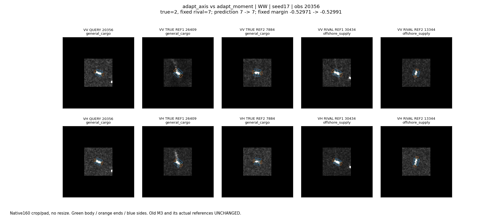

# 投影适配四组原图回看

2026-10-24。主代理实际查看以下4幅派生面板，每幅含查询和旧M3真正使用的2同类/2混淆类参考，VV/VH分开。原生160裁补，不缩放船体，0..255显示。完整原路径、MMSI/过境、选择规则、覆盖及所有八类分数见analysis/cases.json。

seed17预先指定：卷积vs无卷积无救回/误伤，因此从持续正确/错误按obs_id下中位数各选1例；另从适配vs冻结投影救回/误伤按obs_id首次各选1例。不是挑最大效应，代表图也不估计总体比例。旧M3及参考全部冻结，不能把本轮改判解释为新参考匹配学会了。

## 220 普通货：适配救回，不依赖船轴卷积

- 相对冻结moment，散货0→普通货2；固定类对分差-0.44113→+0.29103。同类参考6970/21927，散货参考33678/35396。
- VV查询周围纹理较亮，主体较紧凑；同类6970也有较亮周围，但21927周围较暗。散货参考沿轴更细长，VV/VH的主体亮响应都明显。仅凭这些可见差异，不能认定模型在使用长度或背景来救回。
- 新head固定，恢复原source投影后分差仍+0.27962，仍正确；新VV/VH证据分别替换为源均值后分差+0.05966/+0.08048，也仍正确。两路均有正的条件分差贡献，但任何一路并非本例救回的单独必要条件。
- 船轴卷积固定头置零，分差变化仅约+0.000077。收益不能归为新的轴向采样。

## 1128 化学品：同样的读出调整造成误伤

- 化学品3→普通货2，固定类对分差+0.29162→-0.25608；同类7564/31086，普通货参考6970/21927。
- 查询两极化主体都较短、宽，内部亮响应不均匀；VV周围纹理较明显。同类与竞争参考中均有明亮、紧凑或细长主体，不能把共享亮响应直接当成某一类特征。
- 恢复初始投影仍错，分差-0.28603；VV证据替代后-0.34492，VH替代后-0.23993。新VV在固定头条件下部分保护真类，VH略不利，但误伤不能归结为只有VH出了问题。
- 卷积置零分差贡献约+0.000330，仍无法改变错误。与220一起说明类别证据重分配存在代价；不是成功/失败由朝向单独决定。

## 19531 渔船：持续正确，有效输入只有VV

- 两适配模型都预测渔船；与竞争海工分差约+3.11260/+3.11247。实际同类15874/15202，竞争22841/22924。
- 查询VV主体小而近竖直、像素有限，周围另有亮点；其来源未确认。同类及竞争图均有紧凑目标，外观不提供唯一船型判断。查询VH缺失，同类15202及竞争22924的VH也缺失，面板如实留空。
- 缺失VH不能被诊断为带来正/负贡献。现分析将其替代标为applicable=false，输出不变；初稿曾把标准化列置零等价填入源均值，该分析错误已修正，未影响训练及分类表。
- 卷积固定头分差贡献约-0.000201，没有改变正确状态。不能因没翻转就说完全无分数作用，也不能当成有额外准确率价值。

## 20356 普通货：持续误判海工

- 两适配模型都预测海工7，真类减海工分差约-0.52971/-0.52991。同类26409/7884，竞争30434/13344。
- 查询及竞争30434都呈短而亮的主体，图像右侧另见亮点；不能凭面板确认目标间的物理关系。同类26409的VH还有近主体弱延伸，不能未经验证命名为尾迹。实际支持外观重叠，当前新增读出仍未化解该竞争。
- 恢复原投影分差-0.39786，VV/VH分别替代为-0.41825/-0.37483，均仍错。两路新增证据在本例都进一步减弱真类优势，但本轮没有识别是哪一个像素结构导致。
- 卷积贡献约-0.000239，仍不足改变分类。这是剩余局部证据利用缺口，不是已证实的物理失效机制。

## 可解释边界

已验证的是：投影参与训练改变了类别推力；典型救回与误伤均不需要当前船轴卷积，且固定head恢复原投影也不必逆转决策。尚未验证局部图像结构对应的唯一因果原因，也未证明训练轨迹变化仅由W或最终head中的某一部分造成。固定头干预不是重新训练比较。
