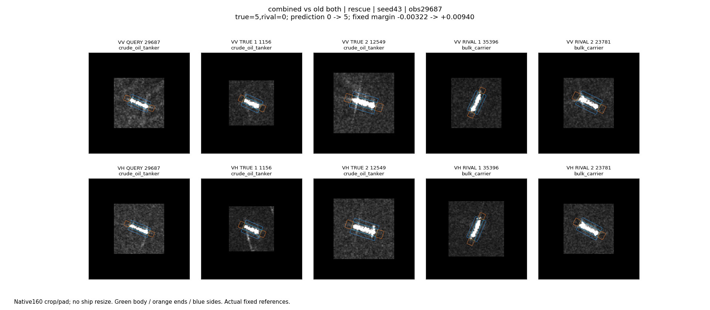
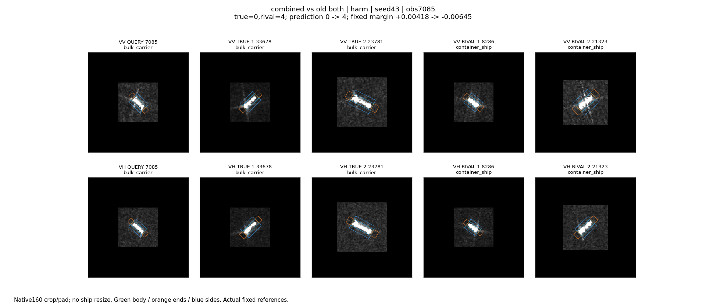
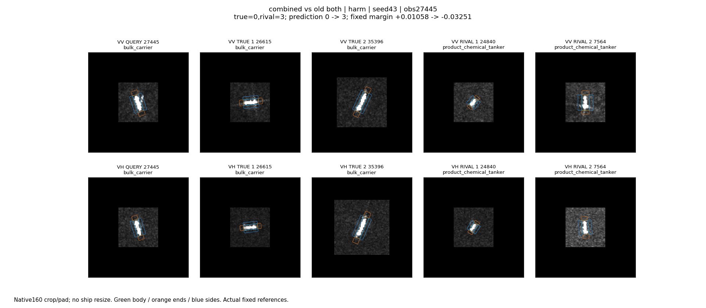
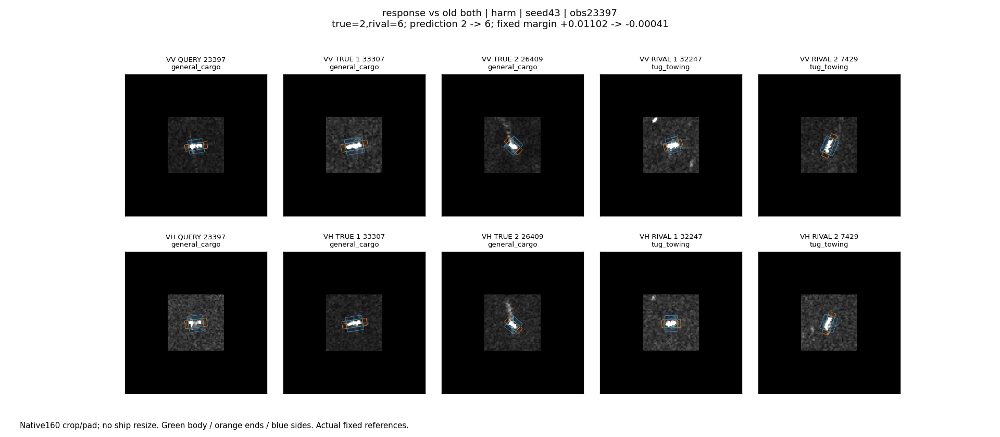
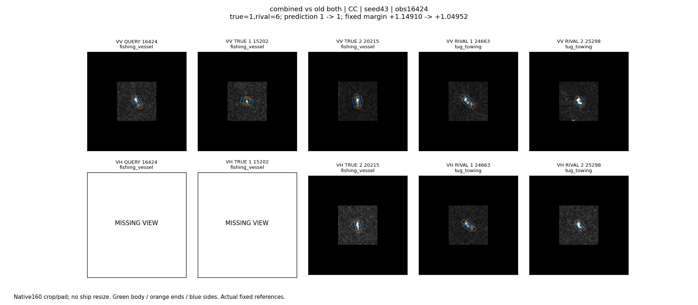
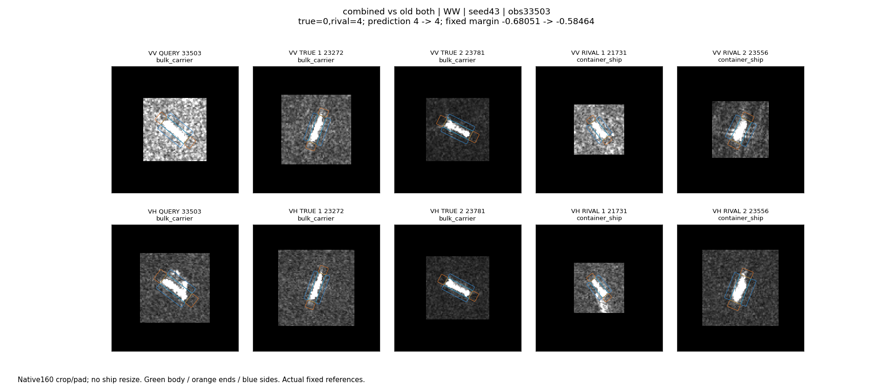

# 六个原图与实际参考案例：已逐张查看

2026-10-25，全部seed43。主代理已实际查看下列六张面板；不是仅生成后宣称已分析。对应路径、原图来源、placement/OBB、实际参考ID、分数和动作见analysis/cases.json。视图保持原生160裁剪/补零；彩色轮廓是区域位置参考，不是本次频段响应热图，也不代表精确感受野边界。

## 29687：原油轮救回

两极化中目标为倾斜明亮长条，近端和周围可见弱显示纹理。同类1156较短、12549更长，散货35396近竖向、23781倾斜；同类与异类均可有类似亮条。图像不支持凭朝向或亮度直接指定类别。

联合版选择VH轴端Gabor16。原油轮分数+0.014915，散货+0.002293，优势从-0.003222到+0.009400。删除选择器操作变化输入后仍选同一动作并救回；删除摘要时改选VV轴端Gabor4仍救回。故救回是真实的，但不能归因于两个输入缺一不可，也不能称已经找出船尾物理因素。

## 7085：相同操作误伤散货船

目标两极化为紧凑倾斜亮条，散货参考33678/23781与集装箱参考8286/21323都可见亮条，尺寸和朝向交叉。联合版也选VH轴端Gabor16，却使集装箱+0.013036超过散货+0.002408，优势+0.004176到-0.006453。删除操作变化输入仍发生，说明选择器没有学会在这个案例拒绝有害动作。

## 27445：另一散货误伤，和救回共享过境

目标两极化接近竖向长亮条。散货参考26615更横向、35396竖向；化学品参考24840较短、7564竖向。目标朝向并不能排除任何一类。VV轴端Gabor16使真类-0.018261、化学品+0.024827，优势+0.010579到-0.032509。该例与29687同属Santos过境S1A_060325_077F57，不是两个独立观测环境证据。

## 23397：联合输入避免了仅响应版的一例误伤

查询为较短近水平亮体，VV/VH内部明暗并不完全一致。同类33307与拖轮32247也有短横向结构；另一些参考更倾斜，局部外围有延伸或孤立亮点。仅响应版VV框内Gabor8令普通货船-0.008077、拖轮+0.003347，优势+0.011016到-0.000408。联合版选择VH侧向Gabor8，仍正确。这里可定位到所选描述操作不同，但不能仅凭图说某个亮点就是误伤根因。

## 16424：持续正确，查询VH缺失

VV查询是细短亮条，VH没有可用视图；同类15202也缺VH，其他参考有VH。联合版选择VV轴端Gabor4，渔船-0.028810、拖轮+0.070776，优势1.149103到1.049517，仍正确。说明top1不变不等于模块没有影响；不能据此推断缺失VH导致了分差变化。

## 33503：持续错误，连续分差改善

VV查询周围显示明亮，VH较暗；实际集装箱参考21731也有类似VV明亮邻域，同类散货参考存在不同显示条件。VV框内Gabor8令散货+0.059265、集装箱-0.036612，优势-0.680514到-0.584637，仍错。删除操作变化输入后改选VH轴端Gabor16，分差-0.685224，连续改善消失。此例支持响应输入影响了连续证据，但尚没有兑现正确分类；显示亮度不是未经校准的绝对后向散射量。

## 归纳

同一动作既能救回也能误伤；动作作用依赖查询及参考的完整分类竞争。当前图像能帮助排除“按朝向直接判类”等简单解释，尚不足以辨识具体物理原因。新增响应在部分源端救回和开发连续分差上有作用，但开发唯一新增救回不要求它存在，不能将其作为已验证的跨采集响应选择机制。
