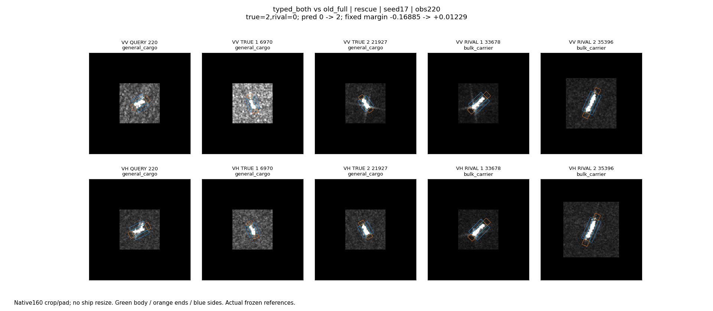
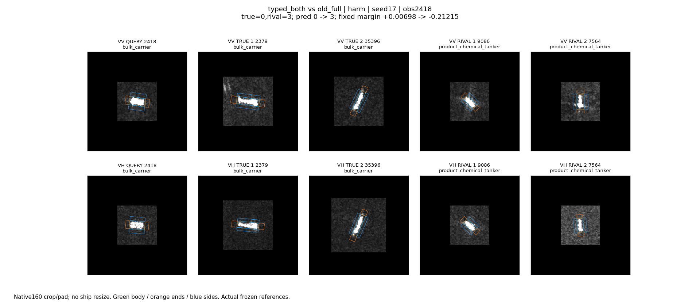
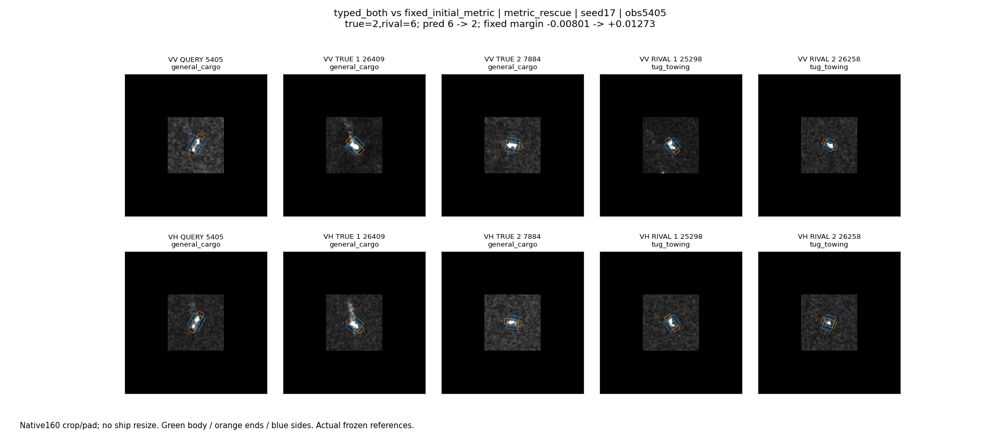
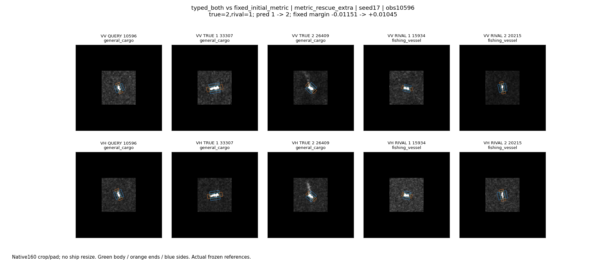
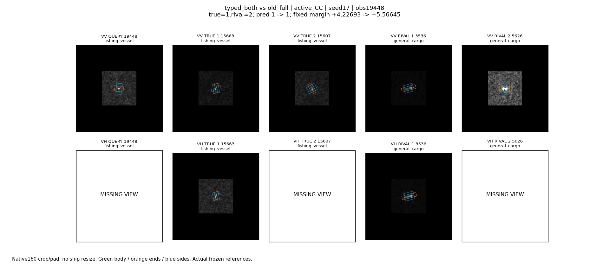
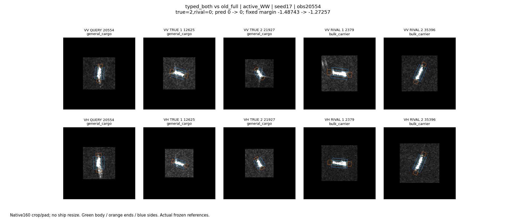

# 原始chip与实际参考回看

2026-10-25。主代理实际查看全部8个面板；每图为原像素160裁补、VV/VH分开、固定灰阶，不缩放船体。绿/橙/蓝轮廓分别表示框内/轴端/侧向。原路径、placement、OBB及参考ID详见analysis/cases.json和extra_cases.json。

本轮面板展示的是输入及区域，不是假称能从肉眼确认散射物理因果。以下统计是已训练模型的条件替换，不相加解释总收益，不将少数案例当总体比例。

## 220：完整系统救回，但两极化的作用不简单同向

seed17，普通货，散货 -> 普通货，固定竞争分差-0.16885 -> +0.01229。查询是较短紧凑亮主体；实际普通货参考6970/21927较短，散货33678/35396更长。不同图的背景显示强度也不同，不能据此断言模型按尺寸或背景判类。

学习相对初始度量的局部正贡献较大项为VV框内fine(+0.005559)，但它不是全部0.181分差改进的解释。以源均值替换查询及参考的VV频带/协方差块，固定分差下降0.323466且失去救回；替换VH同块下降0.294008也失去救回。替换VH类别统计反而提高分差，说明新证据各块会冲突。

## 2418：新增支路把原本边界正确的散货推成化学品

seed17，散货 -> 化学品，固定分差+0.00698 -> -0.21215。查询VV为较宽的紧凑亮主体，VH内部较斑驳；散货2379/35396和化学品9086/7564都存在亮的细长或紧凑目标，肉眼形状不是充分标签。

学习度量相对初始的各类型改动较小，最大几项还在帮助真实类别；误伤不能直接归咎于度量更新。将VH频带/协方差块换成源均值，分差提高0.269168并恢复散货；对应VV块的条件贡献也为负。它证明此模型会误用新增证据，不证明这些图像细节本来就是噪声。

## 5405与10596：对应更新直接影响边界，范围是一景两船

均为seed17、釜山S1A_057876_0723B2过境，不同MMSI。两查询都小，实际同类、混淆参考也含小亮目标，不能靠一个明显大结构解释分类。

- 5405：真普通货，与拖轮竞争。固定新头初始度量-0.008013，学习度量+0.012732；VV框内low、轴端low和VH侧向fine的条件作用较大。原完整模型已正确，学习匹配修复的是新增头的错误，不算旧系统新增救回。
- 10596：真普通货，旧模型和初始度量均判渔船；学习后恢复，分差-0.011507 -> +0.010454。这是完整系统真正新增救回。查询VH细长亮主体，真类参考33307/26409与渔船15934/20215在主体尺度和外围细节上均有变化，不能把类别差直接归于方向或尾迹。
- 两例保留学习T、恢复初始K计分仍正确；保留初始T、仅学习K计分仍错误。这是本轮最直接的“对应确实参与救回”证据，但不足以代表所有采集。

## 持续正确与持续错误

19448，seed17渔船，VV小而偏暗的主体，VH缺失，不能用邻近参考的VH填补。类别分差+4.22693 -> +5.56645，始终正确；这种变化可以改善NLL，却不会增加OA。

20554，seed17普通货，VV/VH均为长亮主体，实际散货参考也有长亮条状响应。相对散货分差-1.48743 -> -1.27257，仍明显为负；新增信息改变证据但不足以跨过边界，不能计作救回。

18879(seed29渔船持续正确)和21151(seed29散货持续错误)也已看。前者较小暗主体，后者较紧凑亮主体且VH框外有亮响应；该种子源端选择0增量，预测与所有新增证据条件效应不变。因此不从这两例推导新模块机制，另补了上面的非零更新案例。

## 结论边界

新证据在两极化、不同局部类型之间存在相反贡献，确实改变分类；但“能影响”不等于“被可靠利用”。本轮更应处理新增关系读出造成的错误修正，而不是凭外观给亮纹命名或统一删去某频段。区域位置可视化与固定头条件替换共同帮助定位作用位置，尚未解释自然观测变化的完整物理原因。
