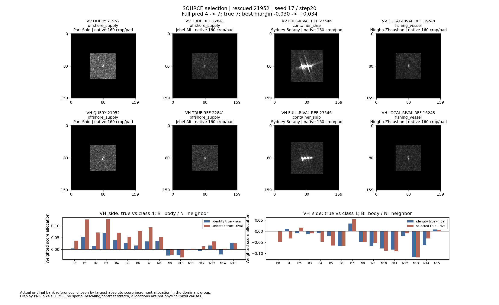
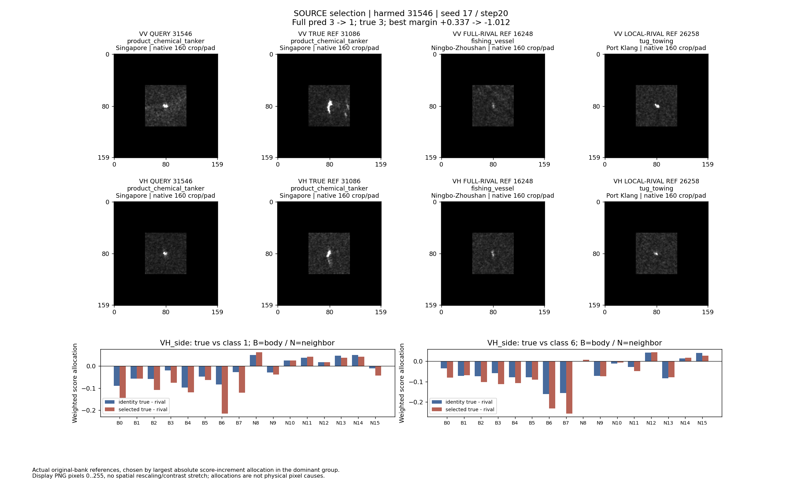

# 源端独立输出核重建的类别混淆诊断

完成日期：2026-10-24。状态：已完成；诊断进程退出码 0，无本支线后台任务。只写本目录，不训练、不调参、不操作 Git。主线统一同步。

## 结论

存在值得针对性检验的**局部重建与类别竞争脱节**：真类能被更好地重建，但某个错类改善更多；真类相对平均错类的优势也不能代表它战胜了最强错类。现有 token 的有利与不利证据会在聚合中相互抵消，因此保留 token、同时比较竞争类的读出具有源端研究依据。

但这些证据**不证明判别性 token 学习可取得净收益，更不证明新算法有效**。当前共享变换已经接受完整分类损失监督，不能把原因写成“没有判别训练”。本次最清楚的反证是：误伤案例的 VH 主体八个 token 全部偏向错类，靠挑选其中一两个现成主体 token 并不足以解决该组混淆；救回案例也没有消除局部最强错类。未来需要验证的是可学习、跨船可复用的竞争信息，而不是展示事后知道真类才能挑出的正贡献。

两张源查询均紧凑、小点状，**不支持长体重复片段或长轴部件顺序错配的归因**。本支线未做轴向实验；主线另行完成源端轴向探针并决定暂不开发该结构，该工作未重复，也未用于更换本次案例。

## 范围与数据

阅读了本实验 `run.py`、`diagnose.py`、父级 `source_data()`、kernel/independent 实现、token 划分和原图读取工具。复用已有 ClearSAR Python、冻结输出核权重、固定带宽、原始参考库及归一化尺度。

| 查询用途 | 查询数 | 不同 MMSI | 港口 | pass_group | VV side/end 有效 | VH side/end 有效 |
|---|---:|---:|---:|---:|---:|---:|
| utility_train | 644 | 587 | 16 | 45 | 644/644 | 561/561 |
| selection | 612 | 562 | 16 | 28 | 612/612 | 561/561 |

参考库固定为 8 类各 8 张，共 64 张 `strategy_fit` 参考；源查询与参考 MMSI 无交集。参考是原模型实际使用的参考，不是为展示重新检索的相似图。类数量和有效性详见 `execution.json`。

父级加载器读取共享表格与 token 容器；本脚本在创建 Reader 前仅保留上述查询及原参考库。预测缓存只取 utility_train/selection 行，不计算、筛选或汇总 evaluation 行。主线后来告知的广覆盖评价数字未进入本诊断、案例选择或设计论证。

17/43 是两套已有配置，均使用已选 step 20；其冻结 full 不同，Metric 初始化沿用父实现固定 seed 17。相同查询在两配置出现不是新增独立样本。selection 已用于原检查点选择，本报告又用于探索性诊断，不能称为全新、未使用的验证集。未更改检查点、带宽、参数、参考库或分类阈值。

## 分数含义与可核对性

每组 `g` 分为 body 和 neighbor，分别用本通道内容求重建系数。记中心化输出核为 `Lqs/Lss`，查询合法 token 数为 `m`：

```text
R_c = [2 * sum(A_c * Lqs_c) - sum(A_c * (A_c @ Lss_c))] / m
raw_cg = (R_body,cg + R_neighbor,cg) / 2
z_cg = (raw_cg - mean_over_valid_classes(raw_g)) / divisor_g
local_c = sum_g a_g * z_cg
new_full_c = old_full_c + centered(sum_g a_g * (z_selected,cg - z_identity,cg))
```

`source_group_scores.csv` 的 body/neighbor 为完整 `R`，combined 为两者平均；`true_skill=R/query_centered_RKHS_energy`，combined 的分母为两通道能量均值。它是相对零重建的解释比例，越高表示该状态核空间中的重建更好；变换后核空间也变了，不能解释成固定原图空间的重建误差下降。`case_channels.csv` 和 `case_tokens.csv` 为能加回 raw 的 **1/2 通道贡献**，不要直接与前表的单通道完整 R 混用。

每个状态、每个组/通道独立寻找最强错类；同时保存均值错类分差。四组聚合的 local 使用对应配置已经冻结的 `a`，identity 与 selected 共用该配置的 `a`。这只是读出诊断，local 本身并未作为独立分类器重新选参。完整模型的最强错类与 local 的最强错类分别保存，不能互相替代。

按参考与查询 token 分配 `A * (A @ Lss)` 的能量项，包含参考间交叉项。因此参考贡献是可加的分数记账，既不是单张参考独立重建分，也不是移除该参考的因果效应；token 贡献不是原图像素因果定位。

检查仅针对会改变解释的具体失败：token 求和须复原 raw，参考求和须复原 token，冻结相对增量须复原源端缓存预测。最终 raw 最大误差 `5.5511e-17`；17/43 缓存预测最大误差分别 `1.9674e-6 / 1.6579e-6`，通过 `4e-5` 容差。诊断脚本曾修正参考维与查询 token 维顺序，最终产物来自修正后的完整运行。未重做父算子全量审阅。

## 源端总体证据与反证

selection 的 combined 分数先按类求均值，再对 8 类等权汇总：

| 组 | 真类 skill：identity / 17 / 43 | 真类减最强错类：identity / 17 / 43 | 局部组 BA：identity / 17 / 43 |
|---|---|---|---|
| VV_side | .223675 / .231964 / .236157 | -.004552 / -.004611 / -.004814 | 33.1361% / 32.8116% / 32.7021% |
| VV_end | .136589 / .142443 / .143723 | -.009761 / -.009884 / -.009879 | 24.5827% / 23.6544% / 23.7225% |
| VH_side | .216605 / .224127 / .228648 | -.008544 / -.009340 / -.008776 | 26.4985% / 27.9513% / 27.0309% |
| VH_end | .128871 / .133500 / .135766 | -.012039 / -.012180 / -.012270 | 15.3644% / 15.9579% / 17.4701% |

真类 skill 在四组都提高，最强错类分差的宏均值却四组都变差。另一方面，两个 VH 组 BA 确有改善，不能把这个结果写成完全无效。VV_side 相对平均错类的分差由 `.013113` 提升到 `.016737/.014462`，但最强错类分差没有改善，说明只看平均错类会掩盖主要竞争。

逐查询配对也存在该现象，非仅聚合均值造成：

| 用途/配置 | 有效查询—组数 | 真类 skill 提高且最强错类分差变差 | 平均错类分差提高且最强错类分差变差 |
|---|---:|---:|---:|
| utility_train / 17 | 2410 | 737 | 641 |
| utility_train / 43 | 2410 | 1037 | 470 |
| selection / 17 | 2346 | 757 | 626 |
| selection / 43 | 2346 | 1093 | 495 |

这些是重复查询的不同组，不是 2346/2410 艘独立船。来源：`source_paired_diagnostics.csv`，取 combined 后按 role/seed 汇总。

完整模型变化及聚合 local 的边界：

| 用途/配置 | 完整模型救回/误伤 | local BA identity→selected | selected local 判错 | 判错中正负 token 贡献并存 |
|---|---:|---|---:|---:|
| utility_train / 17 | 17 / 32 | 35.4437%→36.6324% | 412 | 412 |
| utility_train / 43 | 11 / 6 | 37.3526%→38.1035% | 415 | 414 |
| selection / 17 | 23 / 27 | 31.1773%→31.6354% | 443 | 442 |
| selection / 43 | 5 / 1 | 30.7991%→32.4882% | 447 | 447 |

正负贡献是对该查询 selected local 最强错类计算，包含各合法组的 body/neighbor token。它说明当前聚合内仍有异号证据；**不能把“至少一个正 token”的比例当可达到准确率**，因为选择依赖真标签，而且 token 与组间共享信息。17 的 selection 还有 1 例没有正 token，43 的 utility_train 也有 1 例。

混淆并不限于展示的两个点：selection 的散货船→集装箱船 local 混淆，17 为 66 查询/65 MMSI/13 港口，43 为 63 查询/61 MMSI/14 港口；utility_train 相应为 61/56 查询。它提示竞争问题跨多个源港口存在，但仍未解释成像机制，也未证明不同港口结果独立。`source_confusions.csv` 只统计 local 判错的查询，不能当作完整模型混淆矩阵。

## 原图案例一：21952，完整模型救回但局部竞争未解决



- selection，Port Said，MMSI `438036102`，真类 7 offshore_supply。选择规则为优先 selection、优先两配置共享同种翻转、再按绝对分差变化排序。本轮无共享救回候选，最终取变化最大的 17 案例，不是随机代表样本。
- 配置 17 的完整模型从类 4 container_ship 改为真类 7；对当时最强错类的 margin 从 `-.029657` 到 `+.034031`。对**旧竞争类 4**的固定分差改善 `+1.236219`，变为 `+1.206561`，但此时最强错类已经换成类 1 fishing_vessel，不能拿 `+1.206561` 当最终最佳分差。
- 四组固定类 4 分差增量合计 body `+1.051318`、neighbor `+.184902`。主导 VH_side：body `+.402326`，neighbor `+.071785`。该组真类 body 半分数 `.062305→.073915`，类 4 `.052169→.048064`，真类相对类 4 的改善明确。
- 但聚合 local 一直更偏向渔船：真类分数 `.284151→.747583`，渔船 `1.699346→2.334555`，分差 `-1.415195→-1.586972`。VH_side 主体对渔船只有 B2/B7 两个 selected token 为正，其余六个为负；邻域仅 N15 为正。全组共 14 个正、34 个负 token-channel 项。
- 配置 43 对同一查询持续判渔船，完整模型 margin `-.848280→-.830503`；local 真类对渔船 `-1.073820→-1.056043`。这是同一源查询下的局限，不是两配置共同救回。

实际展示参考：真类 22841（Jebel Ali，MMSI 470685000）；完整模型旧竞争类 23546（container_ship，Sydney Botany，477541100）；local 竞争类 16248（fishing_vessel，Ningbo-Zhoushan，412417916）。均为原参考库实际参与项，在主导 VH_side 组中按该类绝对增量分配最大的参考展示，不是宣称它们是最近邻。各参考完整分配见 `case_references.csv`。

**图像可见事实：**查询及同类参考在 VV/VH 中均为紧凑的小亮目标；查询周围显示纹理较亮。集装箱参考的亮目标占据更长的横向范围，VV 还有明显向外延伸的亮线；渔船参考同样是小而紧凑的目标。这里可保留的解释是模型对不同竞争类表现不同：已有变换能排斥展示的集装箱竞争，却仍偏向渔船局部证据。不能由亮线、大小或纹理命名尾迹、海况、船体散射机制，也不能把单张参考的外观当整个参考类的统计。

## 原图案例二：31546，真类改善但错类改善更多



- selection，Singapore，MMSI `566867000`，真类 3 product_chemical_tanker。无共享误伤候选，按同一规则选中配置 17 最大绝对变化案例。完整模型从类 3 改为类 1 fishing_vessel，最佳分差 `+.337022→-1.011551`，增量 `-1.348575`。
- 相对渔船的四组增量 body 合计 `-1.364826`，neighbor 合计 `+.016251`。主要负项是 VH_side body `-.422386`、VV_end body `-.415180`、VV_side body `-.322885`。不能把这次误伤主要归给邻域。
- VH_side 的真类 body 半分数 `.052302→.079221`，确实上升；渔船 `.071038→.114455`，上升更大。对 local 最强错类 6 tug_towing，同组 `.080212→.120342`。因此“真类重建更好”不足以判断该变换有用。
- VH_side 主体 8/8 token 对渔船、拖轮均为负。对渔船的邻域有 6/8 token 为正；对拖轮有 4/8 为正。B6/B7 主体负项明显，但负项不限于单个位置。此例不支持“只移除一个坏 token 即可解决”；可能需要竞争条件下的新表示或读出，也可能缺乏可稳定分辨的信息，当前未区分。
- 聚合 local 的最强错类始终是拖轮：真类 `-.353406→-.963421`，拖轮 `1.362588→1.906632`，分差 `-1.715994→-2.870054`；全组 15 个正、33 个负项。完整模型最终判渔船而非拖轮，说明冻结 full 与相对增量共同决定最终类别。
- 配置 43 同样持续判渔船且退化：完整模型 margin `-.439913→-1.125178`，local 对拖轮 `-1.376127→-2.121502`。虽不是再次发生对→错翻转，仍提供同向证据恶化的对照。

实际展示参考：真类 31086（Singapore，MMSI 565523000）；完整模型竞争类 16248（fishing_vessel，Ningbo-Zhoushan，412417916）；local 竞争类 26258（tug_towing，Port Klang，533133378）。与查询均不同 MMSI、不同 pass；同类参考虽同港，不能据此称为同次观测。

**图像可见事实：**查询 VV/VH 均为紧凑、小点状亮目标；同类参考在图上更细长、接近竖向，渔船参考小而较弱，拖轮参考也紧凑。存在同类外观差异以及跨类紧凑外观，但仅凭这些显示图不能确定尺度、分辨率、姿态或物理散射的因果关系。源图没有显示可据以论证长体重复片段错配的清楚部件结构。

## 对后续局部判别算子的限定建议

1. 值得检验的对象是**保持 token 直到竞争读出，利用真类与具体强错类的差异**，而不是继续以提高真类或平均类重建为唯一目标。依据是上述异号证据与真类、错类同时改善的实测现象。训练时可获得源标签；部署时只能依赖查询与合法参考及候选类分数，不能使用本报告的真类 oracle。
2. 当前 CE 已对共享 Mb/Mn 和四组系数 a 反传。新增“分类损失”本身不是缺失环节；待检验能力是现有统一通道变换及均匀 token 汇总不能表达的、随查询和竞争类改变的局部证据读出。既要检查最强错类和完整模型收益，也要保留真类已占优部分的误伤，不能只优化展示案例。
3. 两个案例并未证明可学习规则。尤其 31546 主体全负，简单正 token 选择不能直接挽救主体组；21952 的救回也主要是对类 4 的排斥，并未解决类 1。没有新学习或替换对照，本轮不能确定问题来自表示、参考覆盖还是聚合规则，更不能给新算法预报涨点。
4. token 原本已经按无向船轴分成 4 纵向×2 横向，side/end 也有既有分组。当前 kernel/free reconstruction 没有显式保持全体 token 的单调轴向对应；这不等于输入没有局部空间结构，也不等于条件 T 自动保证邻接。它是实现边界，不是本轮已证实的错误根因。两个紧凑查询不足以支持 180 度无向轴下整体一致对应的新结构；主线相关小验证已完成，本轮不追加。

## 原图来源与交付

全部面板实际查看过 VV、VH，以及实际同类、完整模型竞争类、local 竞争类参考。图像来自现有 `image_vv/image_vh` 8-bit PNG，沿用 `geo.native`，按原像素比例 crop/pad 到 160×160，无空间 resize、无额外对比度拉伸。两查询原图均 64×64，居中 pad 48 像素，`input_scale=1`；黑边是补边，不能解释成无回波。这里的“原图”是既有模型输入 PNG，不是原始复数 SLC 或校准后后向散射量。

绝对图像路径、MMSI、pass、有效通道、OBB 几何及 crop/pad 放置均在 `image_provenance.json`；16 个面板单元是 2 查询×4列×2极化，其中同一渔船参考在两面板重复，不是两份独立证据。案例选择、主导组与参考索引在 `cases.json`。

- `diagnose_source.py`：可执行冻结诊断，仅写本目录，CPU 两线程，最后一次主体运行约 22 秒；无优化器步骤或新模型。
- `source_samples.csv` / `source_outcomes.csv`：两个配置、两类源用途的完整/局部分差、翻转及 token 正负贡献。
- `source_group_scores.csv` / `source_class_scores.csv` / `source_macro_scores.csv`：identity/17/43 的真类与各自最强错类、完整通道分数和分类统计。
- `source_paired_diagnostics.csv` / `source_token_conflicts.csv` / `source_confusions.csv`：配对失配、异号 token、跨类别混淆及不同船/港口计数。
- `case_class_scores.csv` / `case_channels.csv` / `case_tokens.csv` / `case_references.csv`：两个案例的类级、通道、token、实际参考分解。
- `source_rescued_21952.png` / `source_harmed_31546.png`：两张原图面板。
- `execution.json`：范围、回放误差、运行结果；`image_provenance.json`：原图追溯。

复现命令（依赖现有父实验文件与 ClearSAR 环境）：

```powershell
& 'D:/Program_documents/Anaconda_envs/envs/ClearSAR/python.exe' -X utf8 -B 'E:/临时会话/scene_aware_classification_20261018/model_closeout_20261023/local_evidence_transport/conditional_relation_operator/distribution_condition_operator/source_error_analysis/diagnose_source.py'
```

读含 `state` 列的 CSV 时建议明确 `dtype={'state': str}`，避免 pandas 分块把 17/43 部分读为数字。本报告的人眼图像观察独立于脚本数值输出，重跑不自动重写报告。以上全部为源端描述性证据，不证明新算法有效；未对外同步，本轮由主线统一 Git 归档。
