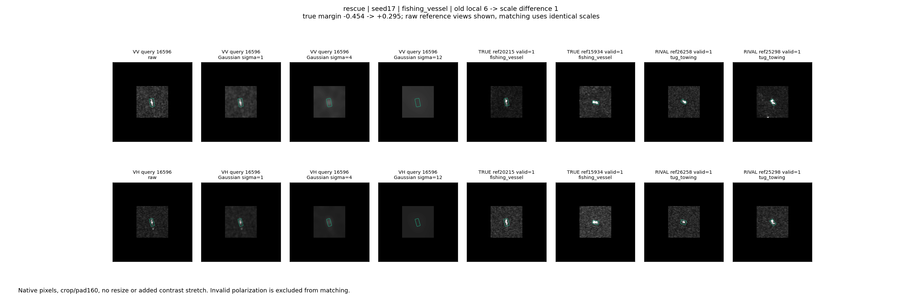
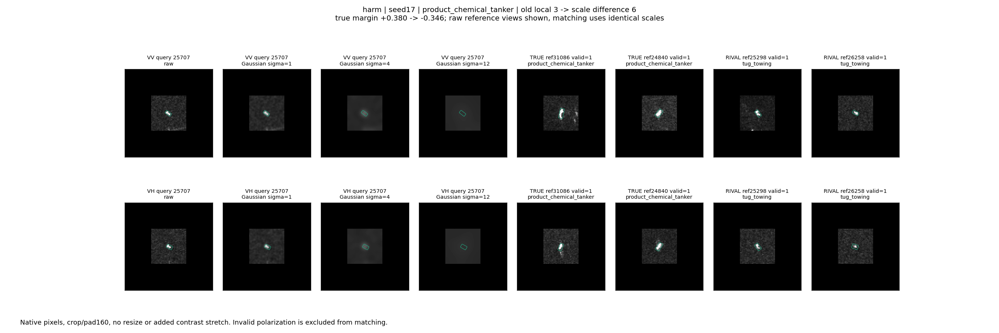
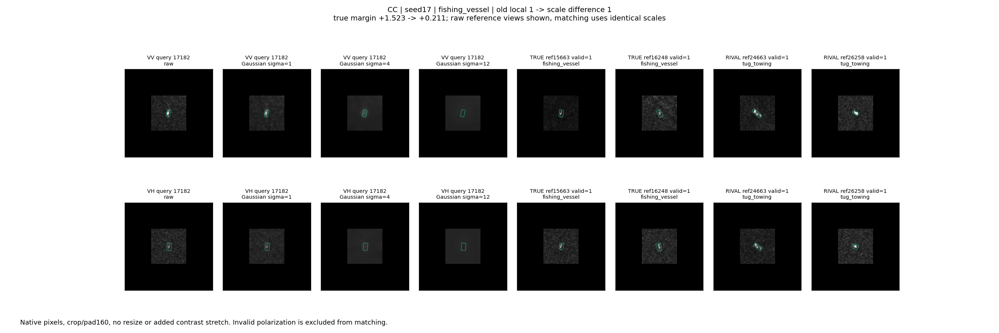
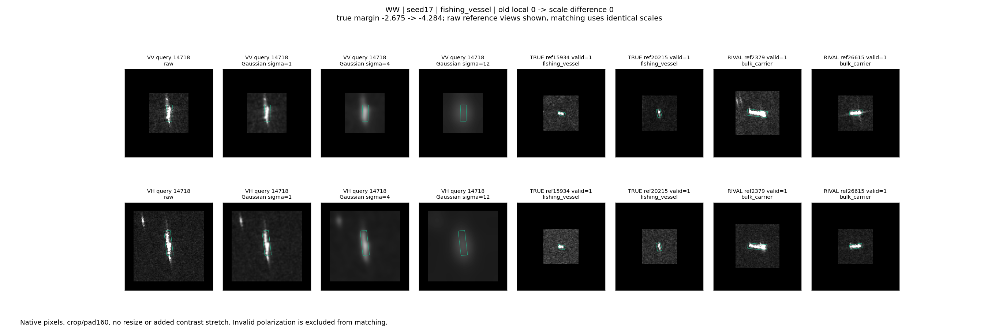

# 查询与参考一致的尺度读出：完成配套训练

2026-10-24。12个新读出头已训练完成；所有候选及checkpoint先在源端冻结，再读取历史评价队列。原始VV/VH及实际参考的四组案例已查看。没有运行中的本轮训练，没有替换原模型。

## 先说结论

**尺度差分可保留为有明确局部作用的候选，但本轮没有证明它值得替换已有强局部读出。** 相对冻结的两模块完整模型，平均BA提高1.012个百分点，OA下降0.412个百分点，J提高0.300个百分点；三个配置的BA均提高。相对普通多尺度并用，差分的平均OA/BA分别高1.512/1.146个百分点。这说明如何组织尺度响应会影响可用性，不是多做几张模糊图就一定有效。

但是，同架构重复原始信息对照和既有强单尺度局部读出整体不弱于差分。**不能把本轮的全部收益归为频带独有信息，也不能把这次实现直接命名为第三个强原创算子。** 不要求每类获胜，保留渔船、普通货船等实际正信号与反例即可，不继续根据这485条标签搜索尺度或参数。

## 实际做了什么

1. 原生PNG分别生成原图、sigma=1/4/12的高斯视图；先滤波，再按原位置补零到160，不重新缩放、拉伸或检测OBB。3399个有效极化视图全部小于160，无新增裁剪外像素。
2. 查询和64张源参考完全采用相同处理，冻结R50 layer1、C4和原先源拟合PCA32，保留20个OBB槽位。PCA坐标此时不先做单位归一化。
3. 四种表示分别是原特征重复四次、四尺度并列、三个相邻尺度差加最粗尺度、固定正交混合四尺度。差分为Y0-Y1、Y1-Y4、Y4-Y12、Y12；形成各通道后再unit。
4. 固定每类原先选出的两张参考，对应通道之间计算原有带空匹配的区域OT。每通道得到VV/VH乘框内/侧邻域/轴端乘相似度/匹配质量，共12维，每类四通道48维。
5. 加原完整模型的三个类别分数上下文，采用类别共享51→12→1头，637参数，输出类间去均值后加回冻结完整模型。四臂相同容量、训练步骤和源端选点规则。

旧强单尺度头205参数是额外实用基线，不是等容量对照。repeat虽然也是637参数，但重复输入的有效维数没有增加，不能只因差分胜repeat就宣称差分特异性成立。所有新头都直接接在原M1/M2完整分数之后；**不是先加旧局部头再叠新头**。

相邻差分在unit之前是四尺度坐标的可逆重参数化，不凭空增加信息。网络F非线性，F(I)-F(GI)不是F(I-GI)，本轮是尺度变化的网络响应，不是纯图像频带、雷达相位或因果因素分离。

## 数据与协议

- 源参考64，监督读出644，源选择612，历史研发评价485；并集1805条。bank只作参考，不是本轮头的训练查询。
- 评价485条、445艘船、29过境组、8类。三配置复用同一评价群体，不能当1455个独立样本。
- 类别数量：散货169、渔船91、普通货69、成品/化学品油轮67、集装箱33、原油轮13、拖轮40、海工补给3。
- 参考全部来自既有fit_train；三个读出队列按MMSI及过境隔离。四臂固定原两参考，不用评价真值选参考。
- 每头最多200步；源selection每5步按J=(OA+BA)/2选checkpoint，允许step0。最后层零初始化，第一层正常初始化，同配置四臂同初始化种子。
- 这是已多轮使用的开发队列，不是新的独立确认，也不是本轮跨数据集结果。

## 完整结果

以下为配置17/29/43均值；OA/BA为百分数，括号为配置间样本标准差，不代表三套独立数据。

| 方案 | OA | BA | NLL | Brier |
|---|---:|---:|---:|---:|
| 冻结M1/M2完整模型 | 58.832 (1.208) | 40.122 (1.152) | 1.3482 | 0.5935 |
| 既有强单尺度局部读出 | 59.313 (2.065) | 41.069 (1.990) | 1.2142 | 0.5536 |
| 同架构重复原始信息 | 59.107 (1.848) | 41.221 (2.912) | 1.2831 | 0.5667 |
| 普通多尺度并列 | 56.907 (2.704) | 39.989 (2.089) | 1.2519 | 0.5632 |
| 相邻尺度差分 | 58.419 (1.172) | 41.134 (1.002) | 1.2390 | 0.5565 |
| 固定正交混合 | 57.251 (3.088) | 39.818 (1.900) | 1.2444 | 0.5606 |

NLL/Brier沿用统一原始logits转softmax，没有用评价集拟合温度，不称为已校准概率。

| 差分相对何者 | 配置17救回/误伤 | 配置29救回/误伤 | 配置43救回/误伤 | 平均OA变化 | 平均BA变化 |
|---|---:|---:|---:|---:|---:|
| 冻结完整模型 | 10/14 | 12/10 | 17/21 | -0.412pp | +1.012pp |
| 既有强局部读出 | 6/17 | 26/21 | 17/24 | -0.893pp | +0.066pp |
| 重复原始信息 | 8/17 | 13/10 | 17/21 | -0.687pp | -0.086pp |
| 普通多尺度 | 9/9 | 9/2 | 30/15 | +1.512pp | +1.146pp |

29过境组配对bootstrap先在每条查询上平均三配置变化，再按过境组重采样2000次。差分相对完整模型的OA区间[-1.535,+0.425]pp、BA区间[-0.388,+3.179]pp；相对普通多尺度OA区间[+0.247,+2.548]pp。BA仅使用覆盖全部8类的1736次抽样，避免缺类时悄悄改变指标，故为条件化探索区间；没有多重比较修正。该队列不足以给出独立确认级显著性结论。

## 收益与损失在哪里

| 类别 | n | 完整模型召回率 | 差分召回率 | 既有强局部召回率 |
|---|---:|---:|---:|---:|
| 散货船 |169|73.37|69.03|73.77|
| 渔船 |91|87.91|90.11|88.28|
| 普通货船 |69|35.75|38.16|35.27|
| 成品/化学品油轮 |67|57.71|58.21|58.21|
| 集装箱船 |33|32.32|35.35|32.32|
| 原油轮 |13|23.08|28.21|28.21|
| 拖轮 |40|10.83|10.00|12.50|
| 海工补给 |3|0.00|0.00|0.00|

**BA改善、OA略降的直接数值原因已经明确：多个类别召回改善，而样本最多的散货船召回下降约4.34个百分点。** 这不是否定局部收益。另一方面，渔船/普通货船/集装箱改善不能自动归为共同的散射物理机制；原油轮13条和海工补给3条的结论尤其需要限定范围。

## 原始chip中的具体解释

四组均为配置17，按既有强局部读出到difference的状态选出大分差变化案例，供解释而非估算总体比例。实际同类和最强错误类各两张参考、VV/VH分开展示，路径记录在analysis/cases.json。

### 救回16596：尺度对比提供了额外判别作用

渔船16596原先误判拖轮，分差-0.454→+0.295。原图显示小而紧凑的目标响应；sigma4/12下具体亮点布局已明显变平。实际参考是渔船20215/15934与拖轮26258/25298，这些参考也都是紧凑目标，单凭原图外形不容易区分。

固定difference头，对四个通道做精确Shapley分解，以每个标准化通道置零即训练均值为参照，其他分数上下文固定。四项对“渔船-拖轮”分差贡献为+0.018、+0.398、+0.073、+0.067；主正项是Y1-Y4。背景及目标细节在平滑过程中的变化被网络读成了更有利的案例关系，但不能据此断言是哪种物理散射。

原模型、旧局部、repeat、普通multiscale均错；difference和mix均对。**此例支持重组尺度关系有价值，不支持相邻差分具有独占优势。**

### 误伤25707：中粗尺度关系也会拉向错误类别

成品/化学品油轮25707原本正确，分差+0.380→-0.346，误为拖轮。查询的紧凑亮响应与两张拖轮参考在肉眼上存在相似处，两个油轮参考则相对细长。平滑后几组均趋于光斑，原细节差异进一步减弱；这是图像可见事实，不是已证明的分类根因。

同样分解，四项对真类-拖轮分差为-0.063、-0.162、-0.314、-0.335。后两项合计约-0.649，说明本头的中粗尺度信息确实推动了错误竞争。repeat、multiscale、mix也误判，说明它并非差分独有失效，不能简单把问题归为差分算法错误。

### 持续正确17182：正确但把优势削弱了

渔船17182仍正确，分差1.523→0.211。VH框内响应弱，VV仍可见小目标；参考中也存在弱响应。四尺度贡献合计约-0.951，其中Y1-Y4约-0.559。与救回16596使用同一组通道却方向相反，说明该通道并非天然“渔船证据”，其作用取决于查询-参考内容与已学头。

### 持续错误14718：查询与现有同类参考的响应明显不一致

渔船14718两极化均有明显细长强亮响应，VH左上还有独立亮结构；不能仅据此把该结构命名为邻船或虚影。选到的同类参考15934/20215较紧凑，错误散货参考2379/26615则有细长亮响应。固定参考未被新尺度重新选择。

分差-2.675→-4.284，四尺度项约-0.205、-0.292、-1.191、-0.750。差分没有解决此例的查询-同类参考不匹配，粗尺度项反而放大错误。它提示参考覆盖是下一步可检验的解释之一，**不是据外观改标签，也没有证明覆盖不足是所有损失的根因**。

Shapley分解精确加和的是同一个已冻结头内的固定真类-错误类分差；起点是该头的训练均值通道，不是旧头或原完整模型。它不是物理因果归因，也不把四项和解释为相对旧模型的全部改善。

## 实现、成本和仍缺的证据

- 原始特征重放误差0；原局部匹配重放最大5.36e-7；差分累加恢复Y0、混合矩阵正交性、四通道贡献加和及最终分差重放通过。
- 有效槽位的差分最小范数约1.55，近零比例为0，没有证据支持“单位化放大几乎为零的差分”是本轮失败原因。
- 图像提取约280.28秒，含3399个有效极化视图的三种新增平滑及C4浅层推理；匹配及12头训练合计29.22秒。该数是本机离线批处理耗时，不是部署端到端延迟。
- 每张有效极化图需额外三个尺度的浅层主干计算，各尺度还有C4；637参数很少不等于整体成本很少。四臂缓存共用提取，不能把一次缓存读取速度当实际推理成本。
- 源选择指标得到改善，但在评价上未兑现为超过强单尺度的净收益；当前证据既不支持简单归罪实现错误，也不足以确定单一根因。冻结PCA32、固定两参考、仅读出头学习及图像尺度和类别的不同关系都是该实验的范围限制。
- 尚未做跨数据集、独立新采集确认或端到端频带学习。没有新增新卷积/注意力的原创证明。

## 留什么，下一步不盲做什么

保留原M1/M2和强普通局部读出；差分作为有界BA收益及尺度关系诊断候选完整归档，不取代现有主线，也不删除负结果。下一轮若推进，优先利用现有缓存检查“固定参考是否缺少与查询匹配的尺度响应”，在源端比较受约束的参考覆盖，而不是立即再加动态频带网络。该建议尚未执行，不保证涨点。

直接证据入口：metrics.csv、paired.csv、classes.csv、passes.csv、uncertainty.csv、training_receipts.csv、norms.csv、analysis/cases.json。设计边界另见DESIGN_REVIEW_ZH.md。
