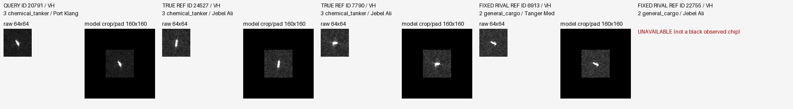
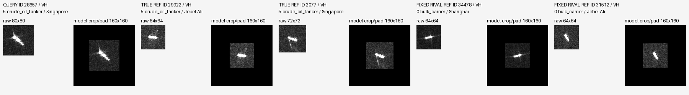
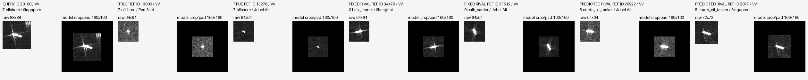
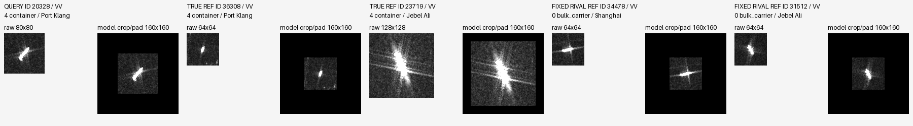
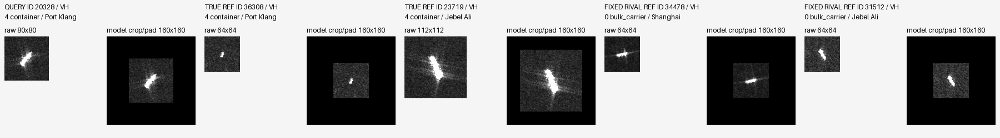
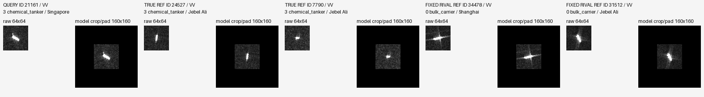
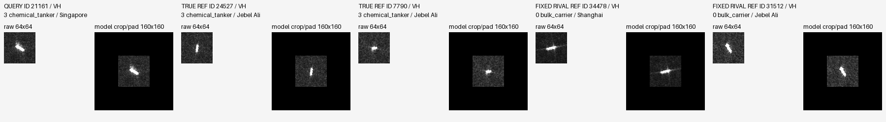
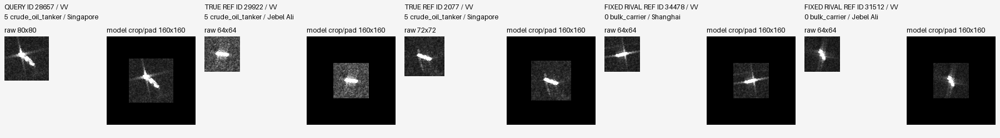
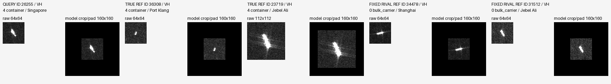

# 原图案例待复核

自动选例不是已读图。分组相对reference_arm，seed17；指定诊断例优先，其余按固定竞争类分差变化选取。

## stage vs baseline / rescued / ID 35666 / seed 17

truth=crude_oil_tanker; bulk_carrier -> crude_oil_tanker; fixed rival=bulk_carrier; margin -0.187241 -> 1.076455; NLL 0.829390 -> 0.357503

MMSI=636022759; pass=S1A_060268_077D6F; port=Singapore
同类参考['29922', '2077']；固定竞争类['34478', '31512']；额外预测竞争类[]。
可见事实：待回看。模型证据：实际分差/预测及path_diagnosis.json；尚不能推断物理成因。

## stage vs baseline / harmed / ID 20791 / seed 17

truth=chemical_tanker; chemical_tanker -> general_cargo; fixed rival=general_cargo; margin 0.235659 -> -0.298461; NLL 0.714209 -> 0.971651

MMSI=413586730; pass=S1A_060692_078D67; port=Port Klang
同类参考['24527', '7790']；固定竞争类['6913', '22755']；额外预测竞争类[]。
可见事实：待回看。模型证据：实际分差/预测及path_diagnosis.json；尚不能推断物理成因。

## stage vs baseline / CC / ID 35906 / seed 17

truth=bulk_carrier; bulk_carrier -> bulk_carrier; fixed rival=crude_oil_tanker; margin 2.239895 -> 1.065854; NLL 0.101894 -> 0.296677

MMSI=636023335; pass=S1A_060268_077D6F; port=Singapore
同类参考['34478', '31512']；固定竞争类['29922', '2077']；额外预测竞争类[]。
可见事实：待回看。模型证据：实际分差/预测及path_diagnosis.json；尚不能推断物理成因。

## stage vs baseline / WW / ID 26255 / seed 17

truth=container; bulk_carrier -> bulk_carrier; fixed rival=bulk_carrier; margin -9.774944 -> -7.401431; NLL 9.812899 -> 7.646925

MMSI=533133374; pass=S1A_060268_077D6F; port=Singapore
同类参考['36308', '23719']；固定竞争类['34478', '31512']；额外预测竞争类[]。
可见事实：待回看。模型证据：实际分差/预测及path_diagnosis.json；尚不能推断物理成因。

## pre3x3 vs baseline / harmed / ID 34278 / seed 17

truth=container; container -> bulk_carrier; fixed rival=bulk_carrier; margin 0.125585 -> -0.034361; NLL 0.870659 -> 0.964786

MMSI=636019337; pass=S1A_060692_078D67; port=Port Klang
同类参考['36308', '23719']；固定竞争类['34478', '31512']；额外预测竞争类[]。
可见事实：待回看。模型证据：实际分差/预测及path_diagnosis.json；尚不能推断物理成因。

## pre3x3 vs baseline / CC / ID 28657 / seed 17

truth=crude_oil_tanker; crude_oil_tanker -> crude_oil_tanker; fixed rival=bulk_carrier; margin 4.090179 -> 4.365571; NLL 0.017326 -> 0.013255

MMSI=538010884; pass=S1A_060268_077D6F; port=Singapore
同类参考['29922', '2077']；固定竞争类['34478', '31512']；额外预测竞争类[]。
可见事实：待回看。模型证据：实际分差/预测及path_diagnosis.json；尚不能推断物理成因。

## pre3x3 vs baseline / WW / ID 28198 / seed 17

truth=offshore; bulk_carrier -> crude_oil_tanker; fixed rival=bulk_carrier; margin -18.944376 -> -19.237797; NLL 19.700030 -> 20.156997

MMSI=538009741; pass=S1A_060268_077D6F; port=Singapore
同类参考['13000', '13276']；固定竞争类['34478', '31512']；额外预测竞争类['29922', '2077']。
可见事实：待回看。模型证据：实际分差/预测及path_diagnosis.json；尚不能推断物理成因。

## post3x3 vs baseline / rescued / ID 35666 / seed 17

truth=crude_oil_tanker; bulk_carrier -> crude_oil_tanker; fixed rival=bulk_carrier; margin -0.187241 -> 0.271398; NLL 0.829390 -> 0.608639

MMSI=636022759; pass=S1A_060268_077D6F; port=Singapore
同类参考['29922', '2077']；固定竞争类['34478', '31512']；额外预测竞争类[]。
可见事实：待回看。模型证据：实际分差/预测及path_diagnosis.json；尚不能推断物理成因。

## post3x3 vs baseline / harmed / ID 20791 / seed 17

truth=chemical_tanker; chemical_tanker -> general_cargo; fixed rival=general_cargo; margin 0.235659 -> -0.074965; NLL 0.714209 -> 0.860536

MMSI=413586730; pass=S1A_060692_078D67; port=Port Klang
同类参考['24527', '7790']；固定竞争类['6913', '22755']；额外预测竞争类[]。
可见事实：待回看。模型证据：实际分差/预测及path_diagnosis.json；尚不能推断物理成因。

## post3x3 vs baseline / CC / ID 35906 / seed 17

truth=bulk_carrier; bulk_carrier -> bulk_carrier; fixed rival=crude_oil_tanker; margin 2.239895 -> 1.789601; NLL 0.101894 -> 0.155246

MMSI=636023335; pass=S1A_060268_077D6F; port=Singapore
同类参考['34478', '31512']；固定竞争类['29922', '2077']；额外预测竞争类[]。
可见事实：待回看。模型证据：实际分差/预测及path_diagnosis.json；尚不能推断物理成因。

## post3x3 vs baseline / WW / ID 20328 / seed 17

truth=container; bulk_carrier -> bulk_carrier; fixed rival=bulk_carrier; margin -3.256083 -> -2.555871; NLL 3.306370 -> 2.648625

MMSI=413132000; pass=S1A_060692_078D67; port=Port Klang
同类参考['36308', '23719']；固定竞争类['34478', '31512']；额外预测竞争类[]。
可见事实：待回看。模型证据：实际分差/预测及path_diagnosis.json；尚不能推断物理成因。

## pre3x3 vs stage / rescued / ID 31779 / seed 17

truth=chemical_tanker; general_cargo -> chemical_tanker; fixed rival=general_cargo; margin -0.280899 -> 0.069484; NLL 0.887682 -> 0.710251

MMSI=574005560; pass=S1A_060268_077D6F; port=Singapore
同类参考['24527', '7790']；固定竞争类['6913', '22755']；额外预测竞争类[]。
可见事实：待回看。模型证据：实际分差/预测及path_diagnosis.json；尚不能推断物理成因。

## pre3x3 vs stage / harmed / ID 35666 / seed 17

truth=crude_oil_tanker; crude_oil_tanker -> bulk_carrier; fixed rival=bulk_carrier; margin 1.076455 -> -0.157440; NLL 0.357503 -> 0.808287

MMSI=636022759; pass=S1A_060268_077D6F; port=Singapore
同类参考['29922', '2077']；固定竞争类['34478', '31512']；额外预测竞争类[]。
可见事实：待回看。模型证据：实际分差/预测及path_diagnosis.json；尚不能推断物理成因。

## pre3x3 vs stage / CC / ID 35906 / seed 17

truth=bulk_carrier; bulk_carrier -> bulk_carrier; fixed rival=crude_oil_tanker; margin 1.065854 -> 2.192422; NLL 0.296677 -> 0.106500

MMSI=636023335; pass=S1A_060268_077D6F; port=Singapore
同类参考['34478', '31512']；固定竞争类['29922', '2077']；额外预测竞争类[]。
可见事实：待回看。模型证据：实际分差/预测及path_diagnosis.json；尚不能推断物理成因。

## pre3x3 vs stage / WW / ID 26255 / seed 17

truth=container; bulk_carrier -> bulk_carrier; fixed rival=bulk_carrier; margin -7.401431 -> -9.672120; NLL 7.646925 -> 9.717718

MMSI=533133374; pass=S1A_060268_077D6F; port=Singapore
同类参考['36308', '23719']；固定竞争类['34478', '31512']；额外预测竞争类[]。
可见事实：待回看。模型证据：实际分差/预测及path_diagnosis.json；尚不能推断物理成因。

## post3x3 vs stage / harmed / ID 21161 / seed 17

truth=chemical_tanker; chemical_tanker -> bulk_carrier; fixed rival=bulk_carrier; margin 0.146597 -> -0.587453; NLL 0.699609 -> 1.079268

MMSI=414491000; pass=S1A_060268_077D6F; port=Singapore
同类参考['24527', '7790']；固定竞争类['34478', '31512']；额外预测竞争类[]。
可见事实：待回看。模型证据：实际分差/预测及path_diagnosis.json；尚不能推断物理成因。

## post3x3 vs stage / CC / ID 28657 / seed 17

truth=crude_oil_tanker; crude_oil_tanker -> crude_oil_tanker; fixed rival=bulk_carrier; margin 3.308449 -> 4.262244; NLL 0.037617 -> 0.014648

MMSI=538010884; pass=S1A_060268_077D6F; port=Singapore
同类参考['29922', '2077']；固定竞争类['34478', '31512']；额外预测竞争类[]。
可见事实：待回看。模型证据：实际分差/预测及path_diagnosis.json；尚不能推断物理成因。

## post3x3 vs stage / WW / ID 26255 / seed 17

truth=container; bulk_carrier -> bulk_carrier; fixed rival=bulk_carrier; margin -7.401431 -> -9.371453; NLL 7.646925 -> 9.420727

MMSI=533133374; pass=S1A_060268_077D6F; port=Singapore
同类参考['36308', '23719']；固定竞争类['34478', '31512']；额外预测竞争类[]。
可见事实：待回看。模型证据：实际分差/预测及path_diagnosis.json；尚不能推断物理成因。

