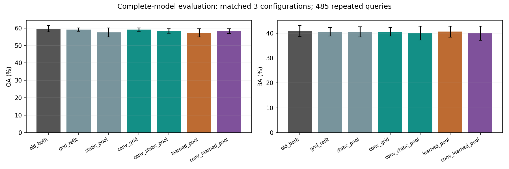

# M2新卷积与新池化：首轮验证结果

2026-10-24，已完成。结论：**卷积存在有边界的直接OA收益，值得保留代码和候选；本版池化的学习增量很弱。整套新M2尚不能替换已有有效M2。** 本轮不否定角色条件卷积或可学习池化这个方向，也不把少量救回当成完整模型已经改善。

## 1. 实际做了什么

- 冻结M1均值+双向注意力，冻结M3 both、源参考及其贡献，仅替换M2残差。完整分数是 `old_both-old_M2+new_M2`。
- 源训练644条/587船/45过境，源选择612条/562船/28过境，开发评价485条/445船/29过境/14港。来自已有自建24港研究队列，不是全数据集、独立新盲测或公开集结果。
- 八分类；开发查询数量依次为散货169、渔船91、普通货69、成品/化学品67、集装箱33、原油13、拖轮40、海工补给3。三配置复用同485张，不能写成1455个独立样本。
- 六组×17/29/43共18次源端拟合，均100次更新×64例；源端J=(OA+BA)/2选点，允许旧模型回退。seed29六组全部回退；grid_refit/conv_grid的seed43也回退。
- 新卷积使用源PCA32低秩残差，不是全256维自由卷积。新池化为角色内部软分配，不是相邻槽硬约束。原像素160裁补、VV/VH分开、C4真实四次前向。
- 随后补了6次仅源端重新标准化的头训练，检验数值尺度解释；没有追加新算子搜索或目标调参。

## 2. 完整模型结果

均值±标准差，百分数；均为已包含冻结M1和M3的完整输出。

|M2版本|OA|BA|
|---|---:|---:|
|保留的旧完整模型|59.66±1.75|40.89±2.17|
|只重训旧网格读出头|59.18±0.94|40.59±1.67|
|新卷积＋旧网格读出|59.18±0.94|40.59±1.67|
|固定槽池化＋配套头|57.53±2.58|40.53±2.04|
|新卷积＋固定槽池化|58.35±1.24|40.07±2.73|
|可学习槽池化|57.32±2.34|40.65±2.22|
|新卷积＋可学习槽池化|58.28±1.34|40.00±2.83|

相对旧完整模型，联合版本OA -1.37pp、BA -0.89pp。三seed救回/误伤分别3/13、0/0、19/29。按过境聚类、先平均seed的2000次bootstrap，OA差95%区间[-1.91,-0.52]pp；BA[-1.42,+0.13]pp。该区间不消除开发集反复使用、类样本稀少等限制；不把当前OA退化简单称为随机波动。

旧模型NLL/Brier为1.2024/0.5492，联合版本为1.2338/0.5621。统一固定softmax转换，没有宣称概率已充分校准。表中比较不是只看top1而漏掉已经出现的整体概率收益。

## 3. 卷积到底有没有起作用

有，但必须区分匹配训练后的总变化与固定头的直接作用。

**匹配训练：** 新卷积+旧网格与只重训旧头的三seed最终类别完全一致。不能把前者救回的20820归功于新卷积，该例关闭卷积仍正确。

**固定头干预：** 在seed43联合版本中，只将卷积输出置零，其他参数和M1/M3全部不变：

|状态|OA|BA|
|---|---:|---:|
|卷积关闭|55.46|39.41|
|卷积启用|56.91|37.07|

卷积直接救回14张、误伤7张，净+7张，OA +1.44pp，但BA -2.34pp。净正确数按类为散货+1、渔船-1、普通货-3、化学品+8、集装箱0、原油0、拖轮+3、海工补给-1。一个海工补给样本就明显影响BA；同时普通货等也有真实损失，不能全部归为稀有类波动。

这是可保留的局部正信号，而非整套方法已经优于旧模型。当前证据主要集中在seed43，尚未证明重复性足以独立支撑论文主贡献。不能在部署时按事后真实类别开关模块。

## 4. 池化为什么没有兑现

首先，不是分配矩阵被锁死或梯度断开：实际分配会变，质量约束与轴符号置换检查通过。24个源端分层诊断例中，seed43联合版分配L1变化中位数约0.039；实际行质量误差最大约3.64e-5。

但将已学池化恢复A0、保留分类头及卷积不变：

- 单独池化的seed17/43在485张评价查询上都没有改变最终类别。
- 联合版seed17无类别变化；seed43启用学习分配反而少对1张。
- 因而“可学习池化比固定池化有些总指标差异”，主要不能据此认定是推理时动态分组救回了样本，还混有训练轨迹和选点差异。

更具体的设计瓶颈已被实际统计证实：**先把特征格平均成槽，再对槽做高低响应摘要，大幅压平了原有局部响应起伏。**

|开发查询|框内h保留比例中位数|轴端h保留比例|侧向h保留比例|
|---|---:|---:|---:|
|VV|7.88%|17.85%|14.80%|
|VH|7.00%|13.94%|10.85%|

这里h是既有类别响应的高低侧差摘要，不是SAR物理频率能量或RCS。区域均值最大误差仅约4.22e-6；本次统计的有效类响应h均比旧逐格读出小。源训练集也出现约7%—18%的比例，不是只从目标结果倒找故事。

**已证明改变了什么：** 均值被保留，但细粒度响应差被强烈压缩。**尚未证明：** 全部分类损失都由这项压缩导致。源端小样本学习、选点迁移与局部表示能力仍可能共同影响。

## 5. 是否只是标准化不匹配

专门补做了仅源端标准化对照。对grid_refit/static_pool分别在644条源训练输入上拟合均值和标准差，通过第一层权重/偏置的等价变换保持零步函数；初始重放误差不超过2.38e-7。后续训练预算、样本序列、源端选点和回退相同。

|对照|OA|BA|
|---|---:|---:|
|旧网格头，重新标准化|59.18|40.59|
|固定池化头，重新标准化|57.59|38.99|

没有恢复旧模型水平。因此，**简单换数值尺度不足以解决问题**；不能把首轮失败只归咎于未重新归一化，也不应直接认定“只要加训练步数就会好”。该对照是在读到压缩诊断后增加的探索，不是独立确认。

## 6. 原图与模型证据对应

已逐一查看17张原始VV/VH派生面板，涉及16个查询，均展示实际同类和混淆类源参考；完整记录见CASE_REVIEW_ZH.md及analysis/*.json。

- **直接卷积救回25745：** 化学品船，关闭卷积错成拖轮；启用后正确。对拖轮分差-0.0197→+0.1265。固定头六区域分解中VH轴端+0.1319、VH侧向+0.0755、VV侧向+0.0680，两个框内项反而为负。说明这例确实从框外角色组合中获益，不是头重训冒充卷积效果。
- **直接卷积误伤23397：** 普通货船，关闭卷积正确，启用后错成拖轮。分差+0.2962→-0.4295；VH轴端-0.3329、VH侧向-0.3486占主要负贡献。同样的外围读出既可能补证，也可能误导。
- **33163救回、33617误伤：** 两例分别为集装箱与散货，均有亮的细长主体，VV可见外围条纹。它们在seed17联合模型中的翻转，关闭卷积或可学习池化仍存在，主要不能当作新算子的成功/失败物理证据。
- **8492救回与25781误伤：** 大部分分差来自分类头变化，而非学习分组；看见“新模型判对”不等于“新池化学会了有效分组”。

这些是精确模型内干预与数值分解，结合图像可见事实；不能由此声称特定外围亮条一定是尾迹、旁瓣、邻船，或已经找到纯因果因素。参考图属于未改变的M3，新M2本身没有重新检索支持。

## 7. 保留与下一步

1. **正式收口模型不变：** M1注意力+均值，M2保留旧OBB区域读出，M3保持both。
2. **新卷积保留为待改候选：** 已证明其能独立改变决策、部分救回来自外围角色，但存在类别取舍和配置依赖，不称已成立的强创新模块。
3. **本版学习池化不作为已成立模块：** 不删除代码/负结果；它需要先解决槽内起伏被平均掉的问题。
4. 更针对性的下一版应优先保留旧逐格高低摘要，学习槽只补充组合信息；或在槽内保留局部残差/分布，再聚合到槽。与单纯扩大网络相比，这直接对应本轮观察到的压缩位置。该修订尚未实现，不能预先保证涨点。

## 8. 实现与成本记录

提取1741条局部缓存161.3秒；18次训练与完整推理730.1秒；6次标准化控制另记conditioning_control/complete.json。新卷积2192参数、池化240参数、M2头853参数。尚未独立测量共享骨干后的端到端延迟，训练时间不冒充部署成本。

原完整分数回放最大误差2.38e-7；全表旧summary回放3.65e-5；零初始化、梯度、质量、轴符号检查通过。案例分析曾因未同步训练时TF32设置出现2.60e-5的分数差，已统一精度后重放通过；这不是训练结论被改写。误伤案例以新错误类别作为固定对手，避免只与旧第二名比较而漏掉新混淆。

所有24次拟合和分析已结束；不扩到3075或公开集。代码、表、完整正负结果、派生图同步研究仓库，原始数据/大空间缓存/权重只留本地。
