# 原图案例待复核

自动选例不是已读图。分组相对reference_arm，seed以各标题为准；主体seed17，D/C额外翻转例来自其他seed。指定诊断例优先，其余按固定竞争类分差变化选取。额外竞争类参考也包含path_diagnosis的baseline固定竞争类，与initial固定竞争类分开记录于cases.json和case_index.csv。

## stage vs baseline / rescued / ID 35666 / seed 17

truth=crude_oil_tanker; bulk_carrier -> crude_oil_tanker; fixed rival=bulk_carrier; margin -0.187241 -> 1.076455; NLL 0.829390 -> 0.357503

MMSI=636022759; pass=S1A_060268_077D6F; port=Singapore
同类参考['29922', '2077']；固定竞争类['34478', '31512']；额外预测竞争类[]。
可见事实：待回看。模型证据：实际分差/预测及path_diagnosis.json；尚不能推断物理成因。

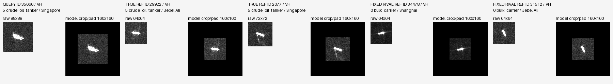

## stage vs baseline / harmed / ID 20791 / seed 17

truth=chemical_tanker; chemical_tanker -> general_cargo; fixed rival=general_cargo; margin 0.235659 -> -0.298461; NLL 0.714209 -> 0.971651

MMSI=413586730; pass=S1A_060692_078D67; port=Port Klang
同类参考['24527', '7790']；固定竞争类['6913', '22755']；额外预测竞争类[]。
可见事实：待回看。模型证据：实际分差/预测及path_diagnosis.json；尚不能推断物理成因。

## stage vs baseline / CC / ID 35906 / seed 17

truth=bulk_carrier; bulk_carrier -> bulk_carrier; fixed rival=crude_oil_tanker; margin 2.239895 -> 1.065854; NLL 0.101894 -> 0.296677

MMSI=636023335; pass=S1A_060268_077D6F; port=Singapore
同类参考['34478', '31512']；固定竞争类['29922', '2077']；额外预测竞争类[]。
可见事实：待回看。模型证据：实际分差/预测及path_diagnosis.json；尚不能推断物理成因。

## stage vs baseline / WW / ID 26255 / seed 17

truth=container; bulk_carrier -> bulk_carrier; fixed rival=bulk_carrier; margin -9.774944 -> -7.401431; NLL 9.812899 -> 7.646925

MMSI=533133374; pass=S1A_060268_077D6F; port=Singapore
同类参考['36308', '23719']；固定竞争类['34478', '31512']；额外预测竞争类[]。
可见事实：待回看。模型证据：实际分差/预测及path_diagnosis.json；尚不能推断物理成因。

## preadd vs baseline / rescued / ID 30206 / seed 17

truth=chemical_tanker; container -> chemical_tanker; fixed rival=container; margin -1.086440 -> 0.925569; NLL 1.662252 -> 0.682044

MMSI=563208100; pass=S1A_060268_077D6F; port=Singapore
同类参考['24527', '7790']；固定竞争类['36308', '23719']；额外预测竞争类[]。
可见事实：待回看。模型证据：实际分差/预测及path_diagnosis.json；尚不能推断物理成因。

## preadd vs baseline / harmed / ID 34278 / seed 17

truth=container; container -> bulk_carrier; fixed rival=bulk_carrier; margin 0.125585 -> -0.765024; NLL 0.870659 -> 1.490245

MMSI=636019337; pass=S1A_060692_078D67; port=Port Klang
同类参考['36308', '23719']；固定竞争类['34478', '31512']；额外预测竞争类[]。
可见事实：待回看。模型证据：实际分差/预测及path_diagnosis.json；尚不能推断物理成因。

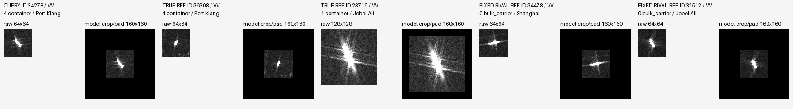

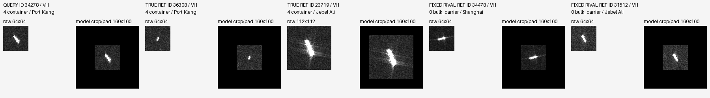

## preadd vs baseline / CC / ID 35906 / seed 17

truth=bulk_carrier; bulk_carrier -> bulk_carrier; fixed rival=crude_oil_tanker; margin 2.239895 -> 1.111355; NLL 0.101894 -> 0.285500

MMSI=636023335; pass=S1A_060268_077D6F; port=Singapore
同类参考['34478', '31512']；固定竞争类['29922', '2077']；额外预测竞争类[]。
可见事实：待回看。模型证据：实际分差/预测及path_diagnosis.json；尚不能推断物理成因。

## preadd vs baseline / WW / ID 26255 / seed 17

truth=container; bulk_carrier -> bulk_carrier; fixed rival=bulk_carrier; margin -9.774944 -> -7.577869; NLL 9.812899 -> 7.798261

MMSI=533133374; pass=S1A_060268_077D6F; port=Singapore
同类参考['36308', '23719']；固定竞争类['34478', '31512']；额外预测竞争类[]。
可见事实：待回看。模型证据：实际分差/预测及path_diagnosis.json；尚不能推断物理成因。

## postadd vs baseline / rescued / ID 30206 / seed 17

truth=chemical_tanker; container -> chemical_tanker; fixed rival=container; margin -1.086440 -> 0.641292; NLL 1.662252 -> 0.803710

MMSI=563208100; pass=S1A_060268_077D6F; port=Singapore
同类参考['24527', '7790']；固定竞争类['36308', '23719']；额外预测竞争类[]。
可见事实：待回看。模型证据：实际分差/预测及path_diagnosis.json；尚不能推断物理成因。

## postadd vs baseline / harmed / ID 34278 / seed 17

truth=container; container -> bulk_carrier; fixed rival=bulk_carrier; margin 0.125585 -> -0.725191; NLL 0.870659 -> 1.459843

MMSI=636019337; pass=S1A_060692_078D67; port=Port Klang
同类参考['36308', '23719']；固定竞争类['34478', '31512']；额外预测竞争类[]。
可见事实：待回看。模型证据：实际分差/预测及path_diagnosis.json；尚不能推断物理成因。

## postadd vs baseline / CC / ID 28385 / seed 17

truth=bulk_carrier; bulk_carrier -> bulk_carrier; fixed rival=general_cargo; margin 3.685773 -> 2.644833; NLL 0.053067 -> 0.131240

MMSI=538010224; pass=S1A_060692_078D67; port=Port Klang
同类参考['34478', '31512']；固定竞争类['6913', '22755']；额外预测竞争类[]。
可见事实：待回看。模型证据：实际分差/预测及path_diagnosis.json；尚不能推断物理成因。

## postadd vs baseline / WW / ID 26255 / seed 17

truth=container; bulk_carrier -> bulk_carrier; fixed rival=bulk_carrier; margin -9.774944 -> -7.442900; NLL 9.812899 -> 7.693430

MMSI=533133374; pass=S1A_060268_077D6F; port=Singapore
同类参考['36308', '23719']；固定竞争类['34478', '31512']；额外预测竞争类[]。
可见事实：待回看。模型证据：实际分差/预测及path_diagnosis.json；尚不能推断物理成因。

## preadd vs stage / rescued / ID 30206 / seed 17

truth=chemical_tanker; crude_oil_tanker -> chemical_tanker; fixed rival=container; margin 0.360342 -> 0.925569; NLL 1.126762 -> 0.682044

MMSI=563208100; pass=S1A_060268_077D6F; port=Singapore
同类参考['24527', '7790']；固定竞争类['36308', '23719']；额外预测竞争类['29922', '2077']。
可见事实：待回看。模型证据：实际分差/预测及path_diagnosis.json；尚不能推断物理成因。

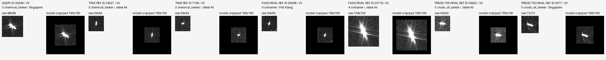

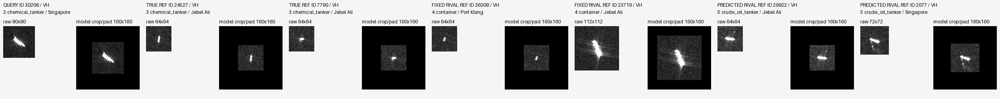

## preadd vs stage / harmed / ID 31069 / seed 17

truth=chemical_tanker; chemical_tanker -> bulk_carrier; fixed rival=bulk_carrier; margin 0.325288 -> -0.158655; NLL 0.635797 -> 0.854313

MMSI=565497000; pass=S1A_060268_077D6F; port=Singapore
同类参考['24527', '7790']；固定竞争类['34478', '31512']；额外预测竞争类[]。
可见事实：待回看。模型证据：实际分差/预测及path_diagnosis.json；尚不能推断物理成因。

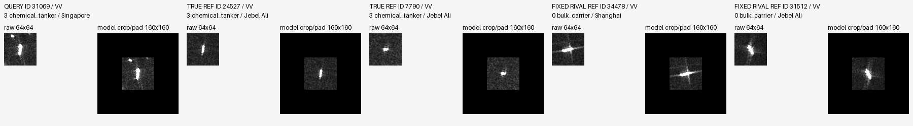

## preadd vs stage / CC / ID 24553 / seed 17

truth=chemical_tanker; chemical_tanker -> chemical_tanker; fixed rival=general_cargo; margin 0.687770 -> 1.387064; NLL 0.424699 -> 0.237739

MMSI=518999494; pass=S1A_058688_074483; port=Jebel Ali
同类参考['24527', '7790']；固定竞争类['6913', '22755']；额外预测竞争类[]。
可见事实：待回看。模型证据：实际分差/预测及path_diagnosis.json；尚不能推断物理成因。

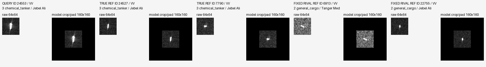

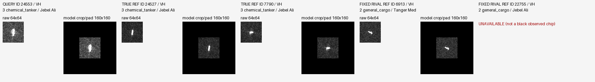

## preadd vs stage / WW / ID 8857 / seed 17

truth=chemical_tanker; crude_oil_tanker -> crude_oil_tanker; fixed rival=crude_oil_tanker; margin -5.822061 -> -5.060637; NLL 5.847491 -> 5.105128

MMSI=352002851; pass=S1A_060268_077D6F; port=Singapore
同类参考['24527', '7790']；固定竞争类['29922', '2077']；额外预测竞争类[]。
可见事实：待回看。模型证据：实际分差/预测及path_diagnosis.json；尚不能推断物理成因。

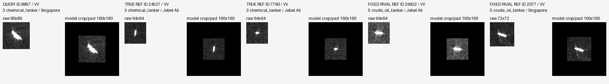

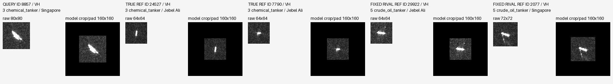

## postadd vs stage / rescued / ID 31779 / seed 17

truth=chemical_tanker; general_cargo -> chemical_tanker; fixed rival=general_cargo; margin -0.280899 -> 0.233935; NLL 0.887682 -> 0.627864

MMSI=574005560; pass=S1A_060268_077D6F; port=Singapore
同类参考['24527', '7790']；固定竞争类['6913', '22755']；额外预测竞争类[]。
可见事实：待回看。模型证据：实际分差/预测及path_diagnosis.json；尚不能推断物理成因。

## postadd vs stage / harmed / ID 31069 / seed 17

truth=chemical_tanker; chemical_tanker -> bulk_carrier; fixed rival=bulk_carrier; margin 0.325288 -> -0.156861; NLL 0.635797 -> 0.854017

MMSI=565497000; pass=S1A_060268_077D6F; port=Singapore
同类参考['24527', '7790']；固定竞争类['34478', '31512']；额外预测竞争类[]。
可见事实：待回看。模型证据：实际分差/预测及path_diagnosis.json；尚不能推断物理成因。

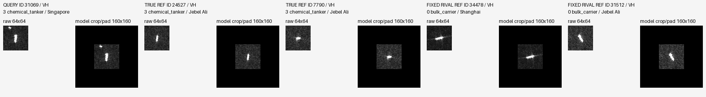

## postadd vs stage / CC / ID 4908 / seed 17

truth=bulk_carrier; bulk_carrier -> bulk_carrier; fixed rival=chemical_tanker; margin 1.357136 -> 1.934075; NLL 0.230297 -> 0.135994

MMSI=256919000; pass=S1A_058688_074483; port=Jebel Ali
同类参考['34478', '31512']；固定竞争类['24527', '7790']；额外预测竞争类[]。
可见事实：待回看。模型证据：实际分差/预测及path_diagnosis.json；尚不能推断物理成因。

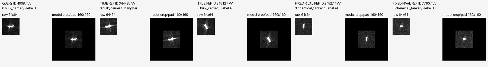

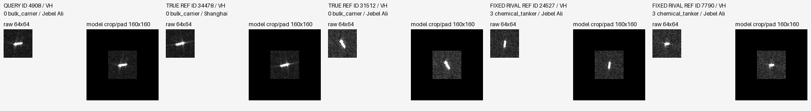

## postadd vs stage / WW / ID 28198 / seed 17

truth=offshore; crude_oil_tanker -> crude_oil_tanker; fixed rival=bulk_carrier; margin -18.457304 -> -19.076891; NLL 19.831814 -> 20.193918

MMSI=538009741; pass=S1A_060268_077D6F; port=Singapore
同类参考['13000', '13276']；固定竞争类['34478', '31512']；额外预测竞争类['29922', '2077']。
可见事实：待回看。模型证据：实际分差/预测及path_diagnosis.json；尚不能推断物理成因。

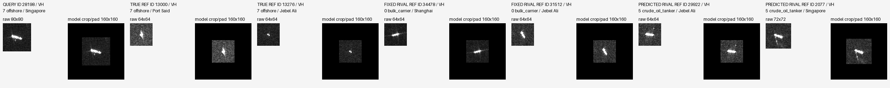

## postadd vs preadd / CC / ID 12595 / seed 17

truth=bulk_carrier; bulk_carrier -> bulk_carrier; fixed rival=chemical_tanker; margin 4.238631 -> 4.525831; NLL 0.020180 -> 0.016295

MMSI=372136000; pass=S1A_060268_077D6F; port=Singapore
同类参考['34478', '31512']；固定竞争类['24527', '7790']；额外预测竞争类[]。
可见事实：待回看。模型证据：实际分差/预测及path_diagnosis.json；尚不能推断物理成因。

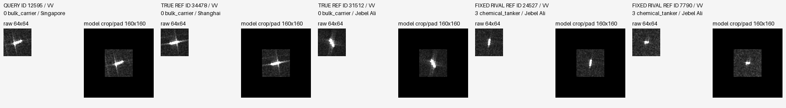

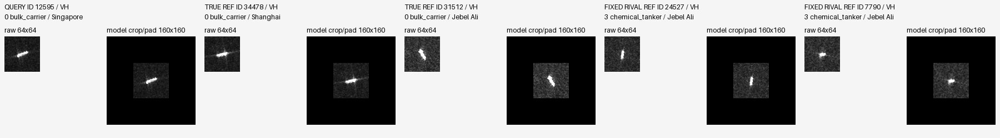

## postadd vs preadd / WW / ID 25311 / seed 17

truth=bulk_carrier; chemical_tanker -> chemical_tanker; fixed rival=chemical_tanker; margin -0.786847 -> -0.548182; NLL 1.608434 -> 1.478075

MMSI=525801752; pass=S1A_060268_077D6F; port=Singapore
同类参考['34478', '31512']；固定竞争类['24527', '7790']；额外预测竞争类[]。
可见事实：待回看。模型证据：实际分差/预测及path_diagnosis.json；尚不能推断物理成因。

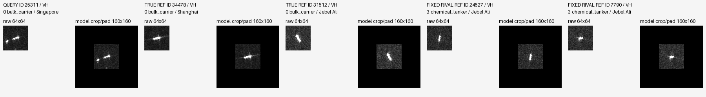

## preadd vs baseline / WW / ID 31069 / seed 17

truth=chemical_tanker; bulk_carrier -> bulk_carrier; fixed rival=bulk_carrier; margin -0.154049 -> -0.158655; NLL 0.874446 -> 0.854313

MMSI=565497000; pass=S1A_060268_077D6F; port=Singapore
同类参考['24527', '7790']；固定竞争类['34478', '31512']；额外预测竞争类[]。
可见事实：待回看。模型证据：实际分差/预测及path_diagnosis.json；尚不能推断物理成因。

## postadd vs baseline / WW / ID 31069 / seed 17

truth=chemical_tanker; bulk_carrier -> bulk_carrier; fixed rival=bulk_carrier; margin -0.154049 -> -0.156861; NLL 0.874446 -> 0.854017

MMSI=565497000; pass=S1A_060268_077D6F; port=Singapore
同类参考['24527', '7790']；固定竞争类['34478', '31512']；额外预测竞争类[]。
可见事实：待回看。模型证据：实际分差/预测及path_diagnosis.json；尚不能推断物理成因。

## postadd vs preadd / harmed / ID 30206 / seed 43

truth=chemical_tanker; chemical_tanker -> container; fixed rival=container; margin 0.021830 -> -0.215489; NLL 1.188961 -> 1.334215

MMSI=563208100; pass=S1A_060268_077D6F; port=Singapore
同类参考['24527', '7790']；固定竞争类['36308', '23719']；额外预测竞争类[]。
可见事实：待回看。模型证据：实际分差/预测及path_diagnosis.json；尚不能推断物理成因。

