# 原图案例待复核

自动选例不是已读图。分组相对reference_arm；主体seed17，补充翻转例以标题seed为准；指定诊断例优先，其余按固定竞争类分差变化选取。

## stage vs baseline / rescued / ID 35666 / seed 17

truth=crude_oil_tanker; bulk_carrier -> crude_oil_tanker; fixed rival=bulk_carrier; margin -0.187241 -> 1.076455; NLL 0.829390 -> 0.357503

MMSI=636022759; pass=S1A_060268_077D6F; port=Singapore
同类参考['29922', '2077']；固定竞争类['34478', '31512']；额外预测竞争类[]。
可见事实：待回看。模型证据：实际分差/预测及path_diagnosis.json；尚不能推断物理成因。

## stage vs baseline / harmed / ID 20791 / seed 17

truth=chemical_tanker; chemical_tanker -> general_cargo; fixed rival=general_cargo; margin 0.235659 -> -0.298461; NLL 0.714209 -> 0.971651

MMSI=413586730; pass=S1A_060692_078D67; port=Port Klang
同类参考['24527', '7790']；固定竞争类['6913', '22755']；额外预测竞争类[]。
可见事实：待回看。模型证据：实际分差/预测及path_diagnosis.json；尚不能推断物理成因。

## stage vs baseline / CC / ID 35906 / seed 17

truth=bulk_carrier; bulk_carrier -> bulk_carrier; fixed rival=crude_oil_tanker; margin 2.239895 -> 1.065854; NLL 0.101894 -> 0.296677

MMSI=636023335; pass=S1A_060268_077D6F; port=Singapore
同类参考['34478', '31512']；固定竞争类['29922', '2077']；额外预测竞争类[]。
可见事实：待回看。模型证据：实际分差/预测及path_diagnosis.json；尚不能推断物理成因。

## stage vs baseline / WW / ID 26255 / seed 17

truth=container; bulk_carrier -> bulk_carrier; fixed rival=bulk_carrier; margin -9.774944 -> -7.401431; NLL 9.812899 -> 7.646925

MMSI=533133374; pass=S1A_060268_077D6F; port=Singapore
同类参考['36308', '23719']；固定竞争类['34478', '31512']；额外预测竞争类[]。
可见事实：待回看。模型证据：实际分差/预测及path_diagnosis.json；尚不能推断物理成因。

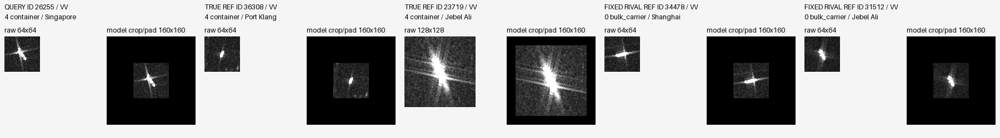

## block1 vs baseline / rescued / ID 21161 / seed 17

truth=chemical_tanker; bulk_carrier -> chemical_tanker; fixed rival=bulk_carrier; margin -0.756182 -> 0.232673; NLL 1.185065 -> 0.644867

MMSI=414491000; pass=S1A_060268_077D6F; port=Singapore
同类参考['24527', '7790']；固定竞争类['34478', '31512']；额外预测竞争类[]。
可见事实：待回看。模型证据：实际分差/预测及path_diagnosis.json；尚不能推断物理成因。

## block1 vs baseline / harmed / ID 20791 / seed 17

truth=chemical_tanker; chemical_tanker -> general_cargo; fixed rival=general_cargo; margin 0.235659 -> -0.469154; NLL 0.714209 -> 1.039023

MMSI=413586730; pass=S1A_060692_078D67; port=Port Klang
同类参考['24527', '7790']；固定竞争类['6913', '22755']；额外预测竞争类[]。
可见事实：待回看。模型证据：实际分差/预测及path_diagnosis.json；尚不能推断物理成因。

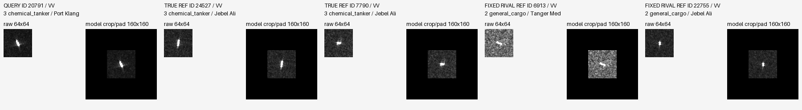

## block1 vs baseline / CC / ID 26628 / seed 17

truth=chemical_tanker; chemical_tanker -> chemical_tanker; fixed rival=bulk_carrier; margin 2.898348 -> 1.735845; NLL 0.089049 -> 0.267645

MMSI=538004002; pass=S1A_058688_074483; port=Jebel Ali
同类参考['24527', '7790']；固定竞争类['34478', '31512']；额外预测竞争类[]。
可见事实：待回看。模型证据：实际分差/预测及path_diagnosis.json；尚不能推断物理成因。

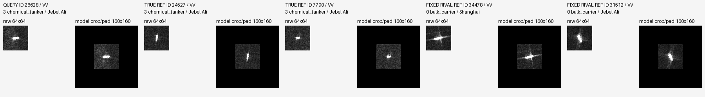

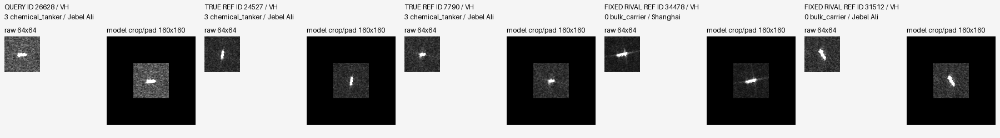

## block1 vs baseline / WW / ID 26255 / seed 17

truth=container; bulk_carrier -> bulk_carrier; fixed rival=bulk_carrier; margin -9.774944 -> -7.192365; NLL 9.812899 -> 7.536591

MMSI=533133374; pass=S1A_060268_077D6F; port=Singapore
同类参考['36308', '23719']；固定竞争类['34478', '31512']；额外预测竞争类[]。
可见事实：待回看。模型证据：实际分差/预测及path_diagnosis.json；尚不能推断物理成因。

## block2 vs baseline / rescued / ID 30206 / seed 17

truth=chemical_tanker; container -> chemical_tanker; fixed rival=container; margin -1.086440 -> 1.060448; NLL 1.662252 -> 0.757865

MMSI=563208100; pass=S1A_060268_077D6F; port=Singapore
同类参考['24527', '7790']；固定竞争类['36308', '23719']；额外预测竞争类[]。
可见事实：待回看。模型证据：实际分差/预测及path_diagnosis.json；尚不能推断物理成因。

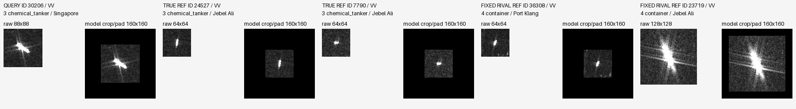

## block2 vs baseline / harmed / ID 34278 / seed 17

truth=container; container -> bulk_carrier; fixed rival=bulk_carrier; margin 0.125585 -> -0.503618; NLL 0.870659 -> 1.298142

MMSI=636019337; pass=S1A_060692_078D67; port=Port Klang
同类参考['36308', '23719']；固定竞争类['34478', '31512']；额外预测竞争类[]。
可见事实：待回看。模型证据：实际分差/预测及path_diagnosis.json；尚不能推断物理成因。

## block2 vs baseline / CC / ID 28385 / seed 17

truth=bulk_carrier; bulk_carrier -> bulk_carrier; fixed rival=general_cargo; margin 3.685773 -> 2.657935; NLL 0.053067 -> 0.119545

MMSI=538010224; pass=S1A_060692_078D67; port=Port Klang
同类参考['34478', '31512']；固定竞争类['6913', '22755']；额外预测竞争类[]。
可见事实：待回看。模型证据：实际分差/预测及path_diagnosis.json；尚不能推断物理成因。

## block2 vs baseline / WW / ID 26255 / seed 17

truth=container; bulk_carrier -> bulk_carrier; fixed rival=bulk_carrier; margin -9.774944 -> -7.580726; NLL 9.812899 -> 7.806872

MMSI=533133374; pass=S1A_060268_077D6F; port=Singapore
同类参考['36308', '23719']；固定竞争类['34478', '31512']；额外预测竞争类[]。
可见事实：待回看。模型证据：实际分差/预测及path_diagnosis.json；尚不能推断物理成因。

## block3 vs baseline / rescued / ID 30206 / seed 17

truth=chemical_tanker; container -> chemical_tanker; fixed rival=container; margin -1.086440 -> 0.925569; NLL 1.662252 -> 0.682044

MMSI=563208100; pass=S1A_060268_077D6F; port=Singapore
同类参考['24527', '7790']；固定竞争类['36308', '23719']；额外预测竞争类[]。
可见事实：待回看。模型证据：实际分差/预测及path_diagnosis.json；尚不能推断物理成因。

## block3 vs baseline / harmed / ID 34278 / seed 17

truth=container; container -> bulk_carrier; fixed rival=bulk_carrier; margin 0.125585 -> -0.765024; NLL 0.870659 -> 1.490245

MMSI=636019337; pass=S1A_060692_078D67; port=Port Klang
同类参考['36308', '23719']；固定竞争类['34478', '31512']；额外预测竞争类[]。
可见事实：待回看。模型证据：实际分差/预测及path_diagnosis.json；尚不能推断物理成因。

## block3 vs baseline / CC / ID 35906 / seed 17

truth=bulk_carrier; bulk_carrier -> bulk_carrier; fixed rival=crude_oil_tanker; margin 2.239895 -> 1.111355; NLL 0.101894 -> 0.285500

MMSI=636023335; pass=S1A_060268_077D6F; port=Singapore
同类参考['34478', '31512']；固定竞争类['29922', '2077']；额外预测竞争类[]。
可见事实：待回看。模型证据：实际分差/预测及path_diagnosis.json；尚不能推断物理成因。

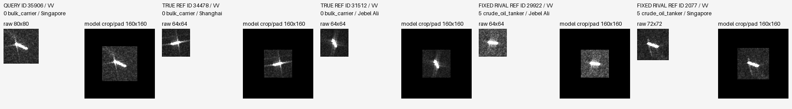

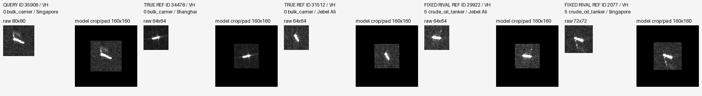

## block3 vs baseline / WW / ID 26255 / seed 17

truth=container; bulk_carrier -> bulk_carrier; fixed rival=bulk_carrier; margin -9.774944 -> -7.577869; NLL 9.812899 -> 7.798261

MMSI=533133374; pass=S1A_060268_077D6F; port=Singapore
同类参考['36308', '23719']；固定竞争类['34478', '31512']；额外预测竞争类[]。
可见事实：待回看。模型证据：实际分差/预测及path_diagnosis.json；尚不能推断物理成因。

## block1 vs block3 / harmed / ID 30206 / seed 17

truth=chemical_tanker; chemical_tanker -> container; fixed rival=container; margin 0.925569 -> -0.026837; NLL 0.682044 -> 0.934424

MMSI=563208100; pass=S1A_060268_077D6F; port=Singapore
同类参考['24527', '7790']；固定竞争类['36308', '23719']；额外预测竞争类[]。
可见事实：待回看。模型证据：实际分差/预测及path_diagnosis.json；尚不能推断物理成因。

## block1 vs block3 / CC / ID 9574 / seed 17

truth=chemical_tanker; chemical_tanker -> chemical_tanker; fixed rival=container; margin 6.216624 -> 7.664745; NLL 0.002565 -> 0.000859

MMSI=352004436; pass=S1A_058688_074483; port=Jebel Ali
同类参考['24527', '7790']；固定竞争类['36308', '23719']；额外预测竞争类[]。
可见事实：待回看。模型证据：实际分差/预测及path_diagnosis.json；尚不能推断物理成因。

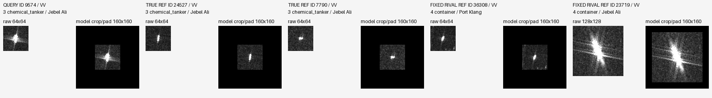

## block1 vs block3 / WW / ID 3693 / seed 17

truth=crude_oil_tanker; bulk_carrier -> bulk_carrier; fixed rival=bulk_carrier; margin -3.914704 -> -5.300758; NLL 3.934732 -> 5.305852

MMSI=248123000; pass=S1A_058688_074483; port=Jebel Ali
同类参考['29922', '2077']；固定竞争类['34478', '31512']；额外预测竞争类[]。
可见事实：待回看。模型证据：实际分差/预测及path_diagnosis.json；尚不能推断物理成因。

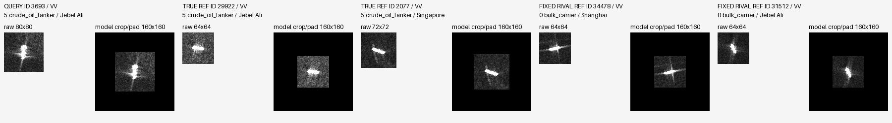

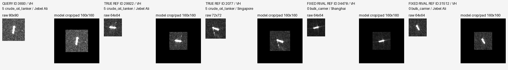

## block1 vs stage / harmed / ID 30167 / seed 17

truth=container; container -> bulk_carrier; fixed rival=bulk_carrier; margin 0.672503 -> -0.344209; NLL 0.438459 -> 0.903821

MMSI=563202400; pass=S1A_060692_078D67; port=Port Klang
同类参考['36308', '23719']；固定竞争类['34478', '31512']；额外预测竞争类[]。
可见事实：待回看。模型证据：实际分差/预测及path_diagnosis.json；尚不能推断物理成因。

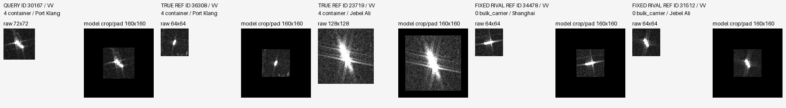

## block1 vs stage / CC / ID 9574 / seed 17

truth=chemical_tanker; chemical_tanker -> chemical_tanker; fixed rival=container; margin 6.529063 -> 7.664745; NLL 0.001976 -> 0.000859

MMSI=352004436; pass=S1A_058688_074483; port=Jebel Ali
同类参考['24527', '7790']；固定竞争类['36308', '23719']；额外预测竞争类[]。
可见事实：待回看。模型证据：实际分差/预测及path_diagnosis.json；尚不能推断物理成因。

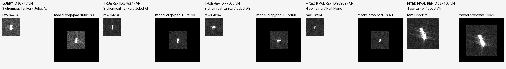

## block1 vs stage / WW / ID 3693 / seed 17

truth=crude_oil_tanker; bulk_carrier -> bulk_carrier; fixed rival=bulk_carrier; margin -3.724022 -> -5.300758; NLL 3.748268 -> 5.305852

MMSI=248123000; pass=S1A_058688_074483; port=Jebel Ali
同类参考['29922', '2077']；固定竞争类['34478', '31512']；额外预测竞争类[]。
可见事实：待回看。模型证据：实际分差/预测及path_diagnosis.json；尚不能推断物理成因。

## block2 vs block3 / rescued / ID 12457 / seed 17

truth=bulk_carrier; chemical_tanker -> bulk_carrier; fixed rival=chemical_tanker; margin -0.339270 -> 0.331699; NLL 1.300999 -> 0.865283

MMSI=371234000; pass=S1A_058688_074483; port=Jebel Ali
同类参考['34478', '31512']；固定竞争类['24527', '7790']；额外预测竞争类[]。
可见事实：待回看。模型证据：实际分差/预测及path_diagnosis.json；尚不能推断物理成因。

## block2 vs block3 / harmed / ID 30167 / seed 17

truth=container; container -> bulk_carrier; fixed rival=bulk_carrier; margin 0.432519 -> -0.016634; NLL 0.525744 -> 0.727041

MMSI=563202400; pass=S1A_060692_078D67; port=Port Klang
同类参考['36308', '23719']；固定竞争类['34478', '31512']；额外预测竞争类[]。
可见事实：待回看。模型证据：实际分差/预测及path_diagnosis.json；尚不能推断物理成因。

## block2 vs block3 / CC / ID 9574 / seed 17

truth=chemical_tanker; chemical_tanker -> chemical_tanker; fixed rival=container; margin 6.216624 -> 7.521118; NLL 0.002565 -> 0.000817

MMSI=352004436; pass=S1A_058688_074483; port=Jebel Ali
同类参考['24527', '7790']；固定竞争类['36308', '23719']；额外预测竞争类[]。
可见事实：待回看。模型证据：实际分差/预测及path_diagnosis.json；尚不能推断物理成因。

## block2 vs block3 / WW / ID 36077 / seed 17

truth=offshore; crude_oil_tanker -> crude_oil_tanker; fixed rival=crude_oil_tanker; margin -9.625959 -> -10.713140; NLL 9.912205 -> 10.948457

MMSI=636023904; pass=S1A_060692_078D67; port=Port Klang
同类参考['13000', '13276']；固定竞争类['29922', '2077']；额外预测竞争类[]。
可见事实：待回看。模型证据：实际分差/预测及path_diagnosis.json；尚不能推断物理成因。

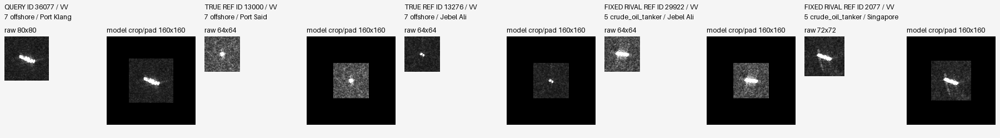

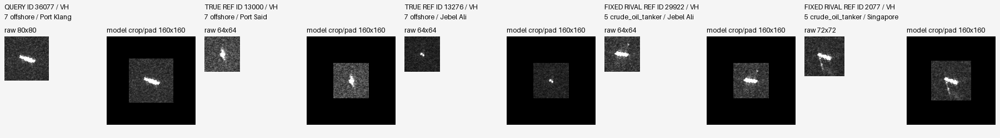

## block2 vs stage / rescued / ID 30206 / seed 17

truth=chemical_tanker; crude_oil_tanker -> chemical_tanker; fixed rival=container; margin 0.360342 -> 1.060448; NLL 1.126762 -> 0.757865

MMSI=563208100; pass=S1A_060268_077D6F; port=Singapore
同类参考['24527', '7790']；固定竞争类['36308', '23719']；额外预测竞争类['29922', '2077']。
可见事实：待回看。模型证据：实际分差/预测及path_diagnosis.json；尚不能推断物理成因。

## block2 vs stage / harmed / ID 30167 / seed 17

truth=container; container -> bulk_carrier; fixed rival=bulk_carrier; margin 0.672503 -> -0.016634; NLL 0.438459 -> 0.727041

MMSI=563202400; pass=S1A_060692_078D67; port=Port Klang
同类参考['36308', '23719']；固定竞争类['34478', '31512']；额外预测竞争类[]。
可见事实：待回看。模型证据：实际分差/预测及path_diagnosis.json；尚不能推断物理成因。

## block2 vs stage / CC / ID 28657 / seed 17

truth=crude_oil_tanker; crude_oil_tanker -> crude_oil_tanker; fixed rival=bulk_carrier; margin 3.308449 -> 4.345874; NLL 0.037617 -> 0.013918

MMSI=538010884; pass=S1A_060268_077D6F; port=Singapore
同类参考['29922', '2077']；固定竞争类['34478', '31512']；额外预测竞争类[]。
可见事实：待回看。模型证据：实际分差/预测及path_diagnosis.json；尚不能推断物理成因。

## block2 vs stage / WW / ID 36661 / seed 17

truth=container; crude_oil_tanker -> crude_oil_tanker; fixed rival=bulk_carrier; margin -3.133522 -> -4.339347; NLL 4.697274 -> 5.433302

MMSI=636092247; pass=S1A_060692_078D67; port=Port Klang
同类参考['36308', '23719']；固定竞争类['34478', '31512']；额外预测竞争类['29922', '2077']。
可见事实：待回看。模型证据：实际分差/预测及path_diagnosis.json；尚不能推断物理成因。

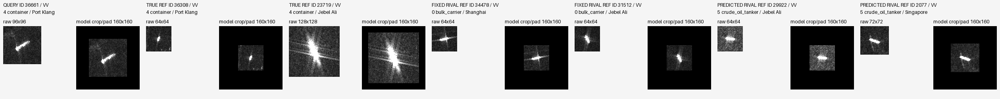

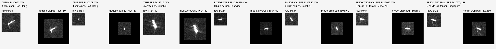

## block2 vs block1 / rescued / ID 30206 / seed 17

truth=chemical_tanker; container -> chemical_tanker; fixed rival=container; margin -0.026837 -> 1.060448; NLL 0.934424 -> 0.757865

MMSI=563208100; pass=S1A_060268_077D6F; port=Singapore
同类参考['24527', '7790']；固定竞争类['36308', '23719']；额外预测竞争类[]。
可见事实：待回看。模型证据：实际分差/预测及path_diagnosis.json；尚不能推断物理成因。

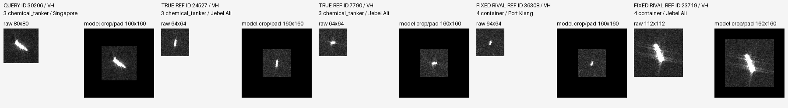

## block2 vs block1 / CC / ID 29078 / seed 17

truth=chemical_tanker; chemical_tanker -> chemical_tanker; fixed rival=general_cargo; margin 2.952947 -> 3.857372; NLL 0.319116 -> 0.124224

MMSI=538090617; pass=S1A_058688_074483; port=Jebel Ali
同类参考['24527', '7790']；固定竞争类['6913', '22755']；额外预测竞争类[]。
可见事实：待回看。模型证据：实际分差/预测及path_diagnosis.json；尚不能推断物理成因。

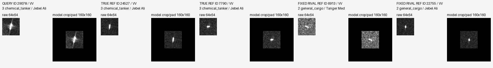

## block2 vs block1 / WW / ID 27525 / seed 17

truth=bulk_carrier; container -> container; fixed rival=container; margin -4.781075 -> -3.690413; NLL 5.052664 -> 4.125232

MMSI=538007954; pass=S1A_060268_077D6F; port=Singapore
同类参考['34478', '31512']；固定竞争类['36308', '23719']；额外预测竞争类[]。
可见事实：待回看。模型证据：实际分差/预测及path_diagnosis.json；尚不能推断物理成因。

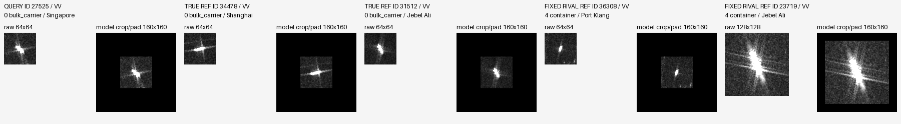

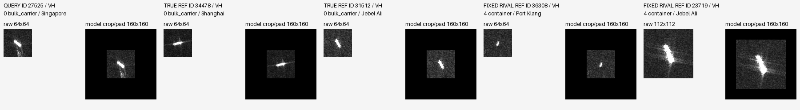

## stage vs baseline / rescued / ID 7602 / seed 29

truth=general_cargo; chemical_tanker -> general_cargo; fixed rival=chemical_tanker; margin -0.752707 -> 0.150191; NLL 1.410543 -> 0.814660

MMSI=341398001; pass=S1A_058688_074483; port=Jebel Ali
同类参考['6913', '22755']；固定竞争类['24527', '7790']；额外预测竞争类[]。
可见事实：待回看。模型证据：实际分差/预测及path_diagnosis.json；尚不能推断物理成因。

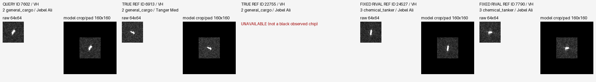

## stage vs baseline / harmed / ID 31779 / seed 29

truth=chemical_tanker; chemical_tanker -> general_cargo; fixed rival=general_cargo; margin 0.285415 -> -0.382023; NLL 0.608401 -> 0.936123

MMSI=574005560; pass=S1A_060268_077D6F; port=Singapore
同类参考['24527', '7790']；固定竞争类['6913', '22755']；额外预测竞争类[]。
可见事实：待回看。模型证据：实际分差/预测及path_diagnosis.json；尚不能推断物理成因。

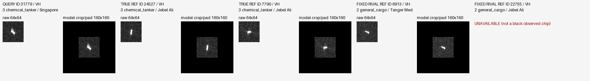

## block1 vs baseline / rescued / ID 30206 / seed 29

truth=chemical_tanker; container -> chemical_tanker; fixed rival=container; margin -1.541232 -> 0.189822; NLL 2.007046 -> 0.976392

MMSI=563208100; pass=S1A_060268_077D6F; port=Singapore
同类参考['24527', '7790']；固定竞争类['36308', '23719']；额外预测竞争类[]。
可见事实：待回看。模型证据：实际分差/预测及path_diagnosis.json；尚不能推断物理成因。

## block1 vs baseline / harmed / ID 30167 / seed 29

truth=container; container -> bulk_carrier; fixed rival=bulk_carrier; margin 0.772496 -> -0.268596; NLL 0.390531 -> 0.863084

MMSI=563202400; pass=S1A_060692_078D67; port=Port Klang
同类参考['36308', '23719']；固定竞争类['34478', '31512']；额外预测竞争类[]。
可见事实：待回看。模型证据：实际分差/预测及path_diagnosis.json；尚不能推断物理成因。

## block1 vs block3 / rescued / ID 21161 / seed 29

truth=chemical_tanker; bulk_carrier -> chemical_tanker; fixed rival=bulk_carrier; margin -0.117238 -> 0.079595; NLL 0.821274 -> 0.726880

MMSI=414491000; pass=S1A_060268_077D6F; port=Singapore
同类参考['24527', '7790']；固定竞争类['34478', '31512']；额外预测竞争类[]。
可见事实：待回看。模型证据：实际分差/预测及path_diagnosis.json；尚不能推断物理成因。

## block1 vs block3 / harmed / ID 30167 / seed 29

truth=container; container -> bulk_carrier; fixed rival=bulk_carrier; margin 0.926810 -> -0.268596; NLL 0.351097 -> 0.863084

MMSI=563202400; pass=S1A_060692_078D67; port=Port Klang
同类参考['36308', '23719']；固定竞争类['34478', '31512']；额外预测竞争类[]。
可见事实：待回看。模型证据：实际分差/预测及path_diagnosis.json；尚不能推断物理成因。

## block1 vs stage / rescued / ID 30206 / seed 29

truth=chemical_tanker; crude_oil_tanker -> chemical_tanker; fixed rival=container; margin -0.273559 -> 0.189822; NLL 1.669093 -> 0.976392

MMSI=563208100; pass=S1A_060268_077D6F; port=Singapore
同类参考['24527', '7790']；固定竞争类['36308', '23719']；额外预测竞争类['29922', '2077']。
可见事实：待回看。模型证据：实际分差/预测及path_diagnosis.json；尚不能推断物理成因。

## block2 vs stage / harmed / ID 7602 / seed 29

truth=general_cargo; general_cargo -> chemical_tanker; fixed rival=chemical_tanker; margin 0.150191 -> -0.403335; NLL 0.814660 -> 1.122077

MMSI=341398001; pass=S1A_058688_074483; port=Jebel Ali
同类参考['6913', '22755']；固定竞争类['24527', '7790']；额外预测竞争类[]。
可见事实：待回看。模型证据：实际分差/预测及path_diagnosis.json；尚不能推断物理成因。

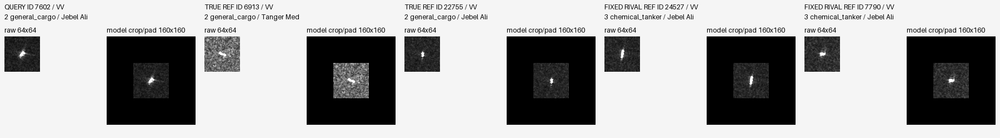

## block2 vs block1 / rescued / ID 30167 / seed 29

truth=container; bulk_carrier -> container; fixed rival=bulk_carrier; margin -0.268596 -> 0.466570; NLL 0.863084 -> 0.508437

MMSI=563202400; pass=S1A_060692_078D67; port=Port Klang
同类参考['36308', '23719']；固定竞争类['34478', '31512']；额外预测竞争类[]。
可见事实：待回看。模型证据：实际分差/预测及path_diagnosis.json；尚不能推断物理成因。

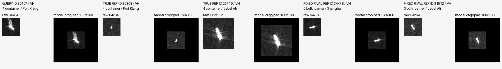

## block1 vs baseline / harmed / ID 31779 / seed 43

truth=chemical_tanker; chemical_tanker -> general_cargo; fixed rival=general_cargo; margin 0.034668 -> -0.582555; NLL 0.723063 -> 1.056740

MMSI=574005560; pass=S1A_060268_077D6F; port=Singapore
同类参考['24527', '7790']；固定竞争类['6913', '22755']；额外预测竞争类[]。
可见事实：待回看。模型证据：实际分差/预测及path_diagnosis.json；尚不能推断物理成因。

## block2 vs baseline / rescued / ID 21161 / seed 43

truth=chemical_tanker; bulk_carrier -> chemical_tanker; fixed rival=bulk_carrier; margin -0.785999 -> 0.133580; NLL 1.209348 -> 0.684151

MMSI=414491000; pass=S1A_060268_077D6F; port=Singapore
同类参考['24527', '7790']；固定竞争类['34478', '31512']；额外预测竞争类[]。
可见事实：待回看。模型证据：实际分差/预测及path_diagnosis.json；尚不能推断物理成因。

## block1 vs block3 / harmed / ID 32638 / seed 43

truth=chemical_tanker; chemical_tanker -> bulk_carrier; fixed rival=bulk_carrier; margin 0.384269 -> -0.416373; NLL 0.645853 -> 1.037271

MMSI=626224000; pass=S1A_058688_074483; port=Jebel Ali
同类参考['24527', '7790']；固定竞争类['34478', '31512']；额外预测竞争类[]。
可见事实：待回看。模型证据：实际分差/预测及path_diagnosis.json；尚不能推断物理成因。

## block2 vs block3 / harmed / ID 30206 / seed 43

truth=chemical_tanker; chemical_tanker -> crude_oil_tanker; fixed rival=container; margin 0.021830 -> 0.428424; NLL 1.188961 -> 1.205310

MMSI=563208100; pass=S1A_060268_077D6F; port=Singapore
同类参考['24527', '7790']；固定竞争类['36308', '23719']；额外预测竞争类['29922', '2077']。
可见事实：待回看。模型证据：实际分差/预测及path_diagnosis.json；尚不能推断物理成因。

## block2 vs stage / rescued / ID 12457 / seed 43

truth=bulk_carrier; chemical_tanker -> bulk_carrier; fixed rival=chemical_tanker; margin -0.043989 -> 0.215738; NLL 1.225165 -> 0.909902

MMSI=371234000; pass=S1A_058688_074483; port=Jebel Ali
同类参考['34478', '31512']；固定竞争类['24527', '7790']；额外预测竞争类[]。
可见事实：待回看。模型证据：实际分差/预测及path_diagnosis.json；尚不能推断物理成因。

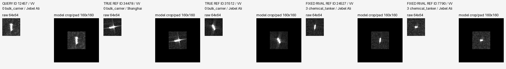

## block2 vs block1 / rescued / ID 32638 / seed 43

truth=chemical_tanker; bulk_carrier -> chemical_tanker; fixed rival=bulk_carrier; margin -0.416373 -> 0.657118; NLL 1.037271 -> 0.532876

MMSI=626224000; pass=S1A_058688_074483; port=Jebel Ali
同类参考['24527', '7790']；固定竞争类['34478', '31512']；额外预测竞争类[]。
可见事实：待回看。模型证据：实际分差/预测及path_diagnosis.json；尚不能推断物理成因。

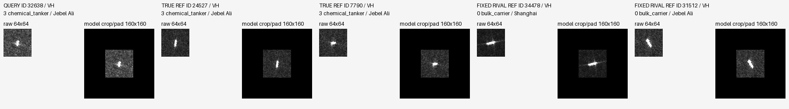

## block2 vs baseline / WW / ID 31141 / seed 17

truth=offshore; crude_oil_tanker -> crude_oil_tanker; fixed rival=bulk_carrier; margin -8.779673 -> -10.385903; NLL 9.900139 -> 12.010660

MMSI=565709000; pass=S1A_060268_077D6F; port=Singapore
同类参考['13000', '13276']；固定竞争类['34478', '31512']；额外预测竞争类['29922', '2077']。
可见事实：待回看。模型证据：实际分差/预测及path_diagnosis.json；尚不能推断物理成因。

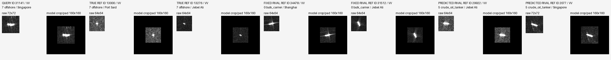

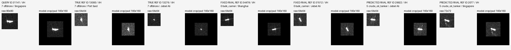

## block2 vs baseline / rescued / ID 12457 / seed 17

truth=bulk_carrier; chemical_tanker -> bulk_carrier; fixed rival=chemical_tanker; margin -0.252143 -> 0.331699; NLL 1.263353 -> 0.865283

MMSI=371234000; pass=S1A_058688_074483; port=Jebel Ali
同类参考['34478', '31512']；固定竞争类['24527', '7790']；额外预测竞争类[]。
可见事实：待回看。模型证据：实际分差/预测及path_diagnosis.json；尚不能推断物理成因。

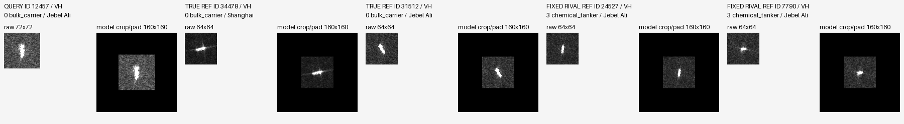

## block2 vs baseline / harmed / ID 30167 / seed 17

truth=container; container -> bulk_carrier; fixed rival=bulk_carrier; margin 0.160811 -> -0.016634; NLL 0.630305 -> 0.727041

MMSI=563202400; pass=S1A_060692_078D67; port=Port Klang
同类参考['36308', '23719']；固定竞争类['34478', '31512']；额外预测竞争类[]。
可见事实：待回看。模型证据：实际分差/预测及path_diagnosis.json；尚不能推断物理成因。

