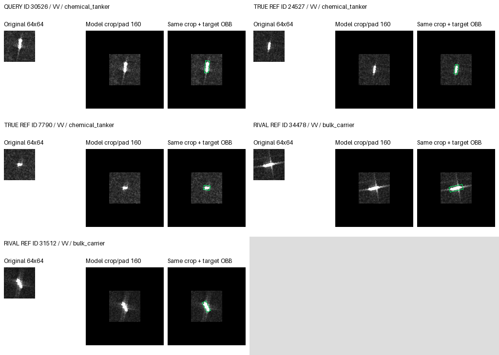
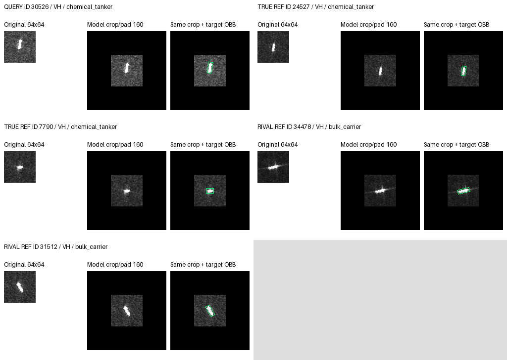
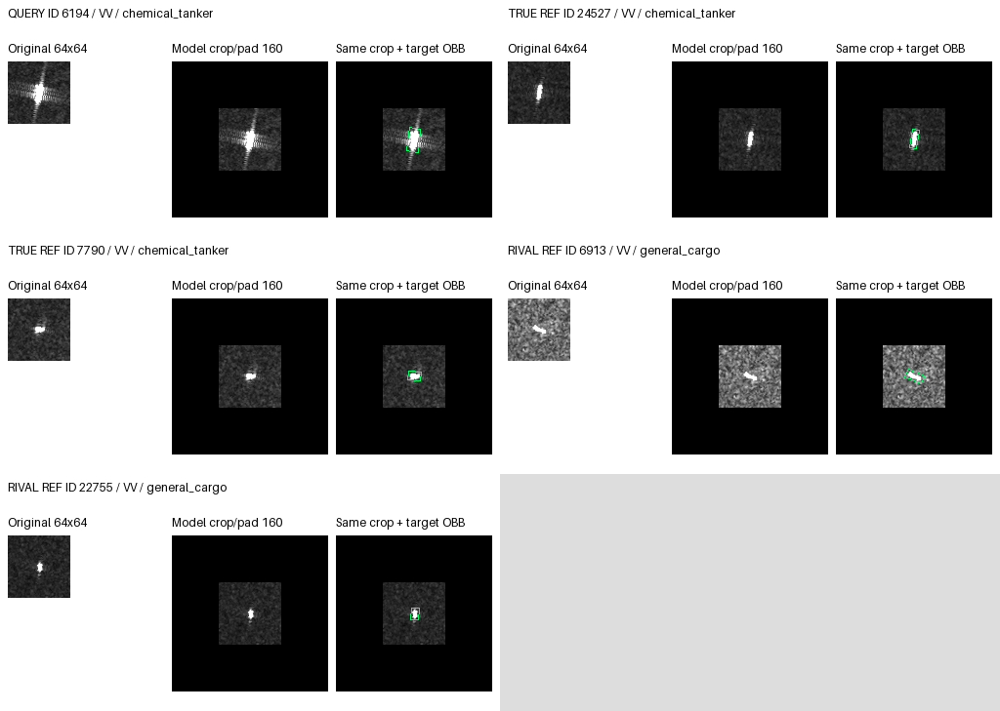
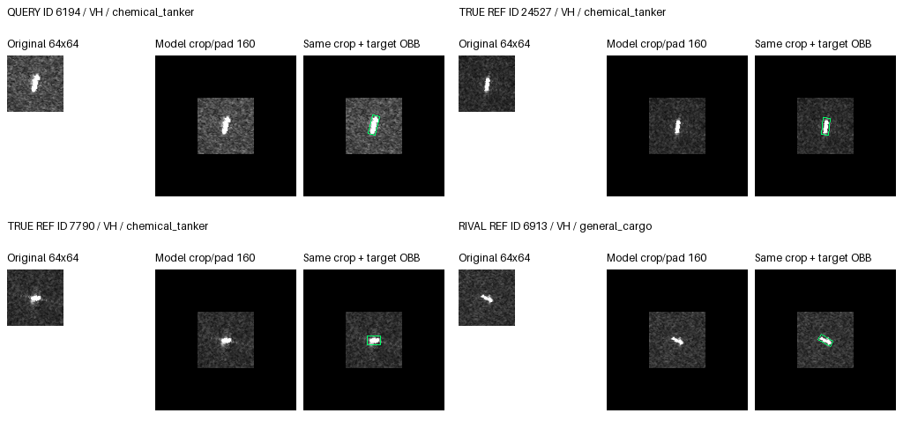

# Requested private transplant cases

Comparison: center_joint_m3_only versus saved full baseline; development only.
Selection: seed43 rescue / seed29 harm; exclude 10407, 2042, 27525; largest absolute fixed-rival margin change, then ID. No tuning.
References: actual source bank, exclude identical ID/MMSI; first two available true/rival class entries in bank order. Posthoc labels only.

## rescued 30526 seed43

Truth: chemical_tanker; fixed rival: bulk_carrier.

| Arm | Prediction | Truth minus fixed rival |
|---|---|---|
| saved_baseline | bulk_carrier | -0.253966153 |
| raw_joint | bulk_carrier | -0.245126247 |
| center_joint | bulk_carrier | -0.232401729 |
| raw_joint_m3_only | bulk_carrier | -0.097256660 |
| raw_joint_live_only | bulk_carrier | -0.401094109 |
| center_joint_m3_only | chemical_tanker | +0.057359338 |
| center_joint_live_only | bulk_carrier | -0.553033620 |

VV references: 24527, 7790, 34478, 31512

VH references: 24527, 7790, 34478, 31512

## harmed 6194 seed29

Truth: chemical_tanker; fixed rival: general_cargo.

| Arm | Prediction | Truth minus fixed rival |
|---|---|---|
| saved_baseline | chemical_tanker | +0.090707272 |
| raw_joint | chemical_tanker | +0.089759663 |
| center_joint | chemical_tanker | +0.117202066 |
| raw_joint_m3_only | chemical_tanker | +0.055261791 |
| raw_joint_live_only | chemical_tanker | +0.124367468 |
| center_joint_m3_only | general_cargo | -0.011748374 |
| center_joint_live_only | chemical_tanker | +0.235901363 |

VV references: 24527, 7790, 6913, 22755

VH references: 24527, 7790, 6913

