# 原始 chip 案例

确定性事后代表例，不代表总体比例。三 seed 结果与分差见 cases.json。
VV/VH 分开，原始 8-bit 显示值、1:1 像素及模型 crop/pad 同时展示；未作拉伸或对比度增强。
主代理已逐幅回看下述8查询的VV/VH与实际参考。事实、路径诊断和解释边界见 ../../CASE_NOTES_ZH.md；不据外观断言物理原因。

## rescue_34733 / bulk_carrier / Santos / {'rescue': 3, 'harm': 0, 'CC': 0, 'WW': 0}

三 seed 平均 top1 分差变化 +2.084646；展示 seed 29。
实际同类参考 ['34478', '31512']；实际混淆类参考 ['36308', '23719']。

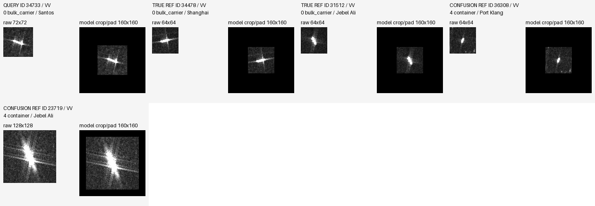
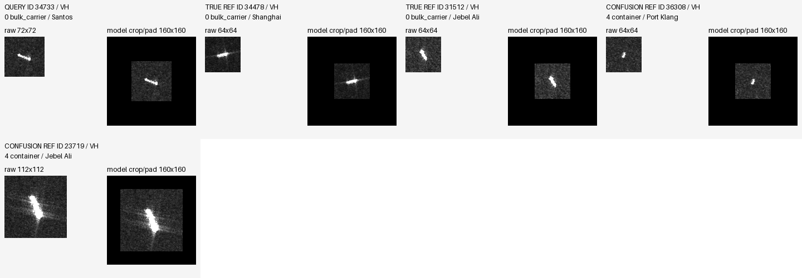

## harm_4007 / container / Santos / {'rescue': 0, 'harm': 3, 'CC': 0, 'WW': 0}

三 seed 平均 top1 分差变化 -1.685485；展示 seed 43。
实际同类参考 ['36308', '23719']；实际混淆类参考 ['34478', '31512']。

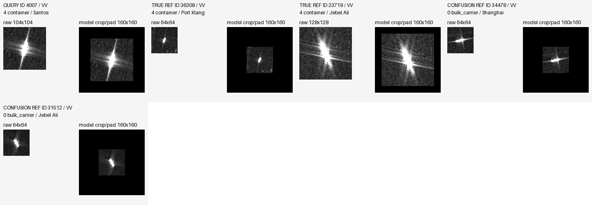
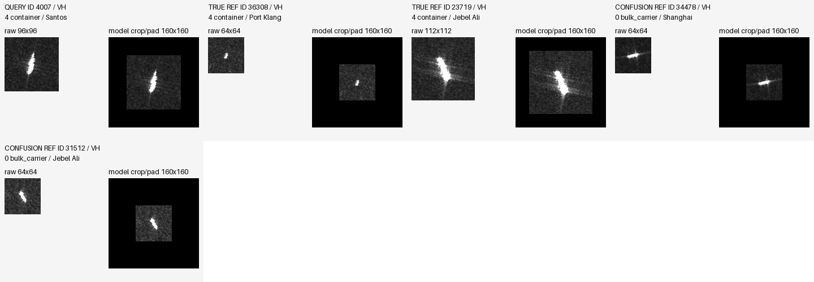

## CC_36543 / crude_oil_tanker / Jebel Ali / {'rescue': 0, 'harm': 0, 'CC': 3, 'WW': 0}

三 seed 平均 top1 分差变化 +2.305580；展示 seed 43。
实际同类参考 ['29922', '2077']；实际混淆类参考 ['34478', '31512']。

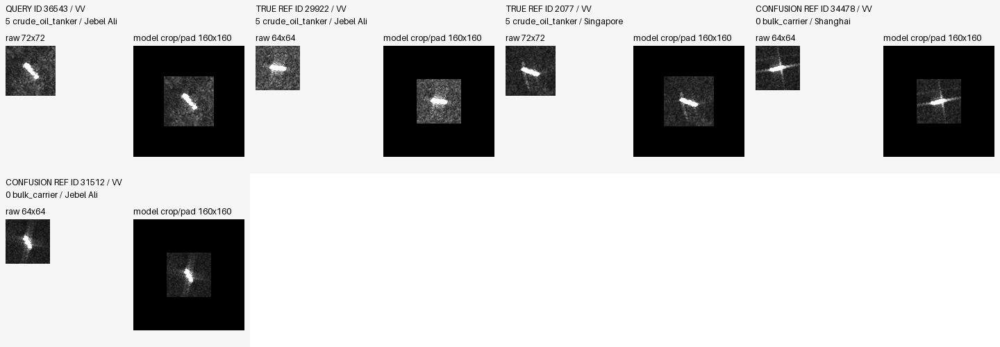

## WW_32844 / crude_oil_tanker / Port Said / {'rescue': 0, 'harm': 0, 'CC': 0, 'WW': 3}

三 seed 平均 top1 分差变化 +3.509818；展示 seed 29。
实际同类参考 ['29922', '2077']；实际混淆类参考 ['34478', '31512']。

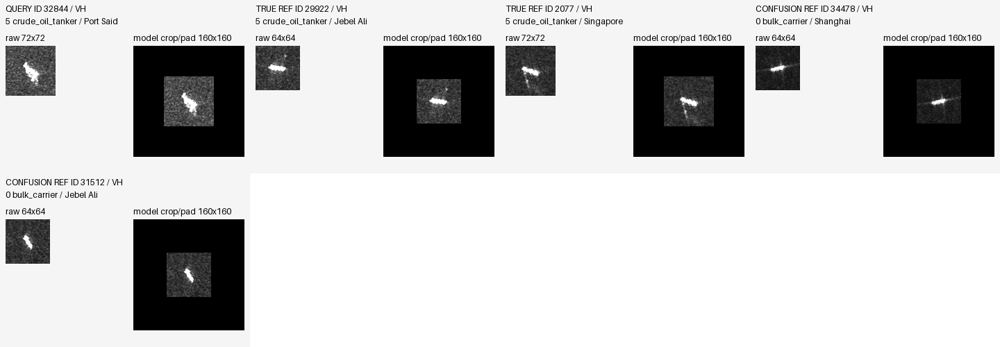

## rescue_30134 / container / Port Klang / {'rescue': 3, 'harm': 0, 'CC': 0, 'WW': 0}

三 seed 平均 top1 分差变化 +1.672917；展示 seed 29。
实际同类参考 ['36308', '23719']；实际混淆类参考 ['34478', '31512']。

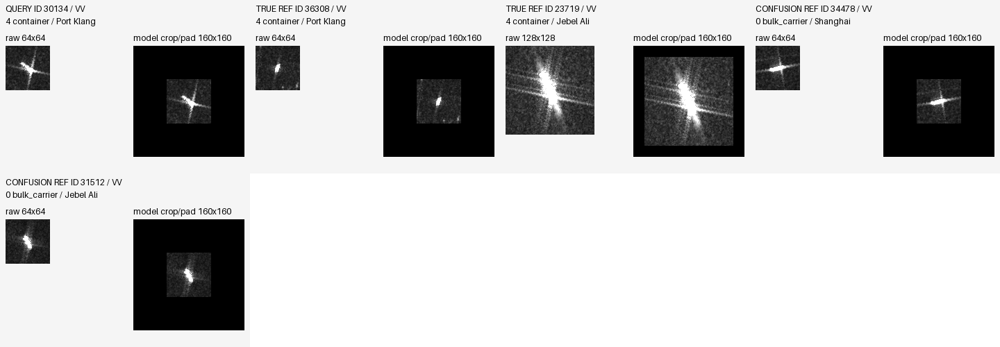
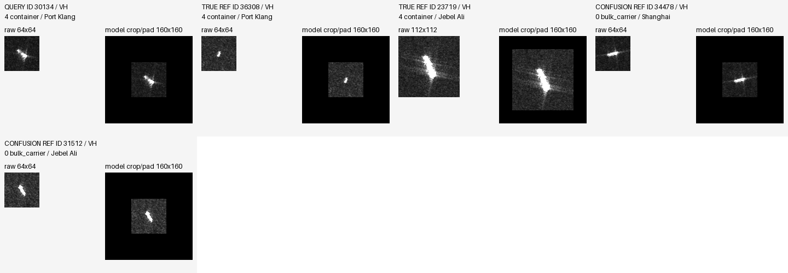

## harm_27591 / chemical_tanker / Jebel Ali / {'rescue': 0, 'harm': 3, 'CC': 0, 'WW': 0}

三 seed 平均 top1 分差变化 -1.305049；展示 seed 29。
实际同类参考 ['24527', '7790']；实际混淆类参考 ['29922', '2077']。

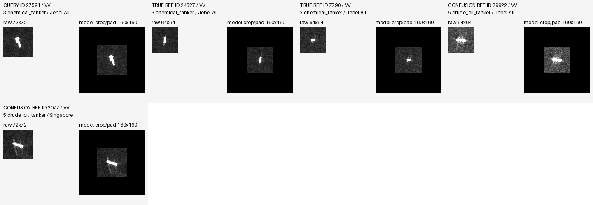

## CC_9724 / bulk_carrier / Santos / {'rescue': 0, 'harm': 0, 'CC': 3, 'WW': 0}

三 seed 平均 top1 分差变化 +1.871081；展示 seed 43。
实际同类参考 ['34478', '31512']；实际混淆类参考 ['36308', '23719']。

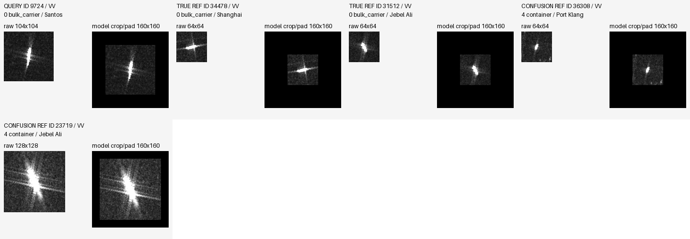
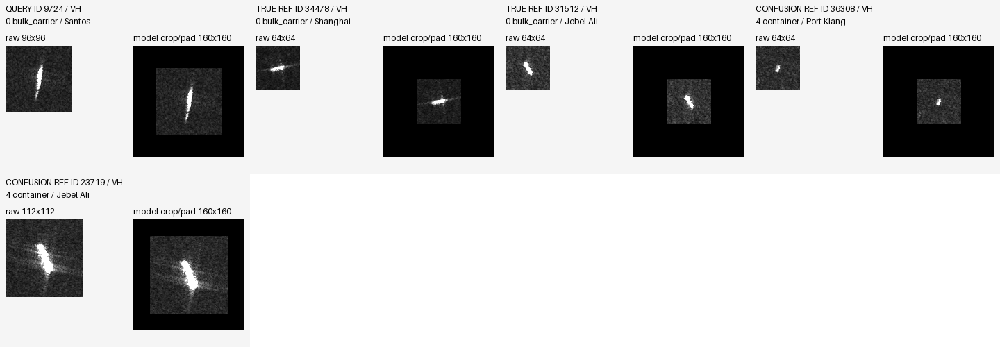

## WW_23004 / offshore / Jebel Ali / {'rescue': 0, 'harm': 0, 'CC': 0, 'WW': 3}

三 seed 平均 top1 分差变化 -2.269052；展示 seed 43。
实际同类参考 ['13000', '13276']；实际混淆类参考 ['36308', '23719']。

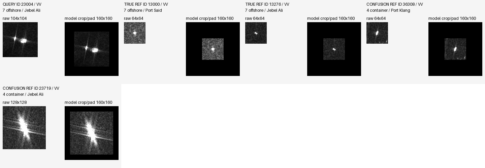
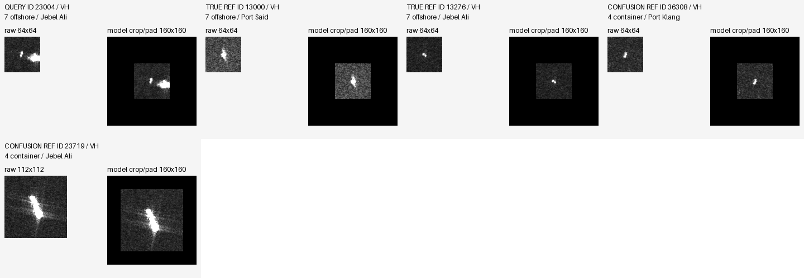
