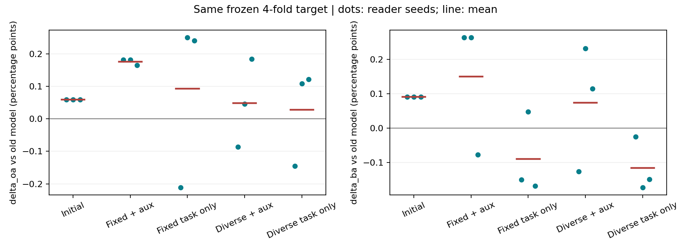
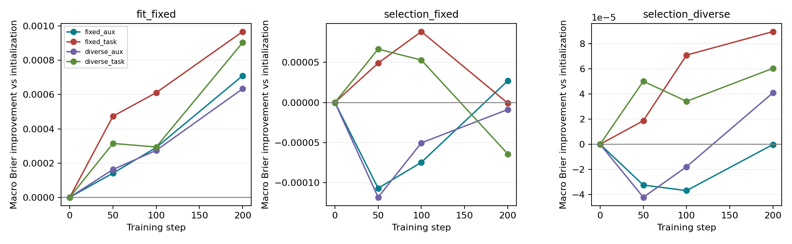

# 支持组织与辅助目标修正：完成报告

2026-10-17。48次配对训练全部完成，12个未训练初始化读出也已评价；没有改动旧模型或历史结果。

## 1. 结论与判断修正

**本轮两项修正没有提高跨采集平均BA，不能替换上轮已有候选。检索辅助项应保留；支持多样化可保留为任务组织方案，但不能宣称它已带来跨采集分类增益。**

这是对上轮原因假设的检验，而不是一定会涨点的修复：

- 去掉检索辅助项，跨采集BA相对上轮候选下降0.2397个百分点，三个读出种子均下降。此前发现辅助梯度较大，**不等于该辅助项有害**。
- 增加支持组合、保留辅助项，跨采集BA下降0.0763个百分点；同采集BA提高0.0416个百分点。它确实改变了训练材料，也有局部正效应，但当前不能解决跨采集瓶颈。
- 两项一起改，跨采集BA下降0.2650个百分点，三个种子均下降。
- 未训练初始化读出本身已比原完整模型高0.0909个BA百分点，来自同一查询在三个种子中的救回。上轮候选训练后相对初始化额外提高0.0591个BA百分点，不能把相对原完整模型的全部0.1501个百分点都解释为本轮关系学习。

“原始图像根本没有有效信息”仍未被证明；“固定任务太少、辅助梯度太强就是已找到的主要根因”也不能成立。当前更准确的结论是：**这些是真实设计/组织现象，但本次受控改动没有兑现更好的跨采集分类。**

## 2. 到底改了什么

沿用OSS1四个留采集折、199张查询、16个支持、同/跨采集各五次支持抽样、三个读出种子。骨干、C4/类别关系、源先验、查询/支持评价集合、0.5全量融合均冻结。

采用上轮静态局部读出，不使用新增10维定标SAR统计；既有VV/VH浅层输入仍在。四臂同初始化、同查询任务访问顺序、200步、每步两个任务、同优化器、同局部核倍率1。

| 方案 | 支持组织 | 损失 |
| --- | --- | --- |
| fixed_aux，上轮候选 | 原固定支持 | 完整宏Brier + 0.05局部检索CE |
| fixed_task | 原固定支持 | 完整宏Brier |
| diverse_aux | 原支持 + 四次合法重抽 | 完整宏Brier + 0.05局部检索CE |
| diverse_task | 同一多支持bank | 完整宏Brier |

重抽只替换支持船只成员：查询、支持所属采集、每类支持数、源先验训练行不变，且排除查询/先验中的MMSI。没有增加训练步数，也没有新增原图；增加的是对已有源图像的支持使用组合。此轮没有切换到更多支持采集、补入原来缺失的类别或修复无效区域。

旧fixed_aux的12个模型参数全部精确复现，最大差异0；其目标OA/BA/Brier/NLL/宏风险/支持MAP@R也与上轮完全相同。对照差异不是旧基线换掉了。

## 3. 完整模型主结果

主表是四折、五次支持抽样、三个读出种子的等权平均。每任务BA对实际出现的查询类别取宏平均。OA/BA单位%，变化量单位百分点；宏Brier收益=原风险-新风险，越大越好，不是百分点。

### 跨采集

| 方案 | OA | BA | 相对原模型ΔOA | 相对原模型ΔBA | 宏Brier收益 |
| --- | ---: | ---: | ---: | ---: | ---: |
| 原完整模型 | 45.0028 | 43.7593 | 0 | 0 | 0 |
| 未训练初始化读出 | 45.0624 | 43.8502 | +0.0595 | +0.0909 | +0.0000175 |
| fixed_aux，上轮候选 | 45.1782 | 43.9093 | +0.1754 | +0.1501 | -0.0000179 |
| fixed_task，去辅助项 | 45.0959 | 43.6697 | +0.0930 | -0.0896 | +0.0000183 |
| diverse_aux，多支持 | 45.0510 | 43.8330 | +0.0482 | +0.0737 | -0.0000018 |
| diverse_task，两项一起 | 45.0310 | 43.6443 | +0.0282 | -0.1150 | -0.0000977 |

### 同采集

| 方案 | OA | BA | 相对原模型ΔOA | 相对原模型ΔBA | 宏Brier收益 |
| --- | ---: | ---: | ---: | ---: | ---: |
| 未训练初始化读出 | 46.0841 | 39.8872 | 0 | 0 | +0.0000295 |
| fixed_aux | 46.2333 | 39.9493 | +0.1492 | +0.0621 | +0.0000980 |
| fixed_task | 46.0516 | 39.9497 | -0.0326 | +0.0625 | -0.0000039 |
| diverse_aux | 46.2272 | 39.9910 | +0.1431 | +0.1038 | +0.0001336 |
| diverse_task | 46.2222 | 39.9163 | +0.1381 | +0.0291 | +0.0000404 |

同采集提升有价值，不作为否决理由；但不能用它替代跨采集主张。去辅助项的跨采集宏风险略优于上轮候选，同时BA更差，这是指标取舍，不是“什么都没学到”。

## 4. 两因素的配对效果

下面变化均相对明确的同种子对照，不是不同方案各挑最好种子。

| 跨采集配对 | ΔOA | ΔBA | 宏Brier收益差 |
| --- | ---: | ---: | ---: |
| 固定支持时去辅助项 | -0.0824 | -0.2397 | +0.0000362 |
| 有辅助项时增加支持组合 | -0.1272 | -0.0763 | +0.0000161 |
| 无辅助项时增加支持组合 | -0.0649 | -0.0254 | -0.0001159 |
| 多支持时去辅助项 | -0.0200 | -0.1887 | -0.0000959 |
| 两项一起，相对上轮候选 | -0.1472 | -0.2650 | -0.0000798 |

三个种子的跨采集ΔBA：

- 固定支持去辅助项：-0.4132、-0.2157、-0.0901。
- 有辅助项增加支持组合：-0.3892、-0.0321、+0.1923。
- 两项一起：-0.2882、-0.4357、-0.0712。
- 上轮训练候选相对未训练初始化：+0.1728、+0.1728、-0.1683。

四个采集簇的探索性bootstrap，去辅助项ΔBA区间[-0.7143,+0.1389]，增加支持组合[-0.3571,+0.1603]，两项一起[-0.7143,+0.1229]。只四簇，不能作普遍显著性结论；三个种子也不是三个独立数据集。

## 5. 为什么支持变多仍没有解决问题

**首先确认干预确实发生，不是只换顺序。** 每个源拟合任务的bank平均有4.809个不同成员集合，训练中平均实际访问4.558组，而固定臂为1组。四臂任务访问次数完全一致，每个任务平均14.545次；不能把组合数当作新增独立船只或采集。

独立源端候选池核查给出更具体的边界：

| 观察 | 源拟合 | 源选择 |
| --- | ---: | ---: |
| 任务数 | 110 | 27 |
| 支持成员可变化的任务 | 107 | 27 |
| 合法候选船只中位数 | 33 | 39 |
| 因类内候选不足而必须保留的原支持槽位 | 39.8% | 38.7% |
| 遍历全部合法池后新增的局部辅助可用查询上下文 | 0 | 0 |

新增候选主要是散货船和集装箱船。原油轮、海工补给船的类内支持成员没有替换空间；渔船、拖轮也极受限制。跨采集渔船/拖轮/海工补给船的有效辅助查询仍分别是源拟合1/0/0、源选择0/0/0。

所以这轮做到了“常见类别换几组支持船”，没有做到“增加此前缺失的局部类别监督”或“增加新的观测条件”。这限制了能从本次支持重抽期待的作用。但候选池限制本身还不是已证实的退化原因，不能反过来保证补齐稀有类后就会涨。

具体名册、类别瓶颈及不读目标标签的复现脚本见[data_audit/FINDINGS.md](data_audit/FINDINGS.md)。

## 6. 学到了什么，为什么去辅助项反而掉BA

记录完整固定源拟合任务、固定源选择任务及扩展源选择bank的0/50/100/200步曲线。不是将当步两个任务的损失充当全训练集成绩。

表中是第200步相对第0步的变化；Brier与检索CE越低越好。

| 方案 | 固定源拟合Brier变化 | 固定源拟合检索CE变化 | 固定源选择Brier变化 | 扩展源选择Brier变化 |
| --- | ---: | ---: | ---: | ---: |
| fixed_aux | -0.0007104 | -0.2480 | -0.0000271 | +0.0000002 |
| fixed_task | -0.0009680 | +0.0476 | +0.0000010 | -0.0000895 |
| diverse_aux | -0.0006338 | -0.2503 | +0.0000089 | -0.0000409 |
| diverse_task | -0.0009038 | +0.0742 | +0.0000644 | -0.0000604 |

**纯Brier确实更努力地优化了完整概率风险，但没有同时保住局部检索结构和分类边界。** 去辅助项后，源拟合Brier改善更多，源拟合与源留出检索CE却上升；固定源选择检索CE增加0.0839，而保留辅助项仅增加0.0006。目标支持MAP@R也从fixed_aux的0.226174降到fixed_task的0.225539。

这支持“辅助项保留了有用的关系约束”这一解释，并用实际匹配删除对照证明了它在当前设置下的BA价值。并未证明所有梯度竞争都无害，亦未证明该辅助权重已最优。不能仅凭上轮终点梯度比就把它判为错误目标。

多支持训练在扩展源选择bank上的Brier与检索CE有所改善，同采集也有小幅收益；只是这些变化没有带来更高的跨采集BA。因此应分开描述表征/连续风险/最终分类，而不是简单说“没有学习”或“已经解决跨采集”。

源拟合与留出改善幅度相差明显，而且依赖支持组织；固定源选择与扩展源选择甚至有不同方向。可以记录泛化差距和部分后期退化，不宜用一个笼统“过拟合”概括所有现象，更不能据此选目标最优的早停点。此次没有按曲线换检查点。

## 7. 回到具体船只与类别

固定支持去辅助项，相对保留辅助项，在跨采集评价中有8次救回、11次误伤事件：散货3/4、杂货1/4、集装箱4/3。这里同一查询会在种子/支持抽样中重复，不是19艘独立船。

主要BA损失发生在S1A_010685_00FED5：上轮候选相对原模型BA+0.9524，去辅助项后接近0。该折只有2张杂货查询，row786在两个种子、draw1中由正确杂货转为散货；同时有集装箱查询的双向变化。这解释了为什么BA变化会比总体净翻转数更明显，但不以少数类别为由否认其实际分类作用。

在S1A_011246_011040，去辅助项反而较上轮候选改善BA约0.2778；因此辅助项不是每个采集必胜。逐折表和所有事件保存在`fold_summary.csv`、`changed_queries.csv`，不只展示总体均值。

未训练初始化的全部top-1救回来自pilot/row745/draw2，在三个种子中重复。初始化读出输入的是**已有预训练特征**，不是独立随机噪声，所以它可以保留原本的局部信息。这一对照说明本轮训练的新增作用应与“读出路径本身的作用”区分，而不是证明全部方法无用。

训练还使支持中心化后的局部能量发生变化：跨采集初始化平均0.0275，fixed_aux为0.2621。固定核倍率不等于固定特征强度；当前未做方向/能量匹配分解，因此额外训练收益不能全部归为某个新语义机制。

## 8. 保留什么，下一步不做什么

**保留上轮静态局部读出和检索辅助项，保持原完整模型不自动替换。** 多支持版的同采集/扩展源支持风险改善作为有边界结果保存，不晋升为跨采集提升组件。两项组合不作为主候选。

本轮不继续扫描辅助权重、不追加更复杂门控、不按目标采集选方案、不增加训练轮数碰碰运气。之前的单图门控不看支持集这一能力缺口仍然存在，但本轮没有测试支持条件门控，也没有证据保证修正它就会涨点。

若后续继续，研究依据应是哪些可用局部类别证据没有覆盖、哪些查询在合法支持条件变化下存在可预测的补证关系，而不是重复依赖“梯度大”“任务少”这两条现象。当前干预只扩展了同一支持采集里的成员组合，不能外推否定跨支持采集的组织或真正任务条件化设计。

## 9. 验证、成本与文件

- `test_sampling.py`四项测试通过：类别数量/无重复、同船多观测的先验隔离、仅排列变化不冒充新成员、原查询任务随机序列复现。
- 全部源bank运行时检查原支持保留、16艘不同船、查询/先验MMSI隔离、支持采集及类别数量不变；bank第0组概率/SS/QS/先验与原任务一致。
- fixed_aux的12个模型参数精确复现，目标120个任务的六项指标也完全复现；600条任务指标、29,850条预测、199张不同查询，无重复任务-模型-查询键。
- 48次拟合及规定源端诊断累计124.27秒；不含原骨干、检测、此前特征提取、bank构造或完整端到端开销。没有新增下载和系统环境修改。
- 三个读出种子不是三个骨干种子；五次支持抽样不是五个独立数据集；四采集仍为已有开发队列，不是全OSS1或其他数据集新验证。

协议：`PROTOCOL_ZH.md`；采样：`sampling.py`；训练：`run.py`；统计/作图：`summarize.py`。

主表：`summary.csv`；逐种子/折/支持：`seed_summary.csv`、`fold_summary.csv`、`support_draw_summary.csv`；两因素配对：`paired_effects.csv`、`effect_summary.csv`；学习曲线：`learning_curves.csv`；实际组合：`support_banks.json`、`training_support_exposure.csv`。所有旧结果保留。
