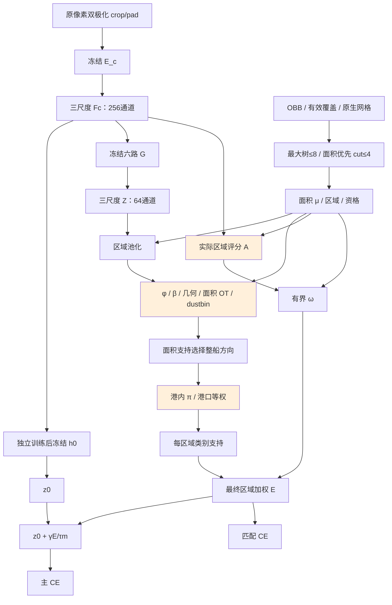

# 第二阶段H：冻结G空间描述、几何划分与多港口证据匹配

日期：2026-11-22。状态：首版独立入口通过92项回归，含合成训练、冻结、保存恢复及评估；本轮OSS2的真实训练和收益尚待验证。第一阶段为独立双极化ConvNeXt-T前三阶段与弱深层注入，四类损失保留；默认strict_controlled，本轮经用户批准采用empirical_regularization，L_leak为经验类别抑制正则，强受控标记仍为false。H期间完整冻结编码器及六套G；64画布、96/128回退、spatial_axis_v1和main_l6／baseline_l8几何保持。运行说明见[两阶段代码说明](<D:/SAR_Experiments/cross_port_sar_ship_ATR/port_prototype_model_20261121/TWO_STAGE_README_ZH.md>)。

本版用冻结G承接第一阶段空间监督；区域划分与运输容量由几何决定；A仅在匹配后学习有界区域权重。停用教师响应探针、先验KL和学习式动态细分，保留多港口多原型、跨位置/邻尺度匹配及多个参考来源。旧方案的历史边界见第12节。

## 1. H的职责与两阶段固定接口

### 1.1 冻结输入与三尺度职责

[第一阶段第8节](<D:/SAR_Experiments/cross_port_sar_ship_ATR/STAGE1_MULTISCALE_DISENTANGLEMENT_DESIGN_ZH.md>)交付E_c、六套G、几何与有效性元数据。E_c为每极化Stage 1–3（3/3/9个block）→ 256通道投影 → 本层/弱深层注入 → 3×3整合 → 原门控/确定性路由。模型身份为convnext_tiny_stages123_v1 / residual_deep_injection_v1。β_fuse、λ_fuse与G一起冻结；H边内β是另一个可训练模块。

64主画布的同桶batch接口：

|尺度|原始Fc，供h0/A及原型选样|冻结Z=G(Fc)，供匹配|主要职责|
|---|---|---|---|
|F1，stride4|[B,2,256,16,16]|[B,2,64,16,16]|主要局部结构，兼顾整体|
|F2，stride8|[B,2,256,8,8]|[B,2,64,8,8]|合法粗局部及整体结构|
|F3，stride16|[B,2,256,4,4]|[B,2,64,4,4]|主要为整船语义/上下文|

96回退网格为24²/12²/6²，128为32²/16²/8²。两极化网络独立，同一(l,p)下query/reference使用同一冻结E_c与G。不同桶分别在原生网格编码/池化，不把整张Fc/Z缩放为统一尺寸。H参数跨桶共享；第一阶段390维分类读出、h0的197维读出、A的72维输入及H的128维描述不随桶变化。

元数据包含valid_coverage、target_weights（各[B,2,1,S/s_l,S/s_l]）、V/T、极化可用性[B,2]、OBB/轴有效性、canvas_hw、整数crop/pad、保护半径、stride=(4,8,16)、offset=(1.5,3.5,7.5)、输入/几何profile、encoder_fingerprint、G结构/权重和match_representation_fingerprint。描述模式为frozen_g_prepool_v1。

第一阶段监督协议也随检查点保留：`leakage_mode`、固定类别先验、Q/配对台账、`leakage_controlled`、独立的`leakage_regularization_eligible`及实际损失参与统计。当前OSS2的`leakage_controlled`保持false，`leakage_regularization_eligible`只表示经验正则的操作级资格；这些字段供训练追溯，不进入H查询特征，不因冻结或导出而升级为因果有效性证明。

本轮另保留`training_qualified=false`与`empirical_experiment_eligible=true`：输入支持采用`stored_native_pixel_footprint`，原始sensor nodata mask仍未知。20个Q样本双极化的纯背景格数为细320、中0、深0，只有stride4场景回归得到直接监督；H不能把三尺度Fc接口解释为三个Fs尺度都已得到独立背景监督。

非根局部逐层检查observable：main_l6的最小长度为6/16/32原像素，baseline_l8为8/16/32；均要求至少2个有效归属中心、跨度≥4/8/16px、单格及区域覆盖≥0.5。根整体使用v_pool有效分支。上采样不会增加粗层的局部资格。

64桶首次长轴两半的合法覆盖，OSS2为87.54%/2.64%/0，自建为78.59%/9.32%/0。因此F1承担主要局部，F2按资格开放粗局部，F3通常承担整体。统计只说明几何读出资格，不衡量语义信息量；分母及计算见[逐层审计](<D:/SAR_Experiments/cross_port_sar_ship_ATR/native_canvas_audit_20261122/STAGE_DEPTH_FUSION_GATE_REVIEW_ZH.md>)。

C3/L3深层信息已在第一阶段门控前弱注入细层；门控后的F3不在H中回写F1/F2。F3仍进入h0、区域评分A及离线原型代表选择。若根或较大区域有合法同/邻层参考分支，也可进入对应匹配；它不会被复制为多个不可分辨小区域的独立描述。

### 1.2 两条前向路径

- 本图路径：冻结Fc → 独立空间分类器h0 → 整体/合法长轴两半读出 → z0。
- 参考路径：几何最大树 → 面积优先cut≤4 → 冻结G后的区域描述 → 尺度/极化边内融合 → 纵向几何与面积OT/dustbin → 面积支持选择整船方向 → 港内原型混合 → 港口等权，得到每个区域对各候选类的支持e_(c,i)。
- 最终加权：查询Fc与已确定区域 → A → 有界权重ω；E_c=Σ_iω_i e_(c,i)，再与z0相加。

A只进入最后一行，不控制树、OT边际、边评分、方向、合法性、参考筛选或dustbin；参考侧不计算用于容量的A。匹配集合是一次不重叠cut，不把根与其子区域同时作为运输节点。当前不另加整船原型分类支路；h0的整船读出属于本图路径。

## 2. 只用源端建立多港口多原型库

用c表示类别，d表示源港口，k表示该“类×港”单元中的代表，p表示极化：

P_(c,d,k)={F1,F2,F3, V,T, availability, geometry, source metadata}。

每个原型是一艘真实源船的一次代表观测，保留其两极化三尺度完整空间图。不把不同船的未对齐空间图逐像素求平均。聚类中心仅作选样依据，不作为虚构局部结构交给匹配器。

### 2.1 选样流程

1. 在本折源训练样本中按船舶身份组织观测，用冻结Fc的目标区域描述选择该船的一次代表观测。跨港重复身份最终只保留一个参考条目，按固定的有效覆盖/观测质量规则确定归属港口。
2. 每份“极化×尺度”目标池化向量单独归一化。用共同有效分支距离的平均构成船间距离，不把独立极化同号通道直接比较；无共同有效极化的候选不直接定义伪距离。
3. 在每个类×港单元内采用medoid/覆盖式代表选择。优先覆盖不同船型外观模式，再在预算内增加代表。缺失极化模式需记录，不能因共享分支少而虚假获得更小距离。
4. 每类设相同总预算B_proto；预算足够时先覆盖各可用源港，再按单元残余覆盖误差增加k。预算不足时明确记录未覆盖港口。稀疏单元不复制船只凑数。
5. H首版训练期间固定代表身份与归属；可学习的是H的比较空间、匹配和权重。暂不加入自由空间原型参数、每步重聚类或同类中心拉齐损失。

原型选择与训练episode组织可用源类别/港口标签。查询前向不输入真实类别、港口或船舶ID作为分类特征。元数据仅供组织、去重和合法性筛选。

### 2.2 训练查询与缓存

训练查询在粗检索、参考条件计算和匹配之前排除同船、同采集组参考。跨港训练episode优先以源港A作为查询、其他源港作为库；类别无跨港支持时回到合法异船/异组源支持或只做本图监督，记录覆盖，不补入自身观测。

可缓存冻结Fc、Z=G(Fc)与几何。H中的投影仍可训练，查询与参考都必须用当前H参数重算投影，参考H路径不能整段no_grad或复用上一步的旧输出。H最终冻结后，才缓存完整投影token用于部署。确定性的区域池化可缓存；A在匹配阶段仍可训练，其当前输出不能作为固定缓存复用。

外层未见目标港不得用于第一阶段、H、建库、标准化或选择超参数。仅H留港、第一阶段见过该港的配置不称完整未见港评估。

## 3. 本图分类、几何区域与最终加权A

先以源类别CE训练h0并冻结，再以原两项分类CE共同训练A与匹配器；第一阶段E_c/G始终固定。本节的A为分类任务驱动的区域证据权重，不是教师响应先验。

### 3.1 轻量本图分类器h0的具体结构

h0先处理空间特征，再做分类读出。输入仍为两极化、三尺度的六张Fc；h0不依赖A、实际匹配cut或参考原型库。

首先用源训练集有效位置估计每个(l,p)分支的一个正RMS标量s_(l,p)，随后固定：
\[
X_{\ell,p}=F_{c,\ell}^{p}/(s_{\ell,p}+\epsilon).
\]
这六个固定标量只用于统一本图分类器输入的数值尺度。为保持既有h0结构，本图分类器首版不在输入及中间路径使用按当前样本统计量重新归一化的LayerNorm、L2归一化或InstanceNorm；固定源端RMS统一本分支的输入尺度。第一阶段已有的归一化保持原样；第4节匹配投影的LayerNorm/L2归一化也保持独立。

以下为本版默认宽度，保留配置接口；表中省略batch维，张量按通道×高×宽表示，空间尺寸以S=64为例。回退桶在自己的S/4网格组织空间特征。h0独立初始化和训练，不复用第一阶段的G/h_l参数；冻结输入仍是256通道Fc。匹配支路复用G，两者职责独立。

|步骤|操作|输出尺寸|
|---|---|---|
|六分支独立投影|各自1×1 Conv，256→32|每极化分别32×16×16、32×8×8、32×4×4|
|各分支局部编码|DWConv 3×3，stride1、padding1 → GELU → PWConv 1×1，32→32|各分支原尺寸不变|
|极化内多尺度组织|按物理坐标对齐到S/4网格（主画布16×16），拼接三尺度，再1×1 Conv，96→64|VV、VH各64×16×16|
|双极化融合|拼接VV、VH及各一张有效性掩码，共130通道；1×1 Conv，130→64|64×16×16|
|联合空间建模|两个残差块：Z←Z+PWConv(GELU(DWConv3×3(Z)))，通道64|64×16×16|
|固定几何读出|整体R0＋合法长轴两半R−/R+；按有效覆盖池化|3×64=192维|
|分类读出|拼接2个极化可用性和3个读出槽有效标记；MLP197→64→C，中间GELU|z0∈R^C|

六个原生尺度分支参数独立；VV/VH在极化内组织阶段也不共享参数。上采样用于坐标对齐，不增加粗层的真实空间分辨率。所有池化按有效覆盖加权，空子格输出零并记录有效性。缺失分支与padding位置在有偏置的层之后重新屏蔽，避免零输入经偏置变成有效证据。

几何与第一阶段第2.1节及当前profile一致。两半只在原生stride4网格满足合法二分时开启；main_l6用6px最小区域长度，baseline_l8用8px。必须至少同一种极化同时支持左右两半，不能用VV支持左半、VH支持右半来拼成合法二分。否则两个64维局部槽及标记置零，保留整体。联合图的池化覆盖使用可用极化V的空间并集，一处物理面积只计一次；第3.3节给出连续面积与原生格点的区别。联合图按并集有效性重新屏蔽；h0输入仍为197维，与实际原子数无关。

默认同时交换R−/R+的向量和槽位标记、保留整体与极化标记，用同一分类MLP计算两次并平均logits，之后才算一次CE。此操作只保证读出不依赖无向轴的编号，不旋转特征图，也不保证原图旋转不变。正常前向固定同一读出几何，发生输入几何增强时按变换重算。2×2读出保留为关闭的可配置对照；本版主要沿可分辨长轴组织局部。

### 3.2 本图分类器训练与冻结

固定第一阶段，以源训练类别标签拟合h0：
\[
\mathcal L_{h_0}=\mathrm{CE}(h_0(X),y).
\]
按类/港覆盖组织训练样本，用源端验证选择本图分类器及其配置。首版本图分类器训练使用正常样本与已确认保持类别的常规增强；若增强发生在输入图像层，需重新经过冻结第一阶段，不能假定旋转缓存Fc等价于旋转输入。缺失极化模式按真实可用性处理。

h0拟合完成后冻结参数、六个源端RMS标量和运行状态，正常前向提供z0。本版不运行原子削弱/增强或幅值对照，不生成教师可信集合，也不以h0的扰动响应监督A。

### 3.3 固定最大原子树与原生可分辨性

本版先用几何生成固定最大树，再用有效面积选择实际cut。原子不由A、类别或港口决定；查询与所有参考使用同一算法。第一阶段的空间辅助头只读整体与第一次合法二分，不依赖本阶段训练。

**坐标与原生合法性。** 沿用第一阶段第2.1节：无向OBB坐标u/v、轴有效条件、stride4/8/16及offset1.5/3.5/7.5、覆盖池化w_pool、唯一格点中心归属owner、observable判据。observable要求区域长轴长度≥L_min(l;profile)、至少2个w_pool≥0.5的归属格点、沿轴中心跨度≥s_l、区域有效覆盖≥0.5；缺失极化为false。名义采样单元用于覆盖，不能解释为卷积感受野。

|配置|stride4最小长度|stride8最小长度|stride16最小长度|其他约束|
|---|---|---|---|---|
|main_l6：主要候选|6 px|16 px|32 px|至少2格点；跨度4/8/16 px；格点／区域覆盖均≥0.5；轴规则不变|
|baseline_l8：保留基线|8 px|16 px|32 px|与main_l6相同|

只调整stride4长度；不把粗层最小长度降为12/24px，不改变网格分辨率或增加插值格点。该observable同时服务第一阶段半区读出、本节原子资格和第4节直接匹配资格；各模块的根例外和成对槽位规则分别明确。

**最大树生成。** 根R0为完整目标OBB，深度0。仅沿长轴中点作二分，保持完整短轴宽度；最大深度d_atom=3，即最多K_atom=8个原子，二/四等分短轴在首版关闭。遍历所有可分节点：若至少同一种有效极化在原生stride4层使左右子区同时observable，则保留两个子节点并继续；否则完整保留父节点为原子。允许分支深度不同，叶原子始终不重叠且覆盖根区域，不删除不合法的一半，也不复制节点凑8个。

输入兼容但轴无效时最大树只有整体根；原始目标截断／完整目标放不进128按第一阶段第2节单列，不算自然小船1原子。无有效目标覆盖的输入标为无有效观测，不生成正常原子或分类训练记录。没有OBB但有既定T时，用该整体T支持作为根，禁用轴向细分/代价。几何和有效性随合法输入增强一起重算。

|仅按长度的原子数上界，实际还须通过格点与覆盖检查|main_l6|baseline_l8|
|---|---|---|
|L=10 px|1个整体原子|1个整体原子|
|L=14 px|至多2个约7 px原子|1个整体原子|
|L=24 px|至多4个约6 px原子|至多2个约12 px原子|
|L=40 px|至多4个约10 px原子|至多4个约10 px原子|
|L=48 px|至多8个约6 px原子|至多4个约12 px原子|
|L=72 px|至多8个约9 px原子|至多8个约9 px原子|

这些是长度上界，不保证某角度／有效掩码一定通过检查；真实树可因分支资格不同而有3、5等非2次幂叶数。最大树8原子与实际匹配最多4叶是两项独立预算。报告各类／港／尺寸段的实际原子数，而不以L/6替代几何检查。

**真实源端覆盖。** 原128画布审计按固定首次观测、MMSI去重，OSS2的682艘兼容船由8px的1／2／≥3原子=109／479／94，变为6px的86／415／181；自建24港12,563艘由3,306／7,074／2,183变为2,667／5,812／4,084。仅放宽跨度或覆盖权重几乎不增加≥3比例，本轮维持原值。OSS2另1艘、自建另18艘原始截断单列；自建结果为完整参考极化几何统计。原口径保存在[源端原子覆盖报告](<D:/SAR_Experiments/cross_port_sar_ship_ATR/atom_coverage_audit_20261122/FINDINGS_ZH.md>)。

按当前64/96/128分桶、8px保护带重新计算，OSS2的8px原子配置为106／481／95，6px为85／413／184；自建两种配置的计数保持上述数值。6px下至少两区域覆盖为OSS2的87.5%、自建78.8%，≥3原子机会为27.0%／32.5%。不同整数窗口引起格点相位变化，不能把小幅计数变化解释为分辨率提升；逐样本复核见[原生画布审计](<D:/SAR_Experiments/cross_port_sar_ship_ATR/native_canvas_audit_20261122/FINDINGS_ZH.md>)。这些比例均不等于合法跨船匹配或分类受益率，应分别统计。

**区域有效量。** 对每个实际区域R_i及(l,p)保存v_pool和v_match。v_pool要求w_pool之和>0；根整体按v_pool直接比较，非根叶须observable。匹配资格由固定几何得到，与类别、门控值、相似度及A无关。本版不生成v_probe或teacher_cache。

物理有效面积G_R=Area(R∩(V_VV∪V_VH))；缺失极化不参加并集，一处面积只计一次。父节点G是所有子节点G之和；实际pool按每极化自己的有效覆盖计算。只有有效目标面积为正的输入进入正常分类；轴不可靠但有有效目标时保留整体根。

### 3.4 面积优先的几何cut

最大树深度d_atom=3、最多8原子；实际匹配区域预算B_leaf=4。cut从根开始，在仍有两个合法子节点的当前叶中，选择有效面积G_R最大的节点展开；平分使用固定节点/物理坐标顺序。达到预算或所有当前叶均不可继续展开时停止。父替换为两个子节点，最终区域始终不重叠且覆盖根。

本版没有A质量阈值τ_split；A不输入此算法。区域数随实际几何和有效覆盖变化，属于几何自适应划分，暂停学习式动态粒度。K_atom=1时N=1，K_atom=2时N=2，更多原子时N≤4。区域形成后逐层重新计算v_pool/v_match，不把原子数推定为所有层都可分辨。

对查询和参考各自定义固定面积比例：
\[
\mu_i^q=G_{R_i}^q/G_{R_0}^q,\qquad
\mu_j^r=G_{R_j}^r/G_{R_0}^r.
\]
有效区域的μ为正且和为1；不能因某类别无对应而删区后重归一。OT只用μ，所有几何、有效性与面积停止梯度。旧A混合边际及其δ参数不属于本版主配置。

### 3.5 A只学习最终实际区域的有界权重

A读取查询的正常六张冻结Fc和已经确定的N≤4个区域，不读取候选类别、港口、真实标签、匹配结果、参考ID或教师可信集合。复用原评分网络，池化对象从最多8个原子改为实际区域；参考路径不需要A。

|步骤|操作|S=64时尺寸|
|---|---|---|
|六分支独立投影|Conv1×1 256→16，GELU，按有效覆盖屏蔽|每极化16×16²/8²/4²|
|空间组织|对齐到S/4网格并拼96通道，Conv3×3 96→32、GELU|Z_A：[B,32,16,16]|
|区域/整体读出|按有效并集pool实际区域R_i及根R0，整体广播|每区域32+32维|
|固定几何统计|六份(l,p)覆盖比例、纵向长度比例ℓ_i、中心绝对值|每区域8维|
|共享评分器|Linear72→32、GELU、Linear32→1|[B,4]分数与真实区域mask|

局部/整体池化和mask沿用既定覆盖规则，卷积/对齐后重新屏蔽缺失与padding。轴无效根取中心0、ℓ=1。六个覆盖比例来自固定几何，不来自门控值。各区域共用评分器，不输入区域编号；补齐槽mask=false。

记分数为b_i，定义：
\[
A_i=\operatorname{softmax}_i(b+\log\mu^q)=\frac{\mu_i^q\exp(b_i)}{\sum_j\mu_j^q\exp(b_j)},\qquad
\omega_i=(1-\alpha)\mu_i^q+\alpha A_i.
\]
0≤α<1，默认候选0.25，只用源端验证确定后固定；它不是可学习的总开关。末层零初始化使A=μ、ω=μ。对有效区域：
\[
\sum_i\omega_i=1,\qquad
(1-\alpha)\mu_i^q\le\omega_i\le(1-\alpha)\mu_i^q+\alpha.
\]
等面积两区、α=0.25时，各ω∈[0.375,0.625]；等面积四区为[0.1875,0.4375]。该界限制集中，不保证A具有物理因果含义。α=0的对照直接用ω=μ并关闭无作用的A参数；N=1时ω=1，可旁路A。

ω只进入E_c=Σ_iω_i e_(c,i)，同一查询的ω对所有候选类别、港口和原型共用。β评分器移除旧先验输入；π保持原九维统计，不新增A/ω；方向选择只用μ。A与匹配器由第9节两项CE同时训练，不再计算L_prior或单独冻结A。

若g_i=∂L/∂ω_i，则∂L/∂b_i=α A_i(g_i−Σ_jA_jg_j)。A因此学习各区域对最终类别区分的作用；若所有区域的证据相同或全部无支持，A没有可用的区分梯度，不能靠额外注意力损失人为制造差异。有效输出须有限、非负且和为1；异常时记录并退回μ，不将数值合法性当作语义置信度。

### 3.6 1–2原子小船的完整路径

**K_atom=1。** 使用根R0，N=1，μ=ω=1，A直接旁路；h0正常分类。根最多生成六份有效描述，仍逐侧检查同极化、同层/邻层候选边。查询根与参考M≤4叶直接求1×M真实运输，加dustbin后为2×(M+1)。参考仅F1有效时，查询有效的F1/F2可比较，F3→F1跨两层被屏蔽；未参与该边的F3仍可用于h0和原型选样。

对类别c，某港两参考e=0.64/0.48、π=0.6/0.4，港内支持为0.576；另一合法港支持0.52，等权后E_c=0.548。多个来源共同服务同一查询根，不增加查询区域数。此数值仅示例，不是实验结果。

**K_atom=2。** 使用两个几何叶，A只调最终ω，不能修改cut或面积OT。以14px长船为例，两个7px半区通过格点/覆盖检查时，main_l6允许F1局部；查询F2/F3不生成这两处的独立匹配描述，但继续进入h0与A上下文。参考较大区域若F2合法，可与查询F1作邻层比较。baseline_l8下可能退回单根；长度合格仍须通过全部几何条件。

等面积两半、A=(0.8,0.2)、α=0.25时，ω=(0.575,0.425)。若同一类别的两处聚合支持为(0.70,0.40)，则E_c=0.5725；第二处无支持时E_c=0.4025，第一处ω仍为0.575。匹配容量始终是μ=(0.5,0.5)，不会被A改成(0.8,0.2)或ω。两处可以分别从不同港口、船和极化获得主要支持。

**K_atom≥3。** 以面积优先cut得到N≤4，逐叶重算尺度资格，再由A学习最终有界权重。更细原子不会产生额外教师监督或新增票数。应按1、2、≥3原子分别报告分类、合法支持、接受质量和A实际贡献；目标截断与无观测输入单列。

任一侧为根时位置区间包含对方子区，正反方向的几何矩阵相同；双方均为标准两半时位置间隔和相对大小代价均为0。此时只求一次等价运输并标方向不可辨。该范围下匹配仍可使用外观，但收益不能归因于不起作用的方向/位置约束。

### 3.7 区域接口

|字段|形状/内容|使用者|
|---|---|---|
|tree_nodes/tree_mask|最多15节点及父子关系|固定几何|
|atoms/atom_mask|最多8个合法叶，区域边界与节点ID|几何统计和cut|
|cut/region_mask|最多4叶；原子归属[B,4,8]、mask[B,4]|描述、A、OT|
|region_area/area_mass|G_R、μ；[B,4]|cut检查、面积OT、最终面积基测度|
|pool_valid/match_valid|[B,4,2,3]及稀疏覆盖权重|空间读出与边资格|
|region_scores/attention/weights|b、A、ω；[B,4]，仅查询|最终加权；不进入匹配构造|
|Fc/Z|三尺度256/64通道空间图|h0/A读Fc；匹配读Z|
|版本元数据|输入/几何、E_c、G、h0、H检查点与描述模式|训练、缓存、部署|

第一阶段成对半区mask不直接替代H的逐区域mask；几何由同一规则重算。实际N可变，补齐槽不参与softmax、logμ、运输或类别聚合。本版不导出teacher_cache、v_probe、prior_mass或τ_split作为运行依赖。

### 3.8 模型与缓存衔接

|变化|可复用|必须重建或训练|
|---|---|---|
|同一E_c/G，仅旧Pool(Fc)匹配改为冻结G读出|兼容Fc、几何、h0/RMS、原型身份|Z/池化/token，φ64→128，新的A及匹配器|
|仅G权重/结构变化|E_c未变时的Fc、几何及按Fc选的原型身份|Z、描述/token及依赖匹配模型；不因形状相同沿用|
|E_c或输入/强度预处理改变|同一源身份与划分；几何完全一致时纯几何可复用|Fc、Z、RMS/h0及A/H全部依赖；按Fc选样的代表重选或显式固定身份作对照|
|同一E_c/G上的6↔8 H侧对照|相同输入/有效性的Fc和Z|半区、最大树、面积cut/掩码/池化；对应h0与A/H配置|
|实际区域预算或面积cut规则改变|Fc、Z和不变的最大树|cut、区域读出、A输入与匹配token；训练/评估对应H|
|α或π/OT超参数改变|冻结Fc/Z、同一几何|按新配置重新训练/评估H；不能用目标港调参|

encoder_fingerprint绑定E_c结构/权重/预处理/路由，geometry_fingerprint绑定几何与输入坐标规则；match_representation_fingerprint额外绑定G和描述模式。这些身份用于判断特征缓存复用，不因输出尺寸相同自动兼容。原型代表选择仍用Fc整体描述，改变该空间另作显式配置。

旧只有Fc而缺少已训练G的检查点不能随机补G当作复用；应恢复或训练对应第一阶段。旧先验A、probe缓存和KL目标不加载到本版最终加权A；网络输入宽度相同也不代表监督语义兼容。新入口与旧ResNet/M1/M2/M3入口独立，不将旧权重静默迁移为ConvNeXt两阶段权重。

## 4. 复用冻结G生成区域描述

每尺度、每极化先执行第一阶段已有G：
\[
Z_{\ell,p}=G_{\ell,p}(F_{c,\ell,p})\in\mathbb R^{64\times h_\ell\times w_\ell},
\]
\[
t_{i,\ell,p}=\operatorname{Pool}_{R_i}(Z_{\ell,p})\in\mathbb R^{64},\qquad
z_{i,\ell,p}=\operatorname{L2Norm}\bigl(\phi_{\ell,p}(t_{i,\ell,p})\bigr)\in\mathbb R^{128}.
\]
φ为Linear64→128+LayerNorm，六分支独立，同一分支在查询与所有参考之间共享。G固定，φ由H两项CE训练。空间编码先于区域池化，复用第一阶段被分类监督的非线性与局部交互；不同极化不直接比较同号通道。

每张图描述为[N,2,3,128]及资格mask[N,2,3]，N≤4。根使用v_pool，非根使用observable；单侧描述有效还必须与对侧同极化、同/邻层有效分支配对。无覆盖/缺失分支置零并屏蔽，不以投影偏置或Normalize零向量制造正常token。G各层之后同样重新屏蔽padding/缺失位置。

相同层格点的coverage池化允许边界面积分摊；owner只用于几何资格，不声称区域读出具有独立卷积感受野。G空间交互和第一阶段上下文本来就可能跨区域。原生不可分辨的粗层不会因G或上采样获得局部资格。

Fc仍供h0和A读取；不把64维Z替换全部Fc接口。64维是已训练的瓶颈，后续128维不能恢复其丢失信息。原Pool(Fc)→φ256→128可作独立同训练预算对照，但不与主路径拼接成未监督旁路。缓存G特征不改变需要用当前φ同时编码query/reference的要求。

## 5. 外观融合与最小几何约束

### 5.1 同一物理区域对先融合尺度与极化

对任意查询区域i与参考区域j，允许不同位置相匹配。先在同极化内计算相似度：
s_(ij,p,l,t)=cos(z^q_(i,l,p),z^r_(j,t,p))，|l−t|≤1。

三个层有7种同层/相邻层组合，两极化最多14个分数；合法覆盖不够时屏蔽相应组合。VV查询对VV参考、VH对VH，第一版不做VV到VH直接cosine。

用小型共享质量评分器读取区域内容、有效覆盖、层组合、两极化可用性及相似度，产生边内权重β，对合法(p,l,t)归一化。不同极化参数基底不直接相减或点乘；质量网络可拼接两极化信息判断它们在该局部是否有用。

先得到外观分数：
\[
S^{\mathrm{app}}_{ij}
=\sum_{p,\ell,t}\beta_{ij}^{p,\ell,t}s_{ij}^{p,\ell,t},
\qquad \beta\ge0,\quad\sum\beta=1.
\]
合法边的S_app∈[−1,1]；无共同有效组合的区域对直接屏蔽。β评分器不读取A/ω，只处理外观和观测质量，几何代价在融合之后单独加入，保留可检查、可关闭的几何接口。

关键：多层与两极化在同一个物理i↔j边内融合，随后只生成一条边，不把14个分数分别作为14票。某区域VV强则β可侧重VV，另一区域可侧重VH，不使用全图固定极化比例。

第一版对每个候选类别的合法原型都进行匹配，不先按查询top1类别裁库。若后续加粗检索，必须每类保留预算，且报告真类候选召回。

### 5.2 几何只保留纵向位置与纵向覆盖长度

首版以当前低分辨率场景下可获得的粗目标几何为输入，只使用船体长轴。每个区域R_i记录归一化纵向中心u_i与覆盖长度ℓ_i：
\[
u_i=\frac{(x_i-c)\cdot e_L}{L_{\mathrm{ship}}},\qquad
\ell_i=\frac{L_i}{L_{\mathrm{ship}}},\qquad
I_i=[u_i-\ell_i/2,\ u_i+\ell_i/2].
\]
c、e_L、L_ship分别为目标OBB中心、长轴单位向量和长轴长度。x_i和L_i来自物理区域沿长轴的投影区间中心与长度；目标全长约对应[−0.5,0.5]。几何以原像素/crop-pad坐标映射计算，独立于Fc层号及其网格尺寸。一个物理区域的六份描述共用同一几何。

采用两项软代价：

**位置代价：纵向区间之间的间隔。** 对参考整船方向假设h∈{+1,−1}：
\[
D_{\mathrm{pos}}(i,j;h)
=\left[|u_i-hu_j|-\frac{\ell_i+\ell_j}{2}\right]_+.
\]
区间重叠时不罚，分离后按间隔增加代价。它允许相邻位置漂移，也允许不同粒度区域部分对应；明显远离的区域仍可凭更强外观支持参与匹配，但需要承担代价。h作用于整艘参考船，第6节在完整对应上统一选择方向。

**大小兼容性：相对纵向覆盖长度的比值。**
\[
D_{\mathrm{size}}(i,j)
=\left[\left|\log\frac{\ell_i}{\ell_j}\right|-\log\kappa\right]_+,
\qquad\kappa>1.
\]
长度比落在[1/κ,κ]内不罚，超出后逐渐增加代价。κ=2可作为待验证起点，表示允许两倍以内的相对覆盖差异，不是已确定的最优值。零长度和无有效覆盖区域预先剔除。

这里的“大小”是沿船体长轴的覆盖比例，不是二维面积或真实船长。两个港口的船体像素长度不同，只要局部占各自船长的比例接近，就不会因此受罚。大区域包含小区域时位置代价可能为零，大小代价补充约束明显的粒度错配。第6节运输边际只使用有效面积，两者职责不同。

例：查询I_i=[0.15,0.35]，参考I_j=[0.10,0.40]，两者位置代价为0、长度比1.5；参考若为[−0.40,−0.20]，h=+1下间隔为0.35。h=−1可能使后一项对应合理，但必须让该查询—参考对的其他区域一起使用此方向，不能逐边各选有利的船首尾。

### 5.3 接入边分数与几何有效性

\[
S^h_{ij}=S^{\mathrm{app}}_{ij}
-v_{qr}\bigl(\lambda_{\mathrm{pos}}D_{\mathrm{pos}}(i,j;h)
+\lambda_{\mathrm{size}}D_{\mathrm{size}}(i,j)\bigr).
\]
λ_pos、λ_size非负，由源端验证确定，训练匹配路径时固定。v_qr∈{0,1}要求查询与参考均通过第一阶段第2.1节的轴有效规则，且各自根R0至少在一种有效极化的stride4层observable；不要求根一定可二分。不满足时两项纵向代价一起关闭，保留合法覆盖检查和外观匹配。不由匹配网络或查询标签决定该标记，阈值随几何规格导出。

代价只加到真实区域对，dustbin不加几何代价。合法性掩码始终生效，关闭几何不恢复padding或缺失极化的无效边。首版不加入短轴/左右位置、船首尾部件标签、二维面积惩罚、邻接/排序拓扑、额外邻域编码、雷达视向补偿或第二轮结构优化，也不增加几何损失。

这两项约束提供粗结构兼容性，不能单独保证散射相似区域具有相同部件语义；剩余判断交给冻结Fc的表征、H的类别监督及第6节拒用机制。

## 6. 面积OT、拒用与方向选择

### 6.1 固定面积容量的部分运输

对每个合法查询—参考对，将第5节S^h放入(N+1)×(M+1)矩阵，额外行列为dustbin。边际固定为：
\[
[\mu_1^q,\ldots,\mu_N^q,1],\qquad
[\mu_1^r,\ldots,\mu_M^r,1],
\]
两边总质量均为2。熵正则Sinkhorn求T，真实块满足Σ_jT_ij≤μ_i^q、Σ_iT_ij≤μ_j^r，余量进入dustbin。μ只取物理有效面积，与A/ω、类别或相似度无关；所有类别、港口、原型和方向共用同一查询μ。

非法边严格屏蔽；无合法真实边时整份参考记为无支持，不做全屏蔽归一化。共享可学习dustbin分数不按类别设置偏置；OT温度为源端固定正数。训练/推理都用连续接受质量，不额外硬阈值裁边；熵正则可能保留微小实边，它按接受量贡献微小支持。

面积OT限制参考区域容量，也允许一对多/多对一的软对应；不同N/M无需补出物理假区域。去除A容量避免教师重要性分布差异额外限制运输，面积容量本身仍会约束跨粒度对应，不保证所有外观相似区域都能完全接受。没有逐区域正确对应标签，训练使用第9节类别监督。

### 6.2 每份参考的接受率与证据

对每个方向h、查询区域i，计算：
\[
m_i^h=\sum_{j\text{真实}}T_{ij}^h,\qquad
r_i^h=m_i^h/\mu_i^q,
\]
\[
\bar s_i^h=\frac{\sum_jT_{ij}^h(S^{\rm app}_{ij}+1)/2}{m_i^h},\qquad
e_i^h=r_i^h\bar s_i^h\in[0,1].
\]
m_i=0时令平均支持与e为0，显式分支避免除零。几何已影响运输，平均外观支持不重复扣罚。首版g≡1，无额外质量门控网络；匹配熵只作为π统计，不另乘一个熵质量因子。

保留r抑制微量接受被重新归一为强支持。例如μ_i=0.2、m_i=0.01、s̄_i=0.9，则r_i=0.05、e_i=0.045。最终贡献为ω_i e_i；因ω与μ已分离，不再使用旧a_i e_i=m_i s̄_i的抵消式，也不声称最终加权严格等于运输质量总和。

### 6.3 方向只由面积支持选择

轴有效且正反方向几何矩阵不同的查询—参考对，分别求两份运输，并以：
\[
Q_h=\sum_i\mu_i^q e_i^h,\qquad h^*=\arg\max_hQ_h
\]
选择整份对应。该对的所有区域、尺度和极化共享同一方向；平分用固定顺序。ω/A/π不参与方向选择，分类梯度沿选中分支传播，不穿过argmax。

轴无效、几何关闭、或两方向分数矩阵相同时只求一次，记录方向不可辨。任一侧为根以及双方均为标准两半时按第3.6节处理。方向不依赖查询真类；也不逐边挑选各自有利方向。方向确定后再构造π统计和融合各参考。

## 7. 多个可靠局部证据怎么聚合

### 7.1 合法集合与各权重的职责

首版配置固定为g=1、π带均匀保底的可学习混合、ρ合法港口等权。对查询区域i及候选类别c，记港口d的合法原型集合为𝒦_(c,d,i)，数量K_(c,d,i)；至少有一个合法原型的港口组成𝒟_(c,i)，数量D_(c,i)。

合法性只由身份/采集组隔离、固定有效覆盖、共同有效极化/尺度等观测条件确定。一个参考须对区域i至少存在一条合法真实边才进入𝒦；低相似度、低接受率或小π不能将参考移出集合。空港口不参加归一化，空类别E_c=0。训练与部署使用同一观测合法性规则，训练期另执行同船/同组排除。

|量|首版定义|职责|
|---|---|---|
|r|由运输矩阵计算|保留绝对接受比例|
|g|恒为1，无参数|关闭额外证据门控|
|π|区域条件的可学习权重，加均匀保底|在同港合法原型间分配混合比例|
|ρ|合法港口等权，无参数|避免港口按样本数多票或按匹配分数反复选优|

证据单元保存查询区域、参考类/港/船/区域、h*、S_app、两项几何代价及有效标记、β、T、r、s̄、π和ρ。最终贡献可追踪到ω_i ρ_(c,d,i) π_(c,d,k,i) e_(c,d,k,i)，不把π解释成局部正确率。

### 7.2 原型评分器与均匀保底

每个e_(c,d,k,i)使用第6节选定整船方向的结果。基于这份对应构造9维统计输入x^π：

|统计|维度|定义|
|---|---|---|
|接受率r、平均支持s̄|2|第6节的连续匹配输出|
|归一化匹配熵H、熵有效标记v_H|2|衡量接受分布的分散程度，见下式|
|查询覆盖v_q、参考覆盖v_r|2|v_q为区域i有效面积比例；v_r为该参考与i存在合法边的区域有效面积比例之均值|
|共同有效VV、VH标记|2|该参考是否至少有一条对应极化的合法比较|
|合法尺度/极化组合比例v_pair|1|在区域i的合法参考区域间平均，分母为每条边最多14个组合|

覆盖量和可用性标记由固定掩码计算；均值不按相似度筛选。对区域i的合法参考区域集合𝒥_i，当m_i>0且J_i=|𝒥_i|>1时：
\[
p_{ij}=T_{ij}/m_i,\qquad
H_i=-\frac{\sum_{j\in\mathcal J_i}p_{ij}\log p_{ij}}{\log J_i},\qquad v_H=1.
\]
约定0log0=0；m_i=0或J_i≤1时H_i=0、v_H=0，显式分支避免除零。H是供评分器学习的描述，不作为单调惩罚；不同区域预算下需重新检查其行为。

共享评分器采用候选结构Linear(9→16)→GELU→Linear(16→1)，输出原型logit：
\[
b_{c,d,k,i}=f_\pi(x^\pi_{c,d,k,i}),\qquad
\widetilde\pi_{c,d,k,i}=
\frac{\exp(b_{c,d,k,i}/\tau_\pi)}
{\sum_{k'\in\mathcal K_{c,d,i}}\exp(b_{c,d,k',i}/\tau_\pi)}.
\]
f_π不读取A/ω，跨类别、港口和原型共享参数，不读取原型编号、港口编号、查询真类或查询港口；源类别/港口元数据只用于分组。τ_π>0由源端选择后固定，区别于类别证据温度τ_m和OT熵温度。

最终权重为：
\[
\pi_{c,d,k,i}=(1-\eta_\pi)\widetilde\pi_{c,d,k,i}
+\frac{\eta_\pi}{K_{c,d,i}},\qquad 0<\eta_\pi<1.
\]
η_π是固定的原型均匀保底系数，与区域混合系数α分别配置；η_π=0.2、τ_π=1可作为候选起点，均未验证最优性。对合法集合：
\[
\sum_k\pi_{c,d,k,i}=1,\qquad
\frac{\eta_\pi}{K}\le\pi_{c,d,k,i}\le1-\eta_\pi+\frac{\eta_\pi}{K}.
\]
K=1时π=1，该集合不产生原型选择梯度；K=0时跳过该港。η_π=0对应普通softmax对照，η_π=1对应原型等权对照。保底只分给合法原型，不恢复无效边。

保底限制权重完全集中，并为证据值路径保留混合系数；它不保证每个原型有有效匹配或非零梯度，也不保证实际贡献均匀。一个区域可以侧重某个参考，另一处侧重另一艘船；需要检查的是大量查询、区域是否长期只依赖同一个代表。较弱合法原型也会获得少量权重，可能稀释支持，这是消融需要测量的代价。

### 7.3 港口等权与完整类别证据

对非空集合，定义：
\[
\rho_{c,d,i}=1/D_{c,i}\quad(d\in\mathcal D_{c,i}),\qquad
e_{c,d,i}=\sum_{k\in\mathcal K_{c,d,i}}\pi_{c,d,k,i}r_{c,d,k,i}\bar s_{c,d,k,i};
\]
\[
e_{c,i}=\frac{1}{D_{c,i}}\sum_{d\in\mathcal D_{c,i}}e_{c,d,i},\qquad
E_c=\sum_i \omega_i e_{c,i}.
\]
D_(c,i)=0时e_(c,i)=0，该区域的ω_i不重新分给该类别的其他区域。ρ由固定合法集合确定，没有港口评分器；某港所有参考得分很低时，仍保留其低证据，不以学到的分数排除该港。

完整展开为：
\[
E_c=\sum_{i:D_{c,i}>0}\frac{\omega_i}{D_{c,i}}
\sum_{d\in\mathcal D_{c,i}}\sum_{k\in\mathcal K_{c,d,i}}
\left[(1-\eta_\pi)\widetilde\pi_{c,d,k,i}+\frac{\eta_\pi}{K_{c,d,i}}\right]
r_{c,d,k,i}\bar s_{c,d,k,i}.
\]
此式中r和s̄在证据值里各出现一次；它们也输入f_π用于参考选择，因此仍有向高匹配支持倾斜的偏好，但没有再乘独立g或再学习ρ。均匀保底限制这种选优的程度。

在同一区域的ω_i份额内融合参考，各权重非负且按所属集合归一化，故E_c∈[0,1]。所有类别使用同一ω_i；原型和港口数量不作为额外票数累加。港口等权是聚合规则，不强迫各港的实际证据贡献相等。

### 7.4 多证据解释与贡献记录

由此，一个候选类别可同时获得：

- 查询区域1与源港A某参考区域的VV细尺度支持；
- 查询区域2与源港B另一参考区域的VH中尺度支持；
- 查询区域3与第三艘代表的多尺度联合支持。

多个参考支持同一个查询区域时，在ω_i这份质量内混合，不按参考数量直接累加，也不自动成为独立置信证据。归一化保证E_c有界，不保证复制原型后数值严格不变：复制某个高分参考仍可能改变均值或softmax分母，因而身份去重与固定预算继续执行。父子不重叠、尺度/极化在边内融合、港内原型混合与港口等权共同约束重复计票。增加不同原型扩大覆盖，其实际收益需验证。

多个区域共同形成任务相关证据，不要求统计独立，也不强制每张图必须有固定K个可靠证据。多处有支持时保留多处；无合法匹配时局部贡献为0，极低接受质量时贡献相应接近0。解释输出按ω_i e_(c,i)排序，并保留未被选为展示top-K的区域在完整分类中的贡献。

以下顺序在训练与部署中一致；前一步已经融合的支持不在后一步再次单独加票。

|融合层级|输入与操作|输出／守恒边界|
|---|---|---|
|物理区域边内|同极化的合法同层／邻层分数，以β归一化融合|一个i↔j外观分数；最多14个组合仍是一条边|
|同一真实参考内|几何影响运输，dustbin保留拒用；统一选择整船方向|每个查询区域得到e=r·s̄，保留绝对接受比例|
|同港原型间|合法原型以带均匀保底的π混合|得到e_(c,d,i)，Σπ=1；低分不能移出合法集合|
|不同港口间|在合法港口内ρ=1/D等权|得到e_(c,i)；低支持港仍保留低支持|
|查询区域间|有界ω_i加权，不因某类缺少对应而重分配|E_c=Σ_i ω_i e_(c,i)∈[0,1]|
|本图与参考路径|z0+γE/τ_m|无合法边时E=0，回到本图分类|

“多个证据”分别记录两种数量：查询侧不同物理区域数N，以及每个区域的参考来源数。K_atom=1的N始终为1，K_atom=2的N为2；多个港口、船或尺度不增加N。可靠性由固定有效覆盖、边资格、几何兼容和连续接受质量约束；π是融合权重，r是接受比例，均不解释为经校准的匹配正确概率。均匀保底也不保证每个来源实际有非零支持。

## 8. 最终分类与拒用后备

采用稳定本图分数上的局部证据增量：
\[
z_{\mathrm{final},c}=z_{0,c}+\gamma E_c/\tau_m.
\]

z0来自已固定的H内本图分类器h0的正常前向；γ>0和τ_m由源端设定/验证后固定。首版不增加一个可学习的总开关让整个局部通路被悄悄关掉，也不让h0在后期反向吸收局部变化。

无合法匹配时E=0，直接回到本图预测；极低接受质量时局部增量趋近0。某类没有合法原型时只保留该类z0，不把它判为不可能。E为非负支持，通过不同类别获得的增量差异改变决策，不直接从z0减去负证据。γ/τ_m控制局部证据相对本图logits的数值尺度，需在源端验证；有局部分支不意味着必然优于基线。

解释输出同时报告E、各区域贡献与拒用率，不只展示最大相似点。γ=0是关闭H局部证据的明确对照；同权重移除用于检查模型依赖，独立重训对照用于检查净收益。

## 9. 训练损失与梯度边界

第一阶段保留四类目标；L_leak按其第6.4节区分默认严格受控模式与本轮OSS2经验类别抑制模式。局部Q只支持局部背景资格，不能证明整张Fs背景已解关联。进入H后E_c与六套G全部冻结，不再更新D或计算第一阶段KL。H先独立拟合本图分类器：
\[
\mathcal L_{h_0}=\operatorname{CE}(z_0,y),
\]
完成后冻结h0、RMS与运行状态。随后只用原有两项CE联合训练匹配与最终区域加权：
\[
\mathcal L_H=\operatorname{CE}(z_{\rm final},y)
+\lambda_m\operatorname{CE}(E/\tau_m,y).
\]
两项分别监督完整分类和参考证据路径自身的区分能力。新变化是允许这两项损失更新A，不增加损失类型。L_prior、教师probe、可信集合及单独的学生蒸馏训练段关闭。

|训练段|有效目标|更新模块|固定模块|
|---|---|---|---|
|第一阶段|L_cls+λ_s L_scene+λ_i L_inv+λ_a L_leak；合格批次D交替CE|E_c、G、第一阶段辅助头/D；模式及资格按第一阶段第6.4–6.5节|H不参与|
|H基础分类|CE(h0(Fc),y)|h0|E_c、G、源端统计规则|
|H匹配/聚合|CE(z_final,y)+λ_m CE(E/τ_m,y)|φ、β评分器、dustbin分数、f_π、区域评分A|E_c/G、h0/RMS、几何cut/μ、几何权重、α、g=1、港口等权与各固定温度|

匹配辅助CE仅在查询有合法真类支持且具备匹配观测时计算，不能因当前r小、π小或匹配错误而跳过。缺真类支持时保留主CE；所有类别均无合法边则E=0、输出固定z0，该样本对匹配/A没有有效梯度。N=1的ω恒1，A没有更新需求。α=0时关闭A优化；其余匹配模块仍正常训练。

β不接收A/ω；f_π只使用第7.2节的九维匹配/覆盖统计。A通过ω→E→两项CE获得梯度，不通过hard cut、边际、方向或合法集合改变匹配条件。两项CE同时通过证据值、π、运输、β和φ更新query/reference的H投影；Fc与Z可detach，但参考φ路径不能整段no_grad。

初始A输出零分数使ω=μ；β近均匀、f_π小输出使π近均匀，dustbin不初始化为强制全拒用。固定正γ保留参考增量，L_match减少h0掩盖局部路径失效的机会。检查真/异类接受率、局部CE、区域权重范围、π及实际贡献集中度；这些结构限制不保证优化或泛化成功。全拒用或区域证据相同时应检查匹配器，不添加注意力损失强行制造非均匀权重。

不增加原型拉齐、多样性、每patch对比、几何、跨尺度相等或预算损失。α=0面积聚合与α>0有界学习聚合是A作用的主对照；它们共享同一几何cut与面积OT，避免同时混入粒度/容量变化。

## 10. 完整训练、部署与导出顺序

B0：按本折源数据训练或恢复第一阶段E_c/G，核对输入、强度预处理、几何profile和冻结状态。提取原生Fc、Z及有效性；源训练行估计h0的六个RMS。最大树按原生资格生成，面积优先cut≤4并保存μ。原型选择仍按源Fc整体描述组织真实船，排除目标港及同船/采集泄漏。

数据前提沿用第一阶段第2节与第6.4–6.5节：共同像素来源链、20个Q的双极化逐图/水域上下文/保护区审核及核心供体分工已落定。按目标几何超出原生边界排除7条后，三组实际共用1318条，全部64画布；存储像素支持不等于已恢复sensor nodata mask。默认strict_controlled不得由经验资格放行；当前OSS2为带上述限制的empirical_regularization开发实验，强training_qualified与leakage_controlled均保持false，另记empirical_experiment_eligible。真实批次四损失非零且门控梯度有限已经工程核验，正式训练仍须逐epoch记录覆盖，尤其scene仅stride4有直接监督。H完整继承这些范围，不升级为严格受控或全尺度独立背景监督。

B1：以源类别CE训练独立h0，经源端验证选定后冻结。h0继续读取原Fc和整体/合法两半；G不参与其优化。无probe生成或KL阶段。

B2：使用源端跨港/异船/异组episode，当前φ同时编码query/reference的冻结G区域池化。训练φ、β、dustbin、f_π及A，两项CE同时工作。几何cut/μ、E_c/G/h0全部固定。A仅给查询的实际区域生成ω，任何匹配条件不读取它。

B3：源验证选择训练配置和检查点后冻结整个H，导出源原型token、真实原型身份与来源、E_c/G、h0/RMS、A/φ/β/dustbin/f_π及全部固定超参数。部署用同一几何、方向和聚合规则，查询不需要类别、港口、Fs或目标港更新库。

训练和前向依赖如下；匹配训练时只有橙色范围内的φ、β、dustbin、π及A更新，h0已完成独立CE训练并冻结：

图中G先编码整张Fc，再按区域池化；μ直接决定OT，ω仅连接最终E。几何和G不因两项CE反向改变，参考侧φ仍参与训练。

部署链路：

原像素双极化crop/pad → 冻结E_c得到Fc；Fc分别进入h0和查询A，另经冻结G得到Z；几何树/面积cut给出区域与μ；Z区域pool→φ→合法边融合→几何/面积OT/dustbin→面积方向选择→港内π/港间ρ，形成e_(c,i)；以查询ω聚合E，与z0相加输出分类。

导出约定：

- 输入：native_crop_pad_bucket_64_96_128_v1、保护半径8px候选、固定强度统计、canvas/整数变换/V及极化可用性。
- 几何：obb_long_axis_atoms_v2、main_l6=(6,16,32)或baseline_l8=(8,16,32)，至少2中心、跨度4/8/16、格点/区域覆盖0.5、最大树深3/8原子、cut_mode=geometry_area、B_leaf=4。
- 表示：convnext_tiny_stages123_v1、residual_deep_injection_v1、学得的β_fuse/λ_fuse、六套G、readout_width=64、descriptor_mode=frozen_g_prepool_v1、128维φ及相应模型/缓存身份。
- 匹配：同极化同/邻层掩码、λ_pos/λ_size/κ、轴规则、方向等价/平分规则、OT温度/迭代及共享dustbin，transport_mass=area。
- 聚合：A实际区域输入规格、region_weight_alpha=0.25候选、π评分器与η_π/τ_π、g_mode=constant_one、port_weighting=uniform_ports、γ/τ_m/λ_m；prior_distillation=false。
- 第一阶段监督：leakage_mode、固定类别先验、Q/配对台账身份、强受控与经验资格、支持mask语义、实际scene/paired/regularization覆盖；经验模式的leakage_controlled仍为false。本轮保留training_qualified=false、empirical_experiment_eligible=true和sensor未知，scene直接监督限stride4。

原τ_split、δ边际混合、probe角度与可信集合不再作为主流程配置。编码器/G或输入改变时按第3.8节更新缓存。正式6/8两阶段比较分别训练第一阶段后冻结；同一E_c/G上的H侧6/8对照单独标记。

### 10.1 OSS2首轮三组对照协议

本轮先检验分类基线→经验解耦→完整H的增量作用，不同时扩大到全部模块消融。20个Q已完成审核，四类各4个核心样本分为8个独立donor和8个query，余4个用于自然scene而非KL；64画布中统一底部左右8×8的Q，共128像素。每epoch对8个query各追加4次，baseline匹配同样32次query曝光。只有合格补充批次激活经验KL/D，均匀类别先验固定；其余自然训练样本正常分类，有Q时仅在实际合法的stride4格上计算场景回归。全20个样本双极化的纯Q格数为320/0/0，不把中、深尺度记为已有直接场景监督。

|比较组|第一阶段|第二阶段与比较目的|
|---|---|---|
|分类基线|门控精确关闭，Fc=P；同骨干/融合/G与纯类别CE，匹配补充query曝光|冻结后独立训练h0，作为最终分类基线|
|经验解耦|四项损失保留；empirical_regularization，独立操作级资格，强受控标记false|冻结E_c/G，训练并单独保存h0；与基线比较第一阶段训练方案的净作用|
|完整H|直接复用上一组同一E_c/G检查点，不重训第一阶段|从上一组同一已选h0出发并冻结它，只训练H的匹配与最终聚合；与上一组比较H增量|

三组使用相同合格数据、输入/几何与源端统计规则。相同seed下共享部分从同一初始state出发，不能因创建门控的顺序改变骨干/G初始化。种子固定17/29/43，第一阶段20epoch、冻结特征上的h0为10epoch、H为20epoch；优化器和硬路由阶段选模规则在本轮测试前固定。验证选模采用balanced accuracy，同时报告macro-F1和OA。H新增训练与推理成本单独报告。

实际分区为718 train、227 val、373历史测试回归，selection194隔离；7个原始目标几何超界样本（训练1、验证1、历史测试5）在三组统一排除，清单与理由保留。训练样本、donor、归一化和原型库不借用验证/测试；OSS2港口代理与此分区不构成严格跨港留一。只依验证结果定位持续正确/错误、救回与误伤案例；配置锁定后统一测试，不根据测试调参。测试在历史工作中已有曝光，只能称历史测试回归，不能包装成新的盲测。

真实8query批次已完成四项损失非零与门控梯度有限的工程核验，强受控样本数仍为0。正式训练的逐epoch覆盖、冻结E_c/G/h0不变、H实际梯度及参考隔离均需随运行核验。固定协议与审计依据另见[本轮实验协议](<D:/SAR_Experiments/cross_port_sar_ship_ATR/oss2_three_arm_experiment_20261122/EXPERIMENT_PROTOCOL_ZH.md>)；当前不报告正式训练完成或性能提升。

## 11. 可插拔范围与最小验证

|模块|输入/输出|主版训练或固定方式|
|---|---|---|
|E_c与G|原像素→Fc256与Z64三尺度|保留第一阶段监督模式与实际覆盖，四目标训练后完整冻结|
|h0|Fc六路→197维读出→z0|类别CE后冻结|
|真实原型组织|源Fc/类港船组元数据→代表身份|源端离线选择，身份去重/固定预算|
|最大树与cut|OBB/V/原生资格→最多4区域与μ|固定几何/面积优先，无A输入|
|A|查询Fc/实际区域→72维评分→A/ω|两项CE，仅最终加权；α=0或N=1旁路|
|描述φ|Pool_R(G(Fc))64→128|两项CE，query/reference共享对应分支|
|边内β|合法同极化同/邻层描述→S_app|两项CE，无A/ω输入|
|几何/面积OT|S_app、区间、μ→T/r/s̄|固定几何偏置；dustbin训练；无A/ω|
|原型/港口融合|各参考e与九维统计→e_(c,i)|f_π训练；π保底/港口等权|
|最终融合|ω、e、z0→分类|两项CE；无新增损失|

各模块配置仍可关闭或替换以隔离作用，关闭时同步移除无作用参数。主版保留原型等权/普通注意力/均匀保底三组π对照，g、可学习港口ρ及细分效用U继续关闭。改变几何预算需重新评估H，不把训练时原子cut与推理时另一cut混用。

完成第10.1节三组主比较后，可单独进行两个H接口对照：

1. 固定E_c/G、几何与真实原型身份，比较旧Pool(Fc)→φ256→128与复用G的Pool(G(Fc))→φ64→128。两种H分别训练，比较最终分类及区域描述差异；固定权重替换另标依赖诊断。
2. 固定几何cut、面积OT及其余H配置，比较α=0面积聚合与α=0.25候选的有界学习聚合。分别训练，报告1/2/≥3原子组、真类支持/接受率与区域贡献，不混入A改变粒度或容量的效应。

必要接口检查：

- E_c/G/h0参数及状态在H训练后不变，A、φ及当前参考H路径确有梯度；G改变使Z/token缓存失效。
- 几何cut不读取A；修改A权重只能改变ω和最终E，不能改变区域、μ、β输入、T、方向或合法参考集合。
- 非根资格按原生尺度重算；根有六份描述不等于每条边有六份合法比较；F3→F1仍屏蔽。
- 物理区域不重叠、父子面积守恒、真实μ和为1；掩码/零面积/缺极化不生成伪token。
- OT非法边为零、真实接受不超过面积容量；零接受显式处理，无合法支持返回z0。
- A的N=1、α=0、初始化及ω上下界正确；K=2示例ω=(0.575,0.425)、E=0.5725/0.4025用于公式核对。
- 比较两个方向几何矩阵，相同时只求一次并记录不可辨；所有尺度/极化共用所选方向。
- 同船/同采集组排除在参考计算前执行；目标港不参与第一阶段、h0、A/H、建库、标准化或选参。
- π/ρ与查询区域ω分层归一，不将多个参考当独立票数；复制原型不是输出不变操作，身份去重继续执行。
- 合法性仅由观测/身份条件确定，不能按相似度或接受率移除弱参考；最终无支持区域不重新分配ω。
- Fc/G信息是否空间常量、64维是否保留同类差异，需通过整船描述替代局部描述等诊断判断；分类成功不单独证明局部部件语义。

实现入口为 [sar_port/two_stage](<D:/SAR_Experiments/cross_port_sar_ship_ATR/port_prototype_model_20261121/sar_port/two_stage/>)，与旧ResNet/M1/M2/M3路径并存。验证完成情况由对应实现记录说明；本设计文档不把未运行的正式实验写成已完成结果。

## 12. 研究依据与历史方案边界

- 多港口真实船原型、多位置/多尺度匹配与分层聚合沿用用户研究主线。真实问题依据：[文献与数据复核](<D:/SAR_Experiments/cross_port_sar_ship_ATR/literature_review_20261122/TWO_STAGE_LITERATURE_REVIEW_ZH.md>)、[原子覆盖统计](<D:/SAR_Experiments/cross_port_sar_ship_ATR/atom_coverage_audit_20261122/FINDINGS_ZH.md>)、[原生画布审计](<D:/SAR_Experiments/cross_port_sar_ship_ATR/native_canvas_audit_20261122/FINDINGS_ZH.md>)。
- SuperGlue（arXiv:1911.11763）提供dustbin与可微部分匹配的相关方法背景；本方案使用区域类别监督，不具备其精确对应标签。ProtoPNet（arXiv:1806.10574）提供局部原型分类背景；本库为分港组织的真实整船空间特征集合。
- 原子树、几何代价、面积OT、冻结G复用及有界最终权重是本项目针对低分辨率SAR的设计组合，其分类与跨港收益需配套实验验证。
- 历史版以h0双向内容探针和幅值对照生成可信原子集合，在集合内计算KL，再由全原子A控制cut与运输容量。条件KL不能确定集合外总质量，且教师任务响应不直接等于匹配价值。本版停用该训练链，不加载其先验缓存，也不把最终权重A解释为教师因果贡献。
- 学习式动态细分暂时停止；当前区域数由几何和预算适配，A只做任务驱动的最终有界加权。以后恢复学习细分应单独明确监督、优化和对照，不在当前入口隐藏启用。
